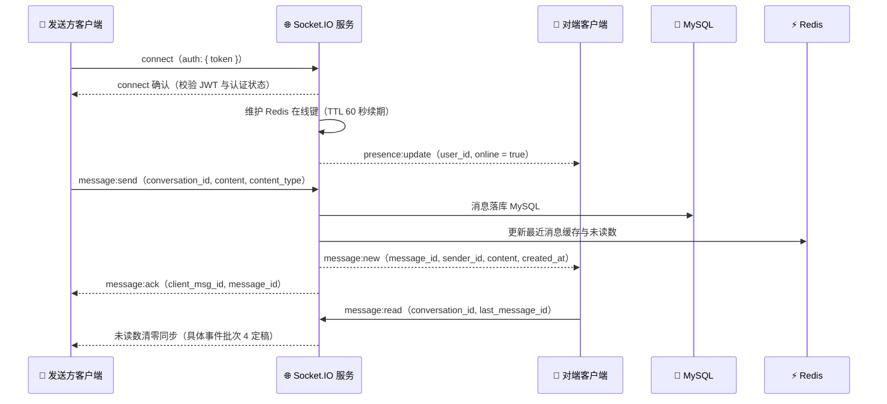

# 校园二手交易平台 · WebSocket 事件契约

_版本 v0.1.0（批次 0：连接规范与事件总表）· 基线：[需求分析](../需求分析.md) v1.1 · 配套：[openapi.yaml](openapi.yaml) · [CHANGELOG](CHANGELOG.md)_

---

## 📋 文档定位

OpenAPI 无法表达 WebSocket 语义，Socket.IO 事件契约单独成文（见[项目规范](../plan/00-项目规范.md)「API 契约规范」）。本文与 `openapi.yaml` 同为前后端并行开发的唯一事实源，修改规则相同：开发 agent 不得直接改文，修订走 `feat/api/b<批次>-<主题>` 分支 + 审查，并登记 CHANGELOG。

**本版（批次 0）固定**：连接与鉴权方式、事件命名规范、错误语义、重连约定、事件总表。
**批次 4 定稿**：各事件字段级 schema（类型/必填/示例）、回执与错误的完整格式、房间模型对前端的影响。

聊天功能本身在批次 4 落地（`flask-socketio` ↔ `socket.io-client` 4.x）；此前批次的前端不得依赖本文任何 `C → S` 事件。

---

## 🔌 连接规范

| 项 | 约定 |
| --- | --- |
| 端点 | 同源 `/socket.io`（开发期由 Vite 代理转发至后端，与 `/api` 代理同规则） |
| 命名空间 | 默认命名空间 `/`，不使用自定义 namespace |
| 传输 | Socket.IO 默认（`websocket` 优先，`polling` 兜底升级） |
| 握手鉴权 | `io(url, { auth: { token: "<JWT>" } })`；令牌与 REST 接口同一套签发（批次 1） |
| 鉴权失败 | 服务端拒绝连接，客户端收到 `connect_error`，载荷 `{ code, message }`，`code` 复用 REST 错误码（1001 / 1002 / 1003；已登录但未通过校园认证为 1004） |
| 心跳 | Socket.IO 内置 ping/pong；应用层不另发心跳事件 |
| 在线状态 | 服务端以 Redis 在线键（TTL 60 秒，连接续期）维护，对端经 `presence:update` 感知；契约层面前端不自行维护在线表 |

握手最小示例（前端）：

```ts
const socket = io('/', {
  auth: { token: authStore.token },
  reconnectionDelay: 1000,
  reconnectionDelayMax: 10_000,
});
socket.on('connect_error', (err) => {
  // err.data 形如 { code: 1002, message: '登录已过期，请重新登录' }
});
```

> 📌 **未认证用户**：连接握手即校验认证状态（`approved`），未通过则拒绝（1004）——与 REST 商品域同一准入线，聊天不存在"已登录但未认证可用"的中间态。

---

## 📛 事件命名规范

- 命名 `<域>:<动作>`，全小写，单词间下划线；与需求分析事件表一致，新增事件不得与之冲突。
- 方向约定：`C → S` 为请求/上报类，`S → C` 为推送/回执类；服务端不发起 `C → S` 命名的事件。
- 需要确认的 `C → S` 事件，服务端以对应回执事件应答（如 `message:send` → `message:ack`）；失败回执格式批次 4 定稿（拟为 `message:error`，见文末清单）。
- 载荷一律为 JSON 对象（非数组、非原始类型），字段名 snake_case，与 REST 契约同风格。

---

## 🧾 事件总表

基线来自需求分析「接口契约」章节；**载荷列为基线字段，字段级 schema 批次 4 定稿**。

| 方向 | 事件 | 载荷（基线） | 状态 |
| --- | --- | --- | --- |
| C → S | `connect`（握手内置） | `auth: { token }` | 本版已定 |
| C → S | `conversation:join` | `conversation_id` | 批次 4 细化 |
| C → S | `message:send` | `conversation_id`、`content`、`content_type` | 批次 4 细化（拟增加 `client_msg_id`） |
| S → C | `message:new` | `message_id`、`sender_id`、`content`、`created_at` | 批次 4 细化 |
| S → C | `message:ack` | `client_msg_id`、`message_id` | 批次 4 细化 |
| C → S | `message:read` | `conversation_id`、`last_message_id` | 批次 4 细化 |
| S → C | `presence:update` | `user_id`、`online` | 批次 4 细化 |
| C → S | `typing` | `conversation_id` | ❌ **P2 不实现**（FR-CHT-08），仅预留命名 |

关于 `typing`：需求基线明确 P2 本期不实现、功能点从界面移除。任何一端不得实现或依赖该事件；预留命名仅为避免未来复用相近名称造成歧义。

会话与消息的业务约束（REST 侧配套）：会话为用户对维度（`user_a_id < user_b_id` 唯一），同一对用户全局一条会话线；历史消息分页经 `GET /api/conversations/{id}/messages` 拉取（批次 4 落地），断线期间漏收的消息以该 REST 接口补偿，不依赖 WebSocket 重放。

---

## 🔄 连接与收发时序（基线）



> 上图中 `D`（MySQL）与 `R`（Redis）为服务端内部依赖，仅用于说明持久化与缓存归属，不属于事件契约。

---

## 📐 批次 4 定稿清单

以下事项随批次 4 契约更新补全并登记 CHANGELOG，此前双方不得擅自固化实现细节：

1. 各事件字段级 schema：类型、必填、约束（如文本长度上限）、示例与反例。
2. 失败回执：`message:error`（拟名）的载荷格式与错误码取值（复用 REST 错误码段）。
3. 房间模型：`conversation:join` 的权限校验（仅会话双方）、重复 join 的幂等语义。
4. 未读数同步：`message:read` 后对端与本人的通知事件形态。
5. 图片消息：`content_type = image` 时 `content` 携带 `ImageRef`（REST 契约已定义）还是 image_id。
6. 重连后状态恢复：是否需要服务端推送离线期间的未读汇总。

---

## 🔄 变更规则

- 与 `openapi.yaml` 同步演进：任何修订走 `feat/api/b<批次>-<主题>` 分支 + 审查循环，合并后在 [CHANGELOG](CHANGELOG.md) 登记（版本、日期、批次、影响端、摘要）。
- 前端 `socket.io-client` 封装位于 `src/api/`（与 REST 客户端同层），事件名以本文为源，不得硬编码散落各组件。
