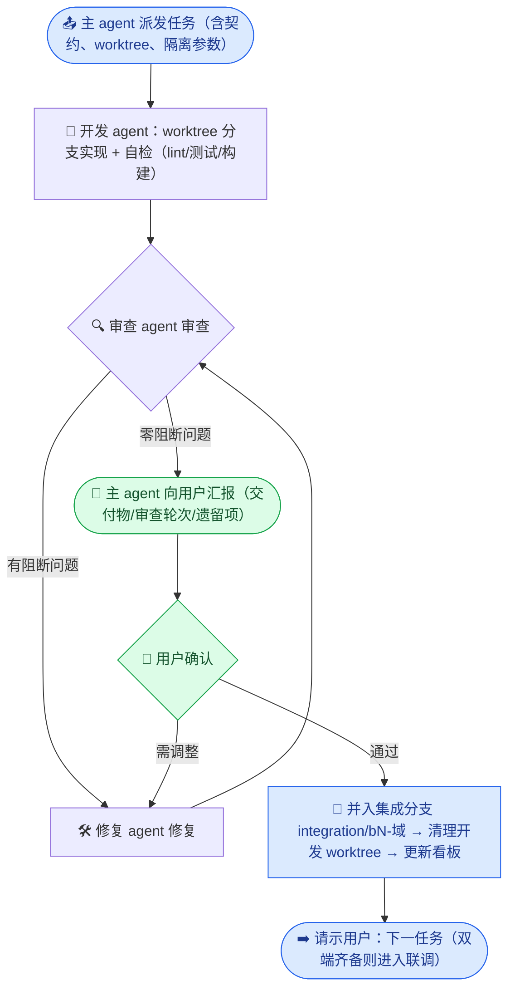
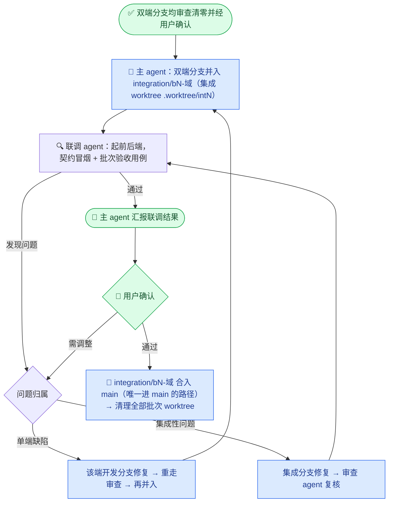
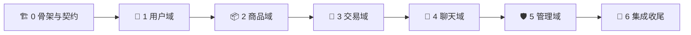

# 校园二手交易平台 · 项目规范

_版本 v0.5（草案五：前端环境变量拆分为三开关，`VITE_API_BASE` 与 `VITE_PROXY_TARGET` 语义分离）· 基线文档：[需求分析](../需求分析.md) v1.1（已确认）_

---

## 📋 文档定位

本文档是 `docs/plan/` 下所有前后端开发任务的**总规范**，约束协作流程、技术栈、API 契约、Git/Worktree 用法、数据隔离与审查标准。任务计划只写"做什么"，执行中"怎么做"一律以本文档为准；与需求分析冲突时，先停下向用户澄清。

### 用户要求映射

| # | 用户要求 | 落实章节 |
| --- | --- | --- |
| 1 | 前端 react-ts，位于 `campus_frontend/` | [技术栈与目录结构](#️-技术栈与目录结构) |
| 2 | 后端 Python Flask，位于 `campus_backend/`；所有包先告知、由用户下载 | [技术栈与目录结构](#️-技术栈与目录结构)、[包管理规范](#-包管理规范) |
| 3 | 使用 Swagger UI 配置 API 文档 | [API 契约规范](#-api-契约规范) |
| 4 | 数据库按根目录 `.env` / `docker-compose.yml`（用户已备好） | [仓库现状](#-仓库现状)、[数据与端口隔离](#️-数据与端口隔离) |
| 5 | subagent 并行开发前后端，API 文档事先确定 | [API 契约规范](#-api-契约规范)、[协作流程与角色](#-协作流程与角色) |
| 6 | 前后端定期协调适配，按模块配对、顺序统一 | [开发批次](#-开发批次) |
| 7 | 主 agent 只做调度与汇报，不写业务代码；每任务完成须用户确认 | [协作流程与角色](#-协作流程与角色) |
| 8 | 合并前审查 → 修复 → 复审，直至零问题才合并 | [任务生命周期](#-任务生命周期)、[DoD 与审查清单](#-完成定义dod与审查清单) |
| 9 | 必须用 git + worktree（`.worktree/`），同库不同表前缀隔离 | [Git 与 Worktree 规范](#-git-与-worktree-规范)、[数据与端口隔离](#️-数据与端口隔离) |
| 10 | 前后端任务分别写入 `docs/plan/frontend/`、`docs/plan/backend/` | [计划文档结构](#-计划文档结构) |
| 11 | 后端遵守 `flask-backend` 规范，前端遵守 `frontend-designer` 规范 | [技术栈与目录结构](#️-技术栈与目录结构)（双端规范基线）、[审查清单](#-审查清单) |
| 12 | 双端分支并入集成分支（如 `integration/b1-user`）联调测试，**禁止直接合并到 main** | [Git 与 Worktree 规范](#-git-与-worktree-规范)、[批次集成与联调流程](#-批次集成与联调流程) |

### 仓库现状

| 项 | 状态 |
| --- | --- |
| 前端脚手架 | 已存在：Vite + React 19 + TypeScript（strict）+ oxlint，`node_modules` 已安装 |
| 后端工程 | 已存在：uv 工程（Python 3.12），`pyproject.toml` 依赖为空，`.venv` 已创建 |
| 存储服务 | 镜像已备好（mysql:8.4 / mongo:8.0 / redis:7.4 / chromadb:1.5.9），由用户 `docker compose up -d` 管理 |
| 凭据 | 根目录 `.env` 供 docker-compose 变量插值、`campus_backend/.env` 供后端应用读取（两者均不入 git）；MySQL 库名 `campus_trading` |
| Git | `main` 分支为集成主线；`.worktree/` 已建且已 gitignore |

> 📌 需求分析中写 React 18 / MySQL 8 / Mongo 7，实际以已装版本（React 19 / MySQL 8.4 / Mongo 8.0）为准，不降级。

---

## 🏗️ 技术栈与目录结构

### 前端（campus_frontend/）

React 19 + TypeScript + Vite，pnpm 管理。目录约定：

```text
campus_frontend/src/
├── api/          # 契约客户端：按模块一文件；types.ts 引用 openapi 生成类型；mock/ 为契约 mock
├── components/   # 跨页面通用组件（Button/Card/Input 等按可达性模式实现）
├── layouts/      # 布局：前台布局、管理后台布局
├── pages/        # 页面，按模块分目录（auth/ product/ order/ chat/ admin/ ...）
├── router/       # 路由表与守卫（游客/未认证/认证学生/管理员四态），路由级 lazy 分割
├── stores/       # 全局客户端状态（zustand，如 authStore）
├── hooks/        # 自定义 hooks
├── types/        # 业务类型入口（re-export 生成的契约类型）
├── utils/        # 纯函数工具
└── styles/       # 全局样式与设计令牌 tokens.css（色彩/间距/字号/圆角/阴影 CSS 变量）
```

规则：

- 请求只经 `src/api/`，组件不得直接 `fetch`/`axios`；路径、参数、返回类型以契约为源。
- 开发期可用 `VITE_USE_MOCK=true` 走 `src/api/mock/`（与契约同构的假数据），后端就绪后切回真实请求，实现同批次前后端真并行。
- UI 组件库（antd）与状态管理（zustand）已确认，见[决策记录](#-决策记录与遗留事项)。

### 前端设计规范（frontend-designer，强制）

所有前端任务的实现与审查以下列基线为准（源自 `frontend-designer` 规范）：

- **可达性（WCAG 2.1 AA）**：语义化 HTML；交互控件键盘可达且 `:focus-visible` 焦点样式可见；触控目标 ≥ 44px；图标按钮带 `aria-label`；加载态 `aria-busy`；错误提示用 `role="alert"`；表单 `label` 与控件 `id` 关联、`aria-invalid`/`aria-describedby` 齐全；色彩对比度达 AA。
- **移动优先响应式**：从 320px 起设计，断点 768px / 1024px 渐进增强；栅格优先 `grid auto-fit`/flex；文字尺寸用相对单位。
- **设计令牌**：色彩、间距（8px 基）、字号阶、圆角、阴影、过渡时长统一定义在 `styles/tokens.css` 的 CSS 自定义属性中；antd 主题经 `ConfigProvider` 对齐令牌（品牌色、圆角、字号）；组件内**禁止硬编码色值与魔法间距**。
- **组件模式**：组合优于继承；props 驱动变体（variant/size）；每个通用组件完整处理 `loading`/`disabled`/`error` 三态；Modal 管理焦点（打开聚焦、关闭还原）。
- **性能基线**：路由级 `React.lazy` + `Suspense` 代码分割；图片 `loading="lazy" decoding="async"` 且有 `alt`；不引入未使用的大体积依赖。

### 后端（campus_backend/）

Flask 应用工厂 + 蓝图分层，uv 管理。**结构与分层以 `flask-backend` 规范为准**，目录约定：

```text
campus_backend/
├── main.py               # 仅入口：import + main()（app.run）
├── pyproject.toml        # uv 管理，依赖由用户执行 uv add
├── .env / .env.example   # 应用配置（不入 git / 模板入 git）
├── uploads/              # 运行时上传目录（不入 git，随各检出独立）
├── migrations/           # flask-migrate(Alembic) 迁移脚本
├── src/
│   ├── app.py            # create_app()：初始化扩展、注册蓝图与错误处理
│   ├── config.py         # 唯一读环境变量处
│   ├── model.py          # db = SQLAlchemy() + 全部 ORM 模型（单文件集中）
│   ├── router.py         # 唯一蓝图注册处
│   ├── common/           # 横切件（flask-backend 之上的扩展）：鉴权装饰器、
│   │                     #   同校作用域(scoped_query/scoped_key)、统一响应封装、
│   │                     #   分页助手、Swagger 文档路由
│   ├── routes/           # web 层：每资源一文件，只做 解析校验→调 service→组装响应
│   └── services/         # 业务层：业务逻辑 + 数据库操作，每资源一文件
└── tests/                # pytest，与 routes/services 对应
```

依赖方向（flask-backend 强制规则，审查项）：`main → app → router → routes → services → model`，单向；`model.py` 零项目内依赖；`routes` 不 import `app`；`services` 不返回 Flask Response；`db` 实例只在 `model.py` 创建；环境变量只在 `config.py` 读取；`common/` 只被 `router/routes/services` 引用，不得反向依赖它们。新增资源固定顺序：`model.py` → `services/xxx_service.py` → `routes/xxx.py` → `router.py` 注册。

### 配置管理

- 根目录 `.env`：**仅 docker-compose 使用**（compose 只读取与 compose 文件同目录的 `.env` 做变量插值），后端不读取；不入 git。**此文件不可删除或移动**，否则 `docker compose up -d` 时密码变量解析为空，容器将无法按预期初始化。
- `campus_backend/.env`：后端应用配置（从 `campus_backend/.env.example` 复制填写；含真实凭据，不入 git）。凭据值取自根目录 `.env`（用户已提供）。
- 两份 `.env` 内容有重叠（存储凭据部分），职责不同、需并存：根目录那份服务 docker-compose，`campus_backend/.env` 服务 Flask 应用。
- 前端无 `.env` 必需项，仅 `VITE_USE_MOCK`、`VITE_API_BASE`、`VITE_PROXY_TARGET` 三个开关（**语义不同、不可混用**：`VITE_API_BASE` 是 axios 基址，含 `/api` 后缀，留空即同源 `/api`；`VITE_PROXY_TARGET` 仅 dev server 代理目标，不进产物）。

`campus_backend/.env` 变量清单（模板随批次 0 建立）：

| 变量 | 说明 | 主仓默认 |
| --- | --- | --- |
| `FLASK_ENV` / `PORT` | 环境与监听端口 | `development` / `5000` |
| `SECRET_KEY` / `JWT_EXPIRE_MINUTES` | JWT 密钥与有效期 | 自生成 / `1440` |
| `MYSQL_HOST/PORT/DB/USER/PASSWORD` | MySQL 连接 | `127.0.0.1/3306/campus_trading/campus_app/…` |
| `MONGO_URI` / `MONGO_DB` | Mongo 连接与库名 | `…@127.0.0.1:27017/campus_market?authSource=admin` |
| `REDIS_HOST/PORT/PASSWORD` / `REDIS_DB_BASE` | Redis 连接与库基址 | `…/6379/…` / `0`（占 db0–3） |
| `CHROMA_HOST/PORT` / `CHROMA_COLLECTION_SUFFIX` | Chroma 连接与集合后缀 | `127.0.0.1/8000` / 空 |
| `EMBEDDING_BASE_URL/API_KEY/MODEL/DIM` | Embedding 端点（OpenAI 兼容） | 云端已就绪：`qwen3.7-text-embedding-flash` / `1024`（已实测连通） |
| `UPLOAD_DIR` / `MAX_UPLOAD_MB` | 上传目录与单图上限 | `uploads` / `5` |
| `DB_TABLE_PREFIX` | worktree 表前缀（见隔离章节） | 空 |

---

## 📦 包管理规范

**铁律：任何包的安装一律由用户执行；agent 只许申报，不许下载。** 用户已选择**一次性全装**且已完成安装（下方清单即为已安装的基线依赖）；此后开发中需要清单外的新包，必须停下申报、经用户批准并安装后才能继续。批次 6 的本地 Embedding 兜底涉及大模型/推理依赖，届时单独协商，不在本清单内。

### 全量包清单对照

"首次用到"仅表示该包最早被哪个批次使用，安装已一次性完成：

| 端 | 包 | 用途 | 首次用到 |
| --- | --- | --- | --- |
| 后端 | `flask` `flask-cors` `flask-sqlalchemy` `flask-migrate` `flask-jwt-extended` `python-dotenv` `pymysql` `cryptography` `pyyaml` | Web 框架 / 跨域 / ORM / 迁移 / JWT / env / MySQL 驱动 / caching_sha2 认证 / 解析 openapi.yaml | 批次 0 |
| 后端 | `flask-swagger-ui` | Swagger UI 页面（静态资源随包分发，离线可用） | 批次 0 |
| 后端 | `pytest` `ruff`（dev） | 测试 / lint·格式化 | 批次 0 |
| 后端 | `chromadb-client` `openai` `redis` `pymongo` | 向量客户端（HttpClient 连服务端）/ Embedding 客户端(OpenAI 兼容) / 缓存三库 / 画像与行为 | 批次 2 |
| 后端 | `flask-socketio` `simple-websocket` | WebSocket | 批次 4 |
| 后端 | `openpyxl` | xlsx 批量导入 | 批次 5 |
| 前端 | `react-router-dom` `axios` `zustand` `antd` `dayjs` | 路由 / HTTP / 客户端状态 / UI 组件库 / 日期 | 批次 0 |
| 前端 | `openapi-typescript`（dev） | 由 `docs/api/openapi.yaml` 生成 TS 类型，保证与契约同步 | 批次 0 |
| 前端 | `socket.io-client` | WebSocket 客户端 | 批次 4 |

> 📌 Chroma 客户端默认取 `chromadb-client`（轻量；本项目只用 HttpClient 连接已运行的 chroma 1.5.9 服务端，完整版 `chromadb` 会拖入 onnxruntime 等重依赖）。若您倾向完整版，把依赖换成 `chromadb` 即可，业务代码两种写法一致。

---

## 🌐 API 契约规范

前后端并行的前提是**契约先行**。契约是唯一事实源，双方都不得单方面偏离。

### 契约文件

| 文件 | 内容 |
| --- | --- |
| `docs/api/openapi.yaml` | OpenAPI 3.0，全部 REST 接口；批次 0 建立 `components`（统一响应体、错误码、分页参数、用户/商品概要等公共 schema），之后每批次**增量**追加 |
| `docs/api/websocket-事件.md` | Socket.IO 事件契约（事件名、载荷、时序），OpenAPI 无法表达 WS，单独成文 |
| `docs/api/CHANGELOG.md` | 契约变更记录（谁、何时、改了什么、影响哪端） |

### Swagger UI（已确认：flask-swagger-ui 包）

- 后端 `src/common/` 提供 `GET /api/openapi.json`（读取 `docs/api/openapi.yaml` 转 JSON 输出）；`/api/docs` 页面由 `flask-swagger-ui` 蓝图承接（离线可用，不依赖 CDN）。

### 契约硬规则

- 统一前缀 `/api`、响应体 `{ code, message, data }`、分页 `page`/`page_size`（默认 20、上限 100）——沿用需求分析接口契约章节，不重复罗列接口。
- 未认证访问商品域返回 403；非本校资源返回 404；缓存键含 `school_id`。
- **开发 agent 不得直接修改契约文件。** 实现中发现契约问题 → 上报主 agent → 主 agent 报用户 → 契约修订（小任务，走审查）→ 同步双方。契约文件只在该任务中变更，从机制上杜绝双端合并冲突。
- 前端类型：`openapi-typescript docs/api/openapi.yaml -o src/api/types.ts`（脚本化进 package.json），组件只准引用生成类型。

---

## 🔁 协作流程与角色

### 角色分工

| 角色 | 职责 | 禁则 |
| --- | --- | --- |
| 主 agent | 拆解与派发任务、维护契约与进度看板、调度 subagent、向用户汇报、执行合并（含集成分支与 main） | 不写业务代码 |
| 开发 agent（subagent） | 在自己的 worktree 分支上实现一个任务，自检（lint/测试/构建）通过后交付 | 不装包、不改契约、不动他人 worktree |
| 审查 agent（subagent） | 按[审查清单](#-审查清单)审查开发产出，输出分级问题报告 | 不直接改代码 |
| 修复 agent（subagent） | 按审查报告修复，仅限报告所列问题 | 不扩大改动范围 |
| 联调 agent（subagent） | 在批次集成分支上起前后端做契约冒烟与批次验收用例，输出联调报告 | 不修代码，只报问题 |

用户：批准规范/计划/包清单、执行包安装、每个任务与每次合并前的确认、方向性决策，同时每次联调后都要由用户确认。

### 任务生命周期



规则：

1. **审查循环（用户要求 8）**：审查报告按 `阻断`（错误、契约不符、隔离违规、测试缺失）与 `建议`（风格、优化）分级。阻断项必须经 修复→复审 清零；建议项由用户在汇报时取舍。任一轮复审都可能再次产生修复，循环直到某轮审查零阻断。
2. **汇报即停（用户要求 7）**：每个任务审查清零后，主 agent 必须停下向用户汇报，等待确认再并入集成分支与派发下一任务。汇报模板：

```text
## 任务汇报 · <批次>-<端>-<模块>
- 分支 / worktree：feat/be/b1-user @ .worktree/b1be
- 交付物：<接口/页面/文件清单>
- 自检：ruff ✅ · pytest 12/12 ✅（前端：tsc ✅ · oxlint ✅）
- 审查：共 2 轮（第 1 轮 3 阻断 2 建议 → 修复 → 第 2 轮 0 阻断），建议项处理：<...>
- 数据清理：worktree 前缀表已 DROP / 无
- 下一步建议：<...>，等待您的指示
```

3. **定期协调（用户要求 6）**：协调以**批次**为节拍——同批次前后端基于同一份冻结契约并行开发；双端均并入集成分支后，由联调 agent 在集成分支联调；联调通过才算批次完成。批次内的契约微调走上一节变更流程，保证两端不漂移。

### 批次集成与联调流程



- **禁止任何开发分支直接合并到 `main`**；`main` 只接受联调通过并经用户确认的集成分支。
- 联调用例来自批次任务计划中的验收标准 + 契约冒烟清单（每接口至少一条正例，关键接口含 401/403/404 反例）。
- 批次 0 的联调即为"骨架拉起"：前后端可启动、`/api/health` 正常、Swagger UI 可访问、路由守卫生效。

---

## 🌿 Git 与 Worktree 规范

分支模型（用户要求 12）。统一格式 `<type>/<scope>/<b批次>-<slug>`，slug 为小写 kebab-case 英文短词（≤3 个），具体名由任务卡给定：

| 分支类型 | 命名格式 | 示例 | 用途 |
| --- | --- | --- | --- |
| 后端开发 | `feat/be/b<批次>-<模块>` | `feat/be/b1-user` | 单任务开发，审查与修复轮共用此分支 |
| 前端开发 | `feat/fe/b<批次>-<界面>` | `feat/fe/b1-user-ui` | 与后端同批次模块配对开发 |
| 契约修订 | `feat/api/b<批次>-<主题>` | `feat/api/b2-search-fields` | 契约文件的唯一变更通道，走完整审查流程 |
| 集成分支 | `integration/b<批次>-<域>` | `integration/b1-user` | 承接本批次双端分支与联调测试；唯一可进 main 的分支 |
| 主线 | `main` | — | 仅接受联调通过且经用户确认的集成分支；**任何开发分支禁止直接合入** |

批次 ↔ 集成分支对照：b0 `integration/b0-skeleton`、b1 `integration/b1-user`、b2 `integration/b2-product`、b3 `integration/b3-order`、b4 `integration/b4-chat`、b5 `integration/b5-admin`、b6 `integration/b6-release`。同端拆多任务时以 slug 区分（如 `feat/be/b2-product-core` 与 `feat/be/b2-product-vector`），任务代号依次为 `b2be`、`b2be2`。

- worktree 布局：开发任务用 `.worktree/<任务代号>/`；每批次联调用独立集成 worktree `.worktree/int<批次>/`（自 `main` 建集成分支后检出）。任务代号 `b<批次><be|fe>`（如 `b1be`），同端多任务加序号（`b1be2`），用于表前缀与端口分配，由主 agent 在任务卡中指定并记入看板。
- 合并顺序：开发分支 →（审查清零 + 用户确认）→ 集成分支 →（联调通过 + 用户确认）→ `main`。前后端分支目录不相交（`campus_backend/` vs `campus_frontend/`），并入集成分支无冲突；契约文件只由契约任务变更，同样无冲突。若仍遇冲突，派遣专门 agent 处理并重走审查。
- worktree 生命周期：派发时创建（自 `main` 最新提交）→ 并入集成分支后 `git worktree remove` + 删开发分支；集成分支合入 `main` 后删除集成 worktree 与集成分支。worktree 内不含未跟踪文件（`.env`、`uploads/`、`node_modules/`、`.venv/`），开发 agent 按任务卡隔离参数自建（见下节）。

```mermaid
gitGraph
    accTitle: 分支与合并模型
    accDescr: 后端与前端开发分支各自完成审查后并入集成分支 integration/b1-user，联调测试通过并经用户确认后，集成分支才合入 main，开发分支从不直接进入 main。

    commit id: "基线"
    branch feat/be/b1-user
    branch feat/fe/b1-user-ui
    checkout feat/be/b1-user
    commit id: "后端用户模块"
    checkout feat/fe/b1-user-ui
    commit id: "前端用户界面"
    checkout main
    branch integration/b1-user
    checkout integration/b1-user
    merge feat/be/b1-user id: "审查通过·并入"
    merge feat/fe/b1-user-ui id: "审查通过·并入"
    commit id: "联调测试通过"
    checkout main
    merge integration/b1-user id: "用户确认·合入主线"
```

---

## 🗄️ 数据与端口隔离

四库共用 docker 实例，靠"前缀/独立库/库基址"隔离，防止并行 worktree 互踩（用户要求 9 的表前缀方案的配套扩展）：

| 存储 | 主仓（main） | worktree（开发/集成） | 载体环境变量 |
| --- | --- | --- | --- |
| MySQL | `campus_trading`，表名无前缀 | 同库，所有表名加 `<任务代号>-` 前缀；集成 worktree 用 `int<批次>-`（含 Alembic 版本表） | `DB_TABLE_PREFIX` |
| MongoDB | `campus_market` | 独立库 `<MONGO_DB>_<任务代号>`（集成为 `campus_market_int2` 这类） | `MONGO_DB` |
| Redis | `REDIS_DB_BASE=0`（db0–3：聊天/评价/商品/系统） | 开发槽位 `4` / `8`，集成槽位 `12`（每组 4 库） | `REDIS_DB_BASE` |
| Chroma | 集合 `product_vectors` | 集合名加任务代号后缀 | `CHROMA_COLLECTION_SUFFIX` |
| 上传文件 | `campus_backend/uploads/` | worktree 自带独立 `uploads/` | 天然隔离 |

实现要点：

- 表前缀在 `model.py` 统一实现（`__tablename__ = prefix("users")`），业务代码无感知；缓存键、Chroma where 条件照常含 `school_id`，与前缀正交。
- worktree 的 `campus_backend/.env` 由开发 agent 按任务卡参数生成（凭据读根目录 `.env`），**主仓 `.env` 永不加前缀**。
- 任务收尾必须 DROP 本任务前缀的全部 MySQL 表、删除独立 Mongo 库与 Chroma 集合；集成 worktree 收尾同样清理 `int<批次>-` 前缀数据。主 agent 合并时核验并记入汇报。

端口分配（避免多进程冲突；槽位占用记入进度看板）：

| 位置 | 后端 | 前端 |
| --- | --- | --- |
| 主仓（main） | `5000` | `5173` |
| 开发 worktree 槽位 A | `5010` | `5180` |
| 开发 worktree 槽位 B | `5020` | `5190` |
| 集成 worktree | `5030` | `5200` |

- 前端 dev server 以 `VITE_PROXY_TARGET` 指向对应后端（代理 `/api` 与 `/socket.io`）；`VITE_API_BASE` 保持留空走同源 `/api`，**不得用它指向后端主机**（会导致请求缺 `/api` 前缀）。
- 若批次 3/4 经用户决定并行，则启用第二个集成槽位（后端 `5040` / 前端 `5210`）。
- 存储容器只许用户启停；agent 可用 `docker compose ps` 与只读探活检查状态，发现未运行即报告用户，不得自行操作容器。

---

## 📅 开发批次

顺序原则：先横切地基（骨架/契约/鉴权），再按"用户 → 商品 → 交易 → 聊天 → 管理"推进域，最后集成收尾。每批次 = 契约定稿 → 双端并行开发（前端先以 mock 开发）→ 双端审查后并入集成分支 → 集成分支联调 → 用户确认后合入 main。

| 批次 | 域 | 集成分支 | 后端范围 | 前端范围 | 首次用到的包 |
| --- | --- | --- | --- | --- | --- |
| 0 | 骨架与契约 | `integration/b0-skeleton` | 工程骨架、公共定义、Swagger 路由、`/api/health`（四库连通 + Embedding 模式）、迁移基线、pytest/ruff 基线 | 工程骨架、路由与四态守卫、布局与设计令牌、api 客户端与 mock 机制、openapi 类型生成脚本 | 见包管理对照表"批次 0"各行 |
| 1 | 用户域 | `integration/b1-user` | 注册/登录/JWT/登出/密码、个人资料、校园认证、学校校区 | 登录注册、找回密码、认证提交与状态页、个人中心 | — |
| 2 | 商品域 | `integration/b2-product` | 商品 CRUD/状态、图片上传、分类、收藏、列表筛选、向量搜索、首页推荐、画像行为 | 首页（推荐 40 宫格）、列表与筛选、详情、发布编辑、我的商品、收藏、搜索 | 后端：chromadb-client/openai/redis/pymongo |
| 3 | 交易域 | `integration/b3-order` | 订单全流程、模拟支付、超时关闭任务、评价与信誉 | 下单、订单列表详情、支付页（二维码+轮询）、评价页 | — |
| 4 | 聊天域 | `integration/b4-chat` | Socket.IO 服务、会话与消息、在线状态、已读 | 会话列表、聊天窗口、未读与在线展示 | 后端：flask-socketio/simple-websocket；前端：socket.io-client |
| 5 | 管理域 | `integration/b5-admin` | 认证审核、用户/商品处置、学校与分类维护、批量导入、统计、操作日志、敏感词复核 | 管理后台全部页面（审核队列、用户、商品、学校、分类、统计图表、日志） | 后端：openpyxl |
| 6 | 集成收尾 | `integration/b6-release` | 种子数据脚本、本地 Embedding 兜底、降级演练 | 演示链路走查、空态/降级提示 | 届时协商 |



- 依赖说明：首页(批次 2)依赖用户鉴权(批次 1)；交易依赖商品；聊天依赖用户+商品；管理依赖用户+商品+交易（统计需要订单）；集成收尾依赖全部。
- 批次 3 与批次 4 互不依赖，若用户希望提速，可在批次 2 完成后由用户决定是否并行（同时占两个开发槽位 + 两个集成槽位）。默认串行。
- Embedding 端点已由用户提供并实测可用（`qwen3.7-text-embedding-flash`，1024 维），批次 2 可直接接入；批次 6 的本地兜底仍届时协商。

---

## ✅ 完成定义（DoD）与审查清单

### DoD（开发 agent 交付标准）

| 端 | 必须满足 |
| --- | --- |
| 共同 | 未安装任何清单外包；未直接修改契约文件（变更走流程）；提交粒度清晰、信息规范（`feat:`/`fix:` + 模块）；无调试遗留物 |
| 后端 | `ruff check` 零报错；`pytest` 全绿且新功能有对应测试；实现与 `openapi.yaml` 一致；flask-backend 分层与依赖方向合规；隔离三件套（鉴权装饰器 / `school_id` 作用域 / scoped 查询与缓存键）落实；worktree 隔离参数正确 |
| 前端 | `pnpm build`（tsc + vite）通过；`oxlint` 零报错；请求仅出自 `src/api/` 且类型来自契约生成；路由守卫符合权限矩阵四态；mock 与契约同步；**前端设计规范基线满足**（可达性 / 令牌 / 响应式 / 性能四节） |

### 审查清单（审查 agent 逐项对照，输出阻断/建议分级）

后端（以 `flask-backend` 反模式清单为逐条对照基础）：

- 分层反模式：视图写 SQL/业务、service 返回 Response、`db` 实例位置、`model.py` 反向依赖、路由堆单文件、`routes` import `app`、散落 `os.getenv`、`.env` 入 git。
- 契约一致性：路径/方法/状态码/响应结构/分页与 `openapi.yaml` 逐条对齐。
- 隔离与安全：403/404 语义、缓存键含 `school_id`、bcrypt 密码、上传校验（类型/MIME/5MB/哈希改名）、ORM 参数化查询、管理接口角色校验。
- 测试质量：断言有效、覆盖主路径与异常路径。

前端（以 `frontend-designer` DO/DON'T 为对照基础）：

- 类型纪律：无契约外私改字段、`any`/`as` 滥用；组件不含请求逻辑；全局状态不散落。
- 权限四态在路由与页面入口均正确拦截。
- 错误处理：`code != 0` 有用户可见反馈；加载/空态齐全。
- mock 数据结构与契约一致（同批次联调前的前置保障）。
- **可达性**：语义标签、键盘可达与焦点样式、`aria-*` 使用、表单关联、对比度、触控目标。
- **响应式与令牌**：320px 起可用、断点合理；色彩/间距/字号来自 `tokens.css` 与 antd 主题，无硬编码。
- **性能**：路由代码分割、图片懒加载与 `alt`、无冗余大依赖。

### 修复循环留痕

每轮审查报告与修复说明由主 agent 摘要记入进度看板（轮次、问题数、结果），联调报告同样留痕，作为"某轮审查零阻断 / 联调通过"的凭据链。

---

## 📁 计划文档结构

```text
docs/
├── 需求分析.md                  # 需求基线（已确认，勿改）
├── api/                         # API 契约（批次 0 建立）
│   ├── openapi.yaml
│   ├── websocket-事件.md
│   └── CHANGELOG.md
└── plan/
    ├── 00-项目规范.md            # 本文档
    ├── 进度看板.md               # 主 agent 维护：批次/任务/分支/审查轮次/槽位占用/联调结果
    ├── backend/                 # 后端任务计划，NN 与前端同号配对
    │   ├── 00-骨架与契约.md
    │   ├── 01-用户模块.md
    │   └── …
    └── frontend/                # 前端任务计划，NN 与后端同号配对
        ├── 00-骨架与契约.md
        ├── 01-用户界面.md
        └── …
```

任务计划文件模板（批次 0 时连同看板一并建立）：目标与范围、涉及 FR/NFR 编号、前置条件（契约节选/包清单/环境参数）、验收标准（含联调用例）、审查重点。编号对齐需求分析的 `FR-XXX-NN`，保证可追溯。

---

## 🧾 决策记录

### 已确认决策（用户确认）

| # | 事项 | 决定 |
| --- | --- | --- |
| 1 | 前端 UI 库 | `antd`（配 `dayjs`） |
| 2 | 前端状态管理 | `zustand` |
| 3 | Swagger UI | 安装 `flask-swagger-ui` 包（离线可用） |
| 4 | 测试基线 | 后端 pytest 必选；前端 tsc + oxlint + 构建必选，暂不引入 vitest |
| 5 | 包安装节奏 | 一次性全装（已安装完成，清单见包管理规范） |
| 6 | 合并模型 | 双端分支并入集成分支 `integration/b<批次>-<域>` 联调，联调通过 + 用户确认后才合入 `main`；**开发分支禁止直接合 main** |
| 7 | 双端编码规范 | 后端遵守 `flask-backend`，前端遵守 `frontend-designer`，均纳入 DoD 与审查清单 |
