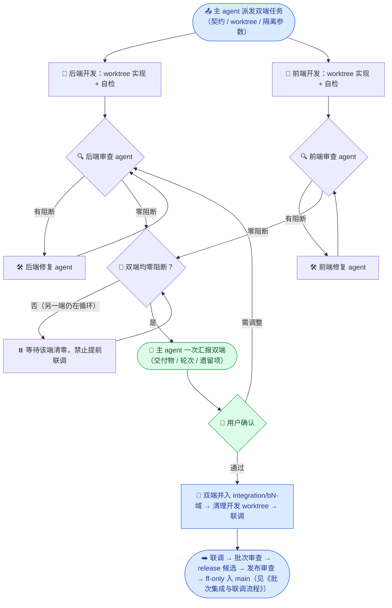
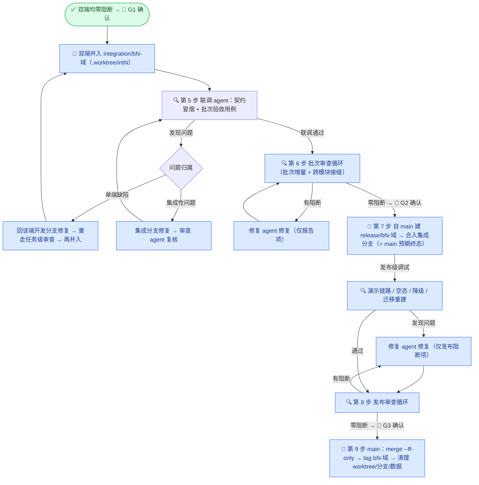
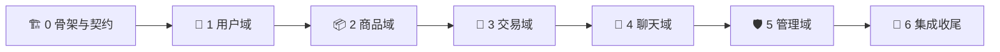

# 校园二手交易平台 · 项目规范

_版本 v0.7（草案七：在"双端并行"五步范式之后补上第 6–9 步——批次审查循环 → release 发布候选（一次性）→ 发布审查循环 → `--ff-only` 合入 main，堵住"联调通过即合 main"的缺口）· 基线文档：[需求分析](../需求分析.md) v1.1（已确认）_

> 📌 v0.7 变更摘要（相对 v0.6）：
> 1. 范式由 5 步扩为 **9 步**：新增「第 6 步 批次审查循环」「第 7 步 release 候选分支 + 发布级调试」「第 8 步 发布审查循环」「第 9 步 `--ff-only` 合入 main」。
> 2. 用户口头所称的 "dev 分支" 在规范内定名为 **`release/b<批次>-<域>`**（一次性发布候选，用完即删）：自 `main` 建、合入集成分支，其树 **必然等于** "main + 本批次"，因此合入 main **只能是 `--ff-only` 快进**，main 由此变成只进已终审代码的纯发布线。
> 3. 新增[发布闸门](#发布闸门release-候选分支v07-新增)一节，含两个新审查清单（批次级、发布级）与三级用户门禁 G1 / G2 / G3。
> 4. release 阶段**复用集成 worktree 槽位与 `int<批次>-` 数据前缀**（同一工作树就地切分支，数据不重建），收尾一次性清理。

> 📌 v0.6 变更摘要（相对 v0.5）：
> 1. 新增"双端并行范式"章节，五步范式与规范阶段一一映射，消除"审查/修复是否串行"的歧义。
> 2. 任务生命周期由单轨改为**双通道并行**：审查、修复、复审均按端独立循环，互不阻塞，但**联调前置条件是双端同时清零**。
> 3. 明确"合并分支并调试"= 并入 `integration/bN-域` 并联调，**不是**进 main；main 只接受集成分支（🔺 v0.7 已进一步收紧：main 不再接收集成分支，必须经 `release/bN-域` 候选中转）。
> 4. 补严三类原先只靠惯例的约束：审查独立性、复审同源、合入前冻结核验。

---

## 📋 文档定位

本文档是 `docs/plan/` 下所有前后端开发任务的**总规范**，约束协作流程、技术栈、API 契约、Git/Worktree 用法、数据隔离与审查标准。任务计划只写"做什么"，执行中"怎么做"一律以本文档为准；与需求分析冲突时，先停下向用户澄清。

### 用户要求映射

| # | 用户要求 | 落实章节 |
| --- | --- | --- |
| 1 | 前端 react-ts，位于 `campus_frontend/` | [技术栈与目录结构](#️-技术栈与目录结构) |
| 2 | 后端 Python Flask，位于 `campus_backend/`；所有包先告知、由用户下载 | [技术栈与目录结构](#️-技术栈与目录结构)、[包管理规范](#-包管理规范) |
| 3 | 使用 Swagger UI 配置 API 文档 | [API 契约规范](#-api-契约规范) |
| 4 | 数据库按根目录 `.env` / `docker-compose.yml`（用户已备好） | [仓库现状](#-仓库现状)、[数据与端口隔离](#️-数据与端口隔离) |
| 5 | subagent 并行开发前后端，API 文档事先确定 | [API 契约规范](#-api-契约规范)、[协作流程与角色](#-协作流程与角色) |
| 6 | 前后端定期协调适配，按模块配对、顺序统一 | [开发批次](#-开发批次) |
| 7 | 主 agent 只做调度与汇报，不写业务代码；每任务完成须用户确认 | [协作流程与角色](#-协作流程与角色) |
| 8 | 合并前审查 → 修复 → 复审，直至零问题才合并 | [任务生命周期](#-任务生命周期)、[DoD 与审查清单](#-完成定义dod与审查清单) |
| 9 | 必须用 git + worktree（`.worktree/`），同库不同表前缀隔离 | [Git 与 Worktree 规范](#-git-与-worktree-规范)、[数据与端口隔离](#️-数据与端口隔离) |
| 10 | 前后端任务分别写入 `docs/plan/frontend/`、`docs/plan/backend/` | [计划文档结构](#-计划文档结构) |
| 11 | 后端遵守 `flask-backend` 规范，前端遵守 `frontend-designer` 规范 | [技术栈与目录结构](#️-技术栈与目录结构)（双端规范基线）、[审查清单](#审查清单任务级) |
| 12 | 双端分支并入集成分支（如 `integration/b1-user`）联调测试，**禁止直接合并到 main** | [Git 与 Worktree 规范](#-git-与-worktree-规范)、[批次集成与联调流程](#批次集成与联调流程第-5-步起至第-9-步) |
| 13 | 双端并行范式：并行开发 → 并行审查 → 并行修复 → 并行复审循环 → 合并联调 → 用户确认后合入 main | [双端并行范式](#-双端并行范式v06-新增)、[任务生命周期](#-任务生命周期)、[批次集成与联调流程](#批次集成与联调流程第-5-步起至第-9-步) |
| 14 | 联调结束**不直接合 main**，须对集成分支再做一轮**批次审查循环** | [发布闸门 · 第 6 步](#第-6-步批次审查循环集成分支上)、[批次审查清单](#批次审查清单第-6-步--审查-agent-并行) |
| 15 | 以**一次性 release 候选分支**替代"直接进 main"：其内容等于 main 终态，在其上调试 + 审查循环，最后才合入 main | [发布闸门](#发布闸门release-候选分支v07-新增)、[Git 与 Worktree 规范](#-git-与-worktree-规范) |

### 仓库现状

| 项 | 状态 |
| --- | --- |
| 前端脚手架 | 已存在：Vite + React 19 + TypeScript（strict）+ oxlint，`node_modules` 已安装 |
| 后端工程 | 已存在：uv 工程（Python 3.12），`pyproject.toml` 依赖为空，`.venv` 已创建 |
| 存储服务 | 镜像已备好（mysql:8.4 / mongo:8.0 / redis:7.4 / chromadb:1.5.9），由用户 `docker compose up -d` 管理 |
| 凭据 | 根目录 `.env` 供 docker-compose 变量插值、`campus_backend/.env` 供后端应用读取（两者均不入 git）；MySQL 库名 `campus_trading` |
| Git | `main` 为唯一发布主线（只接受 `--ff-only` 快进 + tag）；上游依次为 `feat/*` → `integration/*` → `release/*`；`.worktree/` 已建且已 gitignore |

> 📌 需求分析中写 React 18 / MySQL 8 / Mongo 7，实际以已装版本（React 19 / MySQL 8.4 / Mongo 8.0）为准，不降级。

---

## 🏗️ 技术栈与目录结构

### 前端（campus_frontend/）

React 19 + TypeScript + Vite，pnpm 管理。目录约定：

```text
campus_frontend/src/
├── api/          # 契约客户端：按模块一文件；types.ts 引用 openapi 生成类型；mock/ 为契约 mock
├── components/   # 跨页面通用组件（Button/Card/Input 等按可达性模式实现）
├── layouts/      # 布局：前台布局、管理后台布局
├── pages/        # 页面，按模块分目录（auth/ product/ order/ chat/ admin/ ...）
├── router/       # 路由表与守卫（游客/未认证/认证学生/管理员四态），路由级 lazy 分割
├── stores/       # 全局客户端状态（zustand，如 authStore）
├── hooks/        # 自定义 hooks
├── types/        # 业务类型入口（re-export 生成的契约类型）
├── utils/        # 纯函数工具
└── styles/       # 全局样式与设计令牌 tokens.css（色彩/间距/字号/圆角/阴影 CSS 变量）
```

规则：

- 请求只经 `src/api/`，组件不得直接 `fetch`/`axios`；路径、参数、返回类型以契约为源。
- 开发期可用 `VITE_USE_MOCK=true` 走 `src/api/mock/`（与契约同构的假数据），后端就绪后切回真实请求，实现同批次前后端真并行。
- UI 组件库（antd）与状态管理（zustand）已确认，见[决策记录](#决策记录)。

### 前端设计规范（frontend-designer，强制）

所有前端任务的实现与审查以下列基线为准（源自 `frontend-designer` 规范）：

- **可达性（WCAG 2.1 AA）**：语义化 HTML；交互控件键盘可达且 `:focus-visible` 焦点样式可见；触控目标 ≥ 44px；图标按钮带 `aria-label`；加载态 `aria-busy`；错误提示用 `role="alert"`；表单 `label` 与控件 `id` 关联、`aria-invalid`/`aria-describedby` 齐全；色彩对比度达 AA。
- **移动优先响应式**：从 320px 起设计，断点 768px / 1024px 渐进增强；栅格优先 `grid auto-fit`/flex；文字尺寸用相对单位。
- **设计令牌**：色彩、间距（8px 基）、字号阶、圆角、阴影、过渡时长统一定义在 `styles/tokens.css` 的 CSS 自定义属性中；antd 主题经 `ConfigProvider` 对齐令牌（品牌色、圆角、字号）；组件内**禁止硬编码色值与魔法间距**。
- **组件模式**：组合优于继承；props 驱动变体（variant/size）；每个通用组件完整处理 `loading`/`disabled`/`error` 三态；Modal 管理焦点（打开聚焦、关闭还原）。
- **性能基线**：路由级 `React.lazy` + `Suspense` 代码分割；图片 `loading="lazy" decoding="async"` 且有 `alt`；不引入未使用的大体积依赖。

### 后端（campus_backend/）

Flask 应用工厂 + 蓝图分层，uv 管理。**结构与分层以 `flask-backend` 规范为准**，目录约定：

```text
campus_backend/
├── main.py               # 仅入口：import + main()（app.run）
├── pyproject.toml        # uv 管理，依赖由用户执行 uv add
├── .env / .env.example   # 应用配置（不入 git / 模板入 git）
├── uploads/              # 运行时上传目录（不入 git，随各检出独立）
├── migrations/           # flask-migrate(Alembic) 迁移脚本
├── src/
│   ├── app.py            # create_app()：初始化扩展、注册蓝图与错误处理
│   ├── config.py         # 唯一读环境变量处
│   ├── model.py          # db = SQLAlchemy() + 全部 ORM 模型（单文件集中）
│   ├── router.py         # 唯一蓝图注册处
│   ├── common/           # 横切件（flask-backend 之上的扩展）：鉴权装饰器、
│   │                     #   同校作用域(scoped_query/scoped_key)、统一响应封装、
│   │                     #   分页助手、Swagger 文档路由
│   ├── routes/           # web 层：每资源一文件，只做 解析校验→调 service→组装响应
│   └── services/         # 业务层：业务逻辑 + 数据库操作，每资源一文件
└── tests/                # pytest，与 routes/services 对应
```

依赖方向（flask-backend 强制规则，审查项）：`main → app → router → routes → services → model`，单向；`model.py` 零项目内依赖；`routes` 不 import `app`；`services` 不返回 Flask Response；`db` 实例只在 `model.py` 创建；环境变量只在 `config.py` 读取；`common/` 只被 `router/routes/services` 引用，不得反向依赖它们。新增资源固定顺序：`model.py` → `services/xxx_service.py` → `routes/xxx.py` → `router.py` 注册。

### 配置管理

- 根目录 `.env`：**仅 docker-compose 使用**（compose 只读取与 compose 文件同目录的 `.env` 做变量插值），后端不读取；不入 git。**此文件不可删除或移动**，否则 `docker compose up -d` 时密码变量解析为空，容器将无法按预期初始化。
- `campus_backend/.env`：后端应用配置（从 `campus_backend/.env.example` 复制填写；含真实凭据，不入 git）。凭据值取自根目录 `.env`（用户已提供）。
- 两份 `.env` 内容有重叠（存储凭据部分），职责不同、需并存：根目录那份服务 docker-compose，`campus_backend/.env` 服务 Flask 应用。
- 前端无 `.env` 必需项，仅 `VITE_USE_MOCK`、`VITE_API_BASE`、`VITE_PROXY_TARGET` 三个开关（**语义不同、不可混用**：`VITE_API_BASE` 是 axios 基址，含 `/api` 后缀，留空即同源 `/api`；`VITE_PROXY_TARGET` 仅 dev server 代理目标，不进产物）。

`campus_backend/.env` 变量清单（模板随批次 0 建立）：

| 变量 | 说明 | 主仓默认 |
| --- | --- | --- |
| `FLASK_ENV` / `PORT` | 环境与监听端口 | `development` / `5000` |
| `SECRET_KEY` / `JWT_EXPIRE_MINUTES` | JWT 密钥与有效期 | 自生成 / `1440` |
| `MYSQL_HOST/PORT/DB/USER/PASSWORD` | MySQL 连接 | `127.0.0.1/3306/campus_trading/campus_app/…` |
| `MONGO_URI` / `MONGO_DB` | Mongo 连接与库名 | `…@127.0.0.1:27017/campus_market?authSource=admin` |
| `REDIS_HOST/PORT/PASSWORD` / `REDIS_DB_BASE` | Redis 连接与库基址 | `…/6379/…` / `0`（占 db0–3） |
| `CHROMA_HOST/PORT` / `CHROMA_COLLECTION_SUFFIX` | Chroma 连接与集合后缀 | `127.0.0.1/8000` / 空 |
| `EMBEDDING_BASE_URL/API_KEY/MODEL/DIM` | Embedding 端点（OpenAI 兼容） | 云端已就绪：`qwen3.7-text-embedding-flash` / `1024`（已实测连通） |
| `UPLOAD_DIR` / `MAX_UPLOAD_MB` | 上传目录与单图上限 | `uploads` / `5` |
| `DB_TABLE_PREFIX` | worktree 表前缀（见隔离章节） | 空 |

---

## 📦 包管理规范

**铁律：任何包的安装一律由用户执行；agent 只许申报，不许下载。** 用户已选择**一次性全装**且已完成安装（下方清单即为已安装的基线依赖）；此后开发中需要清单外的新包，必须停下申报、经用户批准并安装后才能继续。批次 6 的本地 Embedding 兜底涉及大模型/推理依赖，届时单独协商，不在本清单内。

### 全量包清单对照

"首次用到"仅表示该包最早被哪个批次使用，安装已一次性完成：

| 端 | 包 | 用途 | 首次用到 |
| --- | --- | --- | --- |
| 后端 | `flask` `flask-cors` `flask-sqlalchemy` `flask-migrate` `flask-jwt-extended` `python-dotenv` `pymysql` `cryptography` `pyyaml` | Web 框架 / 跨域 / ORM / 迁移 / JWT / env / MySQL 驱动 / caching_sha2 认证 / 解析 openapi.yaml | 批次 0 |
| 后端 | `flask-swagger-ui` | Swagger UI 页面（静态资源随包分发，离线可用） | 批次 0 |
| 后端 | `pytest` `ruff`（dev） | 测试 / lint·格式化 | 批次 0 |
| 后端 | `chromadb-client` `openai` `redis` `pymongo` | 向量客户端（HttpClient 连服务端）/ Embedding 客户端(OpenAI 兼容) / 缓存三库 / 画像与行为 | 批次 2 |
| 后端 | `flask-socketio` `simple-websocket` | WebSocket | 批次 4 |
| 后端 | `openpyxl` | xlsx 批量导入 | 批次 5 |
| 前端 | `react-router-dom` `axios` `zustand` `antd` `dayjs` | 路由 / HTTP / 客户端状态 / UI 组件库 / 日期 | 批次 0 |
| 前端 | `openapi-typescript`（dev） | 由 `docs/api/openapi.yaml` 生成 TS 类型，保证与契约同步 | 批次 0 |
| 前端 | `socket.io-client` | WebSocket 客户端 | 批次 4 |

> 📌 Chroma 客户端默认取 `chromadb-client`（轻量；本项目只用 HttpClient 连接已运行的 chroma 1.5.9 服务端，完整版 `chromadb` 会拖入 onnxruntime 等重依赖）。若您倾向完整版，把依赖换成 `chromadb` 即可，业务代码两种写法一致。

---

## 🌐 API 契约规范

前后端并行的前提是**契约先行**。契约是唯一事实源，双方都不得单方面偏离。

### 契约文件

| 文件 | 内容 |
| --- | --- |
| `docs/api/openapi.yaml` | OpenAPI 3.0，全部 REST 接口；批次 0 建立 `components`（统一响应体、错误码、分页参数、用户/商品概要等公共 schema），之后每批次**增量**追加 |
| `docs/api/websocket-事件.md` | Socket.IO 事件契约（事件名、载荷、时序），OpenAPI 无法表达 WS，单独成文 |
| `docs/api/CHANGELOG.md` | 契约变更记录（谁、何时、改了什么、影响哪端） |

### Swagger UI（已确认：flask-swagger-ui 包）

- 后端 `src/common/` 提供 `GET /api/openapi.json`（读取 `docs/api/openapi.yaml` 转 JSON 输出）；`/api/docs` 页面由 `flask-swagger-ui` 蓝图承接（离线可用，不依赖 CDN）。

### 契约硬规则

- 统一前缀 `/api`、响应体 `{ code, message, data }`、分页 `page`/`page_size`（默认 20、上限 100）——沿用需求分析接口契约章节，不重复罗列接口。
- 未认证访问商品域返回 403；非本校资源返回 404；缓存键含 `school_id`。
- **开发 agent 不得直接修改契约文件。** 实现中发现契约问题 → 上报主 agent → 主 agent 报用户 → 契约修订（小任务，走审查）→ 同步双方。契约文件只在该任务中变更，从机制上杜绝双端合并冲突。
- 前端类型：`openapi-typescript docs/api/openapi.yaml -o src/api/types.ts`（脚本化进 package.json），组件只准引用生成类型。

---

## 🔁 协作流程与角色

### 双端并行范式（v0.6 新增）

项目全流程以**双端并行**为默认范式，任何串行化都必须由用户显式批准。**九步范式**与规范阶段的映射如下，**每一步都不得跳步、不得合并步骤**：第 1–4 步双端并行、互不阻塞；第 5–9 步是批次级顺序闸门，每道闸门都必须单独放行。

| # | 范式步骤 | 规范阶段 | 并行对象 | 完成判据 |
| --- | --- | --- | --- | --- |
| 1 | 前后端并行开发 | 双开发 agent 各自 worktree 实现 + 自检 | 后端 `feat/be/…` ∥ 前端 `feat/fe/…` | 各自 lint/测试/构建通过（DoD 交付标准） |
| 2 | 前后端并行审查 | 双审查 agent 各按[审查清单](#审查清单任务级)逐条对照 | 后端审查 ∥ 前端审查 | 各自产出分级报告（阻断/建议） |
| 3 | （如有）前后端并行修复 | 双修复 agent 各按本端报告修复 | 后端修复 ∥ 前端修复 | 报告所列阻断项全部有对应改动 |
| 4 | （如有修复）前后端并行复审**循环** | 复审 →（仍阻断）→ 再修复 → 复审 | 同上，按端独立循环 | 某轮双端**均为**零阻断 |
| 5 | 合并分支并调试 | 并入 `integration/bN-域` → 联调 agent 冒烟 + 批次验收 | 双端代码同处集成分支 | 联调报告通过 |
| 6 | **批次审查循环**（v0.7 新增） | 双审查 agent 对集成分支做**批次增量 + 跨模块接缝**审查，阻断→修复→复审直至零阻断 | 后端增量 ∥ 前端增量；接缝项另派交叉审查 | 批次审查某轮零阻断 + 用户确认（G2） |
| 7 | **建 release 候选 + 发布级调试**（v0.7 新增） | 自 `main` 建 `release/bN-域`，`--no-ff` 合入集成分支；在候选分支上起双端做发布级走查 | 双端同处候选分支 | 发布级调试全项通过 |
| 8 | **发布审查循环**（v0.7 新增） | 审查 agent 审"release ↔ main"差异 + 发布专项，阻断→修复→复审 | 单名审查 agent（全栈视角） | 发布审查某轮零阻断 + 用户确认（G3） |
| 9 | **合入 `main`** | 主 agent 执行 `git merge --ff-only` + 打 tag + 清理 | — | ff 成功 + tag 已打 + `int<批次>-` 数据已清 |

> 📌 第 6/8 步是**两道不同的审查**，不可合并：第 6 步看"本批次代码在集成态下有没有系统性问题"（跨模块接缝、桩与真依赖偏差），第 8 步看"这批代码作为发布版本能不能出厂"（调试残留、迁移可重建、安全项、文档同步）。前者是**质量闸门**，后者是**出厂闸门**。

六条硬规则（违反即视为流程违规，需回退重走）：

- **H1 并行不等于合并判定**：第 2–4 步前后端互不阻塞，但**任一端未清零就不得进入第 5 步**。禁止以"另一端还没审完"为由跳过本端循环，也禁止以"本端已清零"为由单方面启动联调。
- **H2 阶段不可兼作**：同一轮次里，审查结论不得由开发 agent 自评替代；修复不得由审查 agent 代做（审查 agent 只出报告）。三类 agent 必须为**不同实例**。
- **H3 循环有界**：同一阻断项连续 **3 轮**未清零，主 agent 必须停止循环并上报用户裁决（拆任务 / 换方案 / 降级需求），不得无限重试。
- **H4 终点唯一**：第 5 步的产物是**集成分支**，它只能流向 `release/bN-域` 候选分支；`main` 只接受由该集成分支衍生出的候选分支，且必须满足[发布闸门](#发布闸门release-候选分支v07-新增)的全部条件与 G2/G3 两次确认。**不存在任何"开发完成即合 main"或"联调通过即合 main"的捷径**。
- **H5 闸门不可跨越**：第 5→6→7→8→9 是五道顺序闸门，每道都以下一道的前置条件为出口。"联调通过"只解锁第 6 步，**不构成合入 main 的理由**；跳过第 6/8 步直接合 main、或用"上一次批次已经审过"顶替本轮审查，一律回退重走。
- **H6 main 只吃快进**：合入 main 只能用 `git merge --ff-only`。ff 失败即证明 release 不是 main 的后继（有人绕过流程动了 main，或 main 已漂移），此时**必须停下报告**，禁止改用 `--no-ff`／`-X ours`／强推掩盖冲突。

### 角色分工

| 角色 | 职责 | 禁则 |
| --- | --- | --- |
| 主 agent | 拆解与派发任务、维护契约与进度看板、调度 subagent、向用户汇报、执行合并（集成分支、release 候选分支、main 的 ff 合入与打 tag） | 不写业务代码 |
| 开发 agent（subagent） | 在自己的 worktree 分支上实现一个任务，自检（lint/测试/构建）通过后交付 | 不装包、不改契约、不动他人 worktree |
| 审查 agent（subagent） | 三处出场：①任务级（按[审查清单](#审查清单任务级)，双端各一名、并行、报告互不合并）；②批次级（第 6 步，[批次审查清单](#批次审查清单第-6-步--审查-agent-并行)）；③发布级（第 8 步，[发布审查清单](#发布审查清单第-8-步--出厂闸门)）。均只输出分级问题报告 | 不直接改代码、不做修复、不替开发 agent 解释实现 |
| 修复 agent（subagent） | 按审查报告修复，仅限报告所列问题；双端各一名，**并行**；第 6/8 步的阻断修复同样由其执行 | 不扩大改动范围、不改契约、不顺手重构 |
| 联调 agent（subagent） | 第 5 步在集成分支做契约冒烟与批次验收用例；第 7 步在 release 候选分支复跑发布级走查（演示链路/空态/降级/迁移重建）。均只输出报告 | 不修代码，只报问题 |

角色数量约束：同一批次内 **审查 agent 至少 2 名（前后端各 1）**，修复 agent 按需 1–2 名；同一 agent 不得在同一批次中身兼开发与审查。第 6 步批次审查**优先复用**本批次任务级审查 agent（同源便于追溯跨轮一致性），接缝项另派 1 名做交叉审查；第 8 步发布审查 agent **必须未参与本批次开发、修复与联调**，且为新派实例。审查 agent 的派发任务卡必须附对应清单的**全量条目**，禁止只给"审一下这个模块"这类开放式指令。

用户：批准规范/计划/包清单、执行包安装、方向性决策，并在批次级的**三个门禁**各确认一次（按批次整体汇报，不按端分别确认）：
- **G1**（第 4 步出口）：双端各自零阻断 → 批准并入集成分支；
- **G2**（第 6 步出口）：联调通过 + 批次审查零阻断 → 批准建 release 候选并推进发布级调试；
- **G3**（第 8 步出口）：发布级调试通过 + 发布审查零阻断 → 批准 `--ff-only` 合入 main。

### 任务生命周期



规则：

1. **双端并行（用户要求 13）**：第 1–4 步按端独立推进，一端进入修复不阻塞另一端审查；双端的审查报告、修复记录、复审结论均**分开归档**，不合并成一份"综合报告"（合并会掩盖单端遗漏）。
2. **审查循环（用户要求 8）**：审查报告按 `阻断`（错误、契约不符、隔离违规、测试缺失）与 `建议`（风格、优化）分级。阻断项必须经 修复→复审 清零；建议项由用户在汇报时取舍。任一轮复审都可能再次产生修复，循环直到某轮审查零阻断。
3. **复审同源**：复审必须由**作出该轮阻断判定的同一审查 agent** 执行，且须逐条复核"上轮阻断项是否真的消除 + 修复是否引入新问题"。复审 agent 更换（上下文丢失等）时，主 agent 必须要求新复审 agent **重跑全量清单**而非只看修复点，并在报告中注明"换审"。
4. **汇合闸**：双端**均**零阻断是唯一可汇报状态；单端清零只能在看板记为"该端待汇合"，不得据此向用户报"任务完成"。用户确认后双端同时并入集成分支。
5. **汇报即停（用户要求 7）**：每个任务双端清零后，主 agent 必须停下向用户汇报，等待确认再并入集成分支与派发下一任务。汇报模板：

```text
## 任务汇报 · <批次>-<模块>（双端）
### 后端 feat/be/b1-user @ .worktree/b1be
- 交付物：<接口/文件清单>
- 自检：ruff ✅ · pytest 12/12 ✅
- 审查：共 2 轮（R1 3 阻断 2 建议 → 修复 → R2 0 阻断）· 审查 agent：A · 复审同源 ✅
- 建议项处理：<采纳/暂缓，理由>
### 前端 feat/fe/b1-user-ui @ .worktree/b1fe
- 交付物：<页面/组件清单>
- 自检：tsc ✅ · oxlint ✅ · build ✅
- 审查：共 3 轮（R1 2 阻断 → R2 1 阻断 → R3 0 阻断）· 审查 agent：B · 换审 ✅ 全量重跑
- 建议项处理：<...>
### 汇合状态
- 双端清零：是（后端 R2 / 前端 R3）· 数据清理：worktree 前缀表已 DROP / 无
- 下一步建议：并入 integration/b1-user 并联调，等待您的指示
```

6. **定期协调（用户要求 6）**：协调以**批次**为节拍——同批次前后端基于同一份冻结契约并行开发；双端均并入集成分支后，由联调 agent 在集成分支联调。**批次的完成判据是第 9 步 `--ff-only` 合入 main + 打 tag**，联调通过只是第 5 步出口，不得据此宣布批次完成。批次内的契约微调走上一节变更流程，保证两端不漂移。双端审查若同时发现**同一处契约疑点**，主 agent 必须合并为一次契约变更评估，禁止两端各自改代码绕过契约。

### 批次集成与联调流程（第 5 步起，至第 9 步）

> 对应范式第 5–9 步。第 5 步的**产物是集成分支**；它既不是 main 的入口票据，也不等于批次完成——后面还有第 6、7、8 三道闸门。本节给出总图，闸门细则见下一节。



- **禁止任何开发分支直接合并到 `main`**；**也禁止集成分支直接合并到 `main`**——集成分支只能先合入 `release/bN-域`，由候选分支进 main。
- **"合并分支并调试"≠"合入 main"**：第 5 步的出口是"联调报告通过"，它只解锁第 6 步批次审查；合入 main 是第 9 步，中间还要过 G2、G3 两道用户门禁。
- **联调期修复必须重走审查**：单端缺陷回该端分支修复后须重走任务级审查再并入；集成性问题在集成分支修复后由审查 agent 专门复核该修复（属第 6 步的前置收尾，不替代第 6 步的整轮批次审查）。
- 联调用例来自批次任务计划中的验收标准 + 契约冒烟清单（每接口至少一条正例，关键接口含 401/403/404 反例）。
- 批次 0 的联调即为"骨架拉起"：前后端可启动、`/api/health` 正常、Swagger UI 可访问、路由守卫生效。

### 发布闸门：release 候选分支（v0.7 新增）

#### 为什么需要这两道闸门

v0.6 的终点是"联调通过 → 合 main"，存在两个结构性缺陷：

1. **任务级审查有盲区**：双端审查各看各端，看不到跨模块接缝；测试桩与真实依赖若签名不一致，用例会"假绿"（批次 2 的 Chroma `metadata=` 单数缺陷就是这样连过三轮审查与联调）。
2. **main 一旦合入即不可回退**：缺陷只能在 main 上修，main 的历史被污染，且没有任何"发布前最后一道验货"的机会。

因此：**main 不再直接接收集成分支**。集成分支先合入一次性的 `release/bN-域` 候选分支——该分支自 `main` 切出、再合入集成分支，因此其树**必然等于** "main 合入本批次后的终态"，但 main 尚未移动。所有发布级验证都在候选分支上完成，最后由 main 做一次 `--ff-only` 快进。

> 📌 命名说明：用户口语中的"dev 分支"在规范内定名为 `release/b<批次>-<域>`（如 `release/b1-user`）。**不设长期 `dev` 主线**——那会形成 main/dev 双主线，与"main 只进已终审代码"的定位冲突。

#### 第 6 步：批次审查循环（集成分支上）

- **时机**：联调通过（冒烟 + 验收用例全绿）之后，G2 之前。
- **对象**：本批次双端全部新增/改动 + 与既有模块的接缝（清单见[批次审查清单](#批次审查清单第-6-步--审查-agent-并行)）。
- **执行**：双审查 agent 并行（后端增量 ∥ 前端增量），接缝项另派 1 名交叉审查；阻断 → 修复 agent → 复审，循环至某轮零阻断。
- **约束**：只修报告所列项；若发现需改契约或设计，**停下报告**，不得在集成分支上私改契约。

#### 第 7 步：建 release 候选 + 发布级调试

在集成 worktree 内**就地切分支**（目录、端口、数据前缀全不变）：

```bash
cd .worktree/int1
git switch -c release/b1-user main        # 必须自 main 建，不是自集成分支建
git merge --no-ff integration/b1-user     # 若有冲突：立即停下报告，禁止 -X ours/theirs
```

- 冲突即"main 已漂移/被非法路径改动"的告警，**不得静默解决**。
- 数据：沿用 `int1-` 表前缀、`campus_market_int1`、Redis db12–15、Chroma `…int1` —— **不重建、不迁移、不清库**，收尾时一次性清理。
- 发布级调试内容（联调 agent 执行，只报不修）：演示链路全走查、空态与降级（Embedding / Chroma / Redis 断连）、`/api/docs`、迁移从零重建、前后端在 5030/5200 联跑。

#### 第 8 步：发布审查循环

- **对象**：`release/bN-域` 相对 `main` 的全部差异（= 本批次全量）+ 发布专项（清单见[发布审查清单](#发布审查清单第-8-步--出厂闸门)）。
- **执行**：审查 agent 一人一报告（全栈视角，必须未参与本批次开发/修复/联调）；阻断 → 修复 agent → 复审，循环至零阻断。
- **专项硬项**（来自批次 2 教训）：桩实现与真实依赖的签名/关键字参数一致；真实容器连通下跑一次关键路径。
- release 分支上的修复**只追加提交**：不 rebase、不 amend、不 force-push（否则凭据链与 ff 关系都会失效）。
- **返工路径（重要）**：若发布审查或调试发现的是**设计级缺陷**（需改契约、改接口语义、跨模块重构），**不得在 release 上修**——立即停下报告，退回集成分支（必要时再回对应端开发分支）修复 → 重走第 6 步批次审查 → 删除旧 `release/bN-域` → **自 main 重新建**候选分支。旧候选分支不复用，避免"候选分支上长出未经批次审查的代码"。

#### 第 9 步：合入 main（`--ff-only`）

```bash
git switch main
git merge --ff-only release/b1-user       # 失败=流程被破坏，停下报告
git tag -a b1-user -m "批次 1 用户域 · G1/G2/G3 三闸门通过"
```

**ff 前核验（主 agent 逐项执行并留痕）**：

1. **树一致性**：`git merge-base --is-ancestor main release/bN-域` 为真（release 是 main 的直接后继）；
2. **范围核验**：`git diff main release/bN-域 --stat` 只含本批次计划内模块与契约节选，无顺手改动、无调试残留；
3. **三级凭据核验**：任务级（各端某轮零阻断）、批次级（第 6 步报告）、发布级（第 8 步报告）在看板均可查，轮次与提交能对上；
4. **契约核验**：`openapi.yaml` / `websocket-事件.md` 变更全部有 `CHANGELOG.md` 记录，`openapi-typescript` 重生成无 diff；
5. **清理清单就绪**：下述清理项已列好待执行（合入后立即执行）。

任一项不通过 → 退回对应闸门，**不得合入**。

**合入后清理（一次性，逐项留痕）**：

- `git worktree remove .worktree/intN`；删除 `release/bN-域`、`integration/bN-域`、本批次 `feat/*` 分支（删前 `--merged` 核验）；
- DROP `intN-` 前缀全部 MySQL 表（含 `alembic_version`）、删 Mongo `<库>_intN`、Chroma `…intN` 集合、清 Redis db12–15；
- 清根 `.env` 的 `intN` overrides 段，`docker compose config` 复核通过；
- 释放 5030/5200 槽位，看板登记本批次 `tag` 与三闸门轮次。

#### 批次汇报模板（G2 / G3 共用）

```text
## 批次汇报 · b1 用户域 · <G2 申请建候选 / G3 申请合 main>
- 分支：integration/b1-user → release/b1-user（自 main 建；release 为 main 直接后继）
- 第 5 步 联调：冒烟 32/32 ✅ · 验收用例 14/14 ✅（联调 agent C）· 联调期修复 3 项均已重走审查
- 第 6 步 批次审查：2 轮（B1 4 阻断 3 建议 → 修复 → B2 0 阻断）· 审查 agent A/B + 接缝交叉 A'
- 第 7 步 发布调试：演示链路 ✅ · 空态/降级 ✅ · 迁移从零重建 ✅ · 真实容器连通 ✅
- 第 8 步 发布审查：2 轮（R1 2 阻断 → 修复 → R2 0 阻断）· 审查 agent D（未参与本批次）
- 闸门核验：is-ancestor ✅ · diff 范围 ✅ · 三级凭据 ✅ · 契约重生无 diff ✅ · 清理清单就绪 ✅
- 数据待清：int1- 10 表 · campus_market_int1 · product_vectorsint1 · Redis db12-15
- 下一步建议：<ff 合入 + tag b1-user / 等待您的指示>
```

#### 禁止行为（违反即回退重走）

- 在 release 候选上新增功能、改契约、顺手重构（只允许修发布阻断项）；
- 用 `--no-ff` / `-X ours` / `-X theirs` / 强推让 ff 失败"消失"；
- 把 release 当长期分支保留，或跨批次复用同一候选分支；
- 用任务级审查报告顶替批次审查或发布审查（三级凭据互不替代）；
- 在 release 上 `rebase` / `amend` 已推送提交。

---

## 🌿 Git 与 Worktree 规范

分支模型（用户要求 12）。统一格式 `<type>/<scope>/<b批次>-<slug>`，slug 为小写 kebab-case 英文短词（≤3 个），具体名由任务卡给定：

| 分支类型 | 命名格式 | 示例 | 用途 |
| --- | --- | --- | --- |
| 后端开发 | `feat/be/b<批次>-<模块>` | `feat/be/b1-user` | 单任务开发，审查与修复轮共用此分支 |
| 前端开发 | `feat/fe/b<批次>-<界面>` | `feat/fe/b1-user-ui` | 与后端同批次模块配对开发 |
| 契约修订 | `feat/api/b<批次>-<主题>` | `feat/api/b2-search-fields` | 契约文件的唯一变更通道，走完整审查流程 |
| 集成分支 | `integration/b<批次>-<域>` | `integration/b1-user` | 承接本批次双端分支、联调与批次审查；**不得直接合入 main** |
| 发布候选 | `release/b<批次>-<域>` | `release/b1-user` | **一次性**：自 `main` 建 + 合入集成分支 = main 的预期终态；承接发布级调试与发布审查；**唯一可进 main 的分支**，合入后即删 |
| 主线 | `main` | — | 只接受 `release/bN-域` 的 `--ff-only` 快进；**任何开发分支与集成分支均禁止直接合入** |

批次 ↔ 分支对照：每个批次**成对**生成两条分支——集成分支 `integration/b<批次>-<域>` 与发布候选 `release/b<批次>-<域>`（b0 `skeleton`、b1 `user`、b2 `product`、b3 `order`、b4 `chat`、b5 `admin`、b6 `release`）。slug 取域简称，两分支一致；b6 的域名为 `release`，其候选分支记为 `release/b6-final`（避免 `release/release` 的歧义）。同端拆多任务时以 slug 区分（如 `feat/be/b2-product-core` 与 `feat/be/b2-product-vector`），任务代号依次为 `b2be`、`b2be2`。

- worktree 布局：开发任务用 `.worktree/<任务代号>/`；每批次联调用独立集成 worktree `.worktree/int<批次>/`（自 `main` 建集成分支后检出）。**发布候选阶段不新建目录**：在同一个集成 worktree 内就地 `git switch -c release/bN-域 main`，因此目录、端口、数据前缀全部沿用（见[数据与端口隔离](#️-数据与端口隔离)）。任务代号 `b<批次><be|fe>`（如 `b1be`），同端多任务加序号（`b1be2`），用于表前缀与端口分配，由主 agent 在任务卡中指定并记入看板。
- 合并顺序（四段，段间均为用户门禁）：`feat/*` →（任务级审查清零 + **G1**）→ `integration/bN-域` →（联调通过 + 批次审查清零 + **G2**）→ `release/bN-域` →（发布级调试通过 + 发布审查清零 + **G3**）→ `main`（**仅 `--ff-only`**）。前后端分支目录不相交（`campus_backend/` vs `campus_frontend/`），并入集成分支无冲突；契约文件只由契约任务变更，同样无冲突。若仍遇冲突，派遣专门 agent 处理并重走审查。
- worktree 生命周期：派发时创建（自 `main` 最新提交）→ 并入集成分支后 `git worktree remove` + 删开发分支；集成 worktree 在 release 阶段**转为发布候选工作树**（就地切分支）；合入 `main` 并打 tag 后删除该 worktree、`release/bN-域` 与 `integration/bN-域`。worktree 内不含未跟踪文件（`.env`、`uploads/`、`node_modules/`、`.venv/`），开发 agent 按任务卡隔离参数自建（见下节）。

```mermaid
gitGraph
    accTitle: 分支与合并模型（含发布候选）
    accDescr: 双端开发分支经 G1 确认后并入集成分支，联调与批次审查零阻断后自 main 建 release 候选分支并合入集成分支，候选分支上完成发布调试与发布审查，最后 main 以 ff-only 快进合入候选分支并打 tag。

    commit id: "基线"
    branch feat/be/b1-user
    branch feat/fe/b1-user-ui
    checkout feat/be/b1-user
    commit id: "后端用户模块"
    checkout feat/fe/b1-user-ui
    commit id: "前端用户界面"
    checkout main
    branch integration/b1-user
    checkout integration/b1-user
    merge feat/be/b1-user id: "G1·并入"
    merge feat/fe/b1-user-ui id: "G1·并入"
    commit id: "联调通过·批次审查零阻断"
    checkout main
    branch release/b1-user
    checkout release/b1-user
    merge integration/b1-user id: "候选=main 终态"
    commit id: "发布调试+发布审查零阻断"
    checkout main
    merge release/b1-user id: "G3·ff-only·tag"
```

> 📌 图中最后一步在真实 Git 里是**快进**（不产生合并提交），gitGraph 只能画成 merge，此处仅表意。是否真快进，以 `git merge --ff-only` 是否成功为准。

---

## 🗄️ 数据与端口隔离

四库共用 docker 实例，靠"前缀/独立库/库基址"隔离，防止并行 worktree 互踩（用户要求 9 的表前缀方案的配套扩展）：

| 存储 | 主仓（main） | worktree（开发/集成） | 载体环境变量 |
| --- | --- | --- | --- |
| MySQL | `campus_trading`，表名无前缀 | 同库，所有表名加 `<任务代号>-` 前缀；集成 worktree 用 `int<批次>-`（含 Alembic 版本表） | `DB_TABLE_PREFIX` |
| MongoDB | `campus_market` | 独立库 `<MONGO_DB>_<任务代号>`（集成为 `campus_market_int2` 这类） | `MONGO_DB` |
| Redis | `REDIS_DB_BASE=0`（db0–3：聊天/评价/商品/系统） | 开发槽位 `4` / `8`，集成槽位 `12`（每组 4 库） | `REDIS_DB_BASE` |
| Chroma | 集合 `product_vectors` | 集合名加任务代号后缀 | `CHROMA_COLLECTION_SUFFIX` |
| 上传文件 | `campus_backend/uploads/` | worktree 自带独立 `uploads/` | 天然隔离 |

> 📌 **发布候选阶段（第 7–8 步）不新建数据标识**：沿用所在集成 worktree 的 `int<批次>-` 表前缀 / `campus_market_int<批次>` / Redis db12–15 / Chroma `…int<批次>`。数据与集成阶段是同一套，所以候选分支上的验收结论与联调结论可直接比对；代价是清理窗口延后到合入 main 之后（一次性清）。

实现要点：

- 表前缀在 `model.py` 统一实现（`__tablename__ = prefix("users")`），业务代码无感知；缓存键、Chroma where 条件照常含 `school_id`，与前缀正交。
- worktree 的 `campus_backend/.env` 由开发 agent 按任务卡参数生成（凭据读根目录 `.env`），**主仓 `.env` 永不加前缀**。
- 任务收尾必须 DROP 本任务前缀的全部 MySQL 表、删除独立 Mongo 库与 Chroma 集合；集成/release 阶段**合并为一次收尾**：`int<批次>-` 前缀数据在 `release/bN-域` 合入 main 并打 tag 之后统一清理（第 9 步清理清单）。主 agent 逐项核验并记入汇报。

端口分配（避免多进程冲突；槽位占用记入进度看板）：

| 位置 | 后端 | 前端 |
| --- | --- | --- |
| 主仓（main） | `5000` | `5173` |
| 开发 worktree 槽位 A | `5010` | `5180` |
| 开发 worktree 槽位 B | `5020` | `5190` |
| 集成 worktree / release 候选（同一工作树，就地切分支） | `5030` | `5200` |

- 前端 dev server 以 `VITE_PROXY_TARGET` 指向对应后端（代理 `/api` 与 `/socket.io`）；`VITE_API_BASE` 保持留空走同源 `/api`，**不得用它指向后端主机**（会导致请求缺 `/api` 前缀）。
- 若批次 3/4 经用户决定并行，则启用第二个集成槽位（后端 `5040` / 前端 `5210`）。
- 存储容器只许用户启停；agent 可用 `docker compose ps` 与只读探活检查状态，发现未运行即报告用户，不得自行操作容器。

---

## 📅 开发批次

顺序原则：先横切地基（骨架/契约/鉴权），再按"用户 → 商品 → 交易 → 聊天 → 管理"推进域，最后集成收尾。每批次 = 契约定稿 → 双端并行开发（前端先以 mock 开发）→ 双端审查（G1）→ 并入集成分支联调 → 批次审查（G2）→ release 候选 + 发布级调试 + 发布审查（G3）→ `--ff-only` 合入 main 并打 tag。**任一环节未过闸门，批次不得宣告完成。**

| 批次 | 域 | 集成分支（发布候选为同名 `release/` 分支） | 后端范围 | 前端范围 | 首次用到的包 |
| --- | --- | --- | --- | --- | --- |
| 0 | 骨架与契约 | `integration/b0-skeleton` | 工程骨架、公共定义、Swagger 路由、`/api/health`（四库连通 + Embedding 模式）、迁移基线、pytest/ruff 基线 | 工程骨架、路由与四态守卫、布局与设计令牌、api 客户端与 mock 机制、openapi 类型生成脚本 | 见包管理对照表"批次 0"各行 |
| 1 | 用户域 | `integration/b1-user` | 注册/登录/JWT/登出/密码、个人资料、校园认证、学校校区 | 登录注册、找回密码、认证提交与状态页、个人中心 | — |
| 2 | 商品域 | `integration/b2-product` | 商品 CRUD/状态、图片上传、分类、收藏、列表筛选、向量搜索、首页推荐、画像行为 | 首页（推荐 40 宫格）、列表与筛选、详情、发布编辑、我的商品、收藏、搜索 | 后端：chromadb-client/openai/redis/pymongo |
| 3 | 交易域 | `integration/b3-order` | 订单全流程、模拟支付、超时关闭任务、评价与信誉 | 下单、订单列表详情、支付页（二维码+轮询）、评价页 | — |
| 4 | 聊天域 | `integration/b4-chat` | Socket.IO 服务、会话与消息、在线状态、已读 | 会话列表、聊天窗口、未读与在线展示 | 后端：flask-socketio/simple-websocket；前端：socket.io-client |
| 5 | 管理域 | `integration/b5-admin` | 认证审核、用户/商品处置、学校与分类维护、批量导入、统计、操作日志、敏感词复核 | 管理后台全部页面（审核队列、用户、商品、学校、分类、统计图表、日志） | 后端：openpyxl |
| 6 | 集成收尾 | `integration/b6-release` | 种子数据脚本、本地 Embedding 兜底、降级演练 | 演示链路走查、空态/降级提示 | 届时协商 |



- 依赖说明：首页(批次 2)依赖用户鉴权(批次 1)；交易依赖商品；聊天依赖用户+商品；管理依赖用户+商品+交易（统计需要订单）；集成收尾依赖全部。
- 批次 3 与批次 4 互不依赖，若用户希望提速，可在批次 2 完成后由用户决定是否并行（同时占两个开发槽位 + 两个集成槽位）。默认串行。
- Embedding 端点已由用户提供并实测可用（`qwen3.7-text-embedding-flash`，1024 维），批次 2 可直接接入；批次 6 的本地兜底仍届时协商。

---

## ✅ 完成定义（DoD）与审查清单

### DoD（开发 agent 交付标准）

| 端 | 必须满足 |
| --- | --- |
| 共同 | 未安装任何清单外包；未直接修改契约文件（变更走流程）；提交粒度清晰、信息规范（`feat:`/`fix:` + 模块）；无调试遗留物 |
| 后端 | `ruff check` 零报错；`pytest` 全绿且新功能有对应测试；实现与 `openapi.yaml` 一致；flask-backend 分层与依赖方向合规；隔离三件套（鉴权装饰器 / `school_id` 作用域 / scoped 查询与缓存键）落实；worktree 隔离参数正确 |
| 前端 | `pnpm build`（tsc + vite）通过；`oxlint` 零报错；请求仅出自 `src/api/` 且类型来自契约生成；路由守卫符合权限矩阵四态；mock 与契约同步；**前端设计规范基线满足**（可达性 / 令牌 / 响应式 / 性能四节） |

### 闸门 DoD（主 agent 放行标准，v0.7 新增）

| 闸门 | 必须满足（缺一不可放行） |
| --- | --- |
| **G1** 并入集成 | 双端各自某轮零阻断且报告落盘、复审同源；DoD 三栏全过；提交粒度与信息合规；无清单外包、无契约私改 |
| **G2** 建 release 候选 | 联调报告通过（契约冒烟 + 批次验收用例）；**批次审查清单零阻断**；跨模块接缝已完成交叉核验；联调期修复均已重走审查 |
| **G3** 合入 main | 发布级调试全项通过；**发布审查清单零阻断**；`git merge-base --is-ancestor main release/bN-域` 为真；迁移可从零重建；清理清单已就绪 |

### 审查清单（任务级）

**执行要求（v0.6 收紧）**：

- 双端审查**并行**进行，但报告**各自独立成文**（`docs/review/b<批次>-<端>-<T|B|R><轮>.md` 或等价留档；任务级记 `T`、批次级记 `B`、发布级记 `R`），禁止合成一份跨端报告。
- 审查报告必须**逐条回执**：对下方每一条清单项标注 `✅ 通过 / ❌ 阻断 / ⚠️ 建议 / ➖ 本任务不涉及`，并给出文件与行号定位；只写结论不写定位的报告视为无效，需重审。
- 每条阻断项须写明：现象、判定依据（清单条目 / `openapi.yaml` 哪一节 / 哪个反模式）、最小修复方向。**不得只写"建议优化"就归入建议**——能导致错误、契约不符、隔离违规、测试缺失的，一律计阻断。
- 审查 agent **只读**：可运行 lint/测试/构建做验证，但不得改动被审分支的任何文件；发现问题只出报告。

后端（以 `flask-backend` 反模式清单为逐条对照基础）：

- 分层反模式：视图写 SQL/业务、service 返回 Response、`db` 实例位置、`model.py` 反向依赖、路由堆单文件、`routes` import `app`、散落 `os.getenv`、`.env` 入 git。
- 契约一致性：路径/方法/状态码/响应结构/分页与 `openapi.yaml` 逐条对齐。
- 隔离与安全：403/404 语义、缓存键含 `school_id`、bcrypt 密码、上传校验（类型/MIME/5MB/哈希改名）、ORM 参数化查询、管理接口角色校验。
- 测试质量：断言有效、覆盖主路径与异常路径。

前端（以 `frontend-designer` DO/DON'T 为对照基础）：

- 类型纪律：无契约外私改字段、`any`/`as` 滥用；组件不含请求逻辑；全局状态不散落。
- 权限四态在路由与页面入口均正确拦截。
- 错误处理：`code != 0` 有用户可见反馈；加载/空态齐全。
- mock 数据结构与契约一致（同批次联调前的前置保障）。
- **可达性**：语义标签、键盘可达与焦点样式、`aria-*` 使用、表单关联、对比度、触控目标。
- **响应式与令牌**：320px 起可用、断点合理；色彩/间距/字号来自 `tokens.css` 与 antd 主题，无硬编码。
- **性能**：路由代码分割、图片懒加载与 `alt`、无冗余大依赖。

### 批次审查清单（第 6 步 · 审查 agent 并行）

**范围**：本批次双端全部新增/改动 **+** 与既有模块的接缝。任务级清单已在第 2 步做过，这里**不重复逐行重审**，只查"单端审查看不见"的面：

- **跨模块接缝**：鉴权装饰器 / `school_id` 作用域 / `scoped_query` 在各 service 的落地是否一致（尤其跨批次改动过的旧模块）；缓存键、Chroma `where`、Mongo 查询是否**都**带 `school_id`。
- **契约四方一致**：`openapi.yaml` ↔ `routes` ↔ 前端 `src/api/` ↔ `src/api/mock/`，逐字段比对路径/方法/状态码/响应结构/分页；`CHANGELOG.md` 是否登记全部变更；`openapi-typescript` 重生成是否有 diff。
- **分层与依赖方向（全仓扫描）**：`routes` 是否 import `app`、`services` 是否返回 Response、`db` 是否只在 `model.py`、`model.py` 是否有反向依赖、是否存在散落 `os.getenv`、`common/` 是否被反向引用。
- **隔离参数真实生效**：查**实际表名/库名/集合名/db 号**是否带本任务缀（不看 `.env` 写了什么，看运行时真实生效值）。
- **桩与真实依赖一致性**（b2 B-1 教训，重点）：测试桩的方法签名、关键字参数、返回结构是否与真实库一致；桩是否覆盖了真实库会抛错的分支。
- **配置与密钥**：`.env` 未入 git、无硬编码凭据、`.env.example` 与实际变量同步、新增变量已在规范表登记。
- **迁移可重放**：空库 `flask db upgrade` 全通；`downgrade` 可用；迁移脚本无手写 SQL 遗漏。
- **前端集成面**：真实后端下路由四态行为与 mock 期一致；错误码兜底覆盖新接口。
- **横切一致性**：分页默认值/上限、统一响应体、错误码表在各模块无分叉。

### 发布审查清单（第 8 步 · 出厂闸门）

**范围**：`release/bN-域` 相对 `main` 的全部差异 + 发布态专项。审查 agent 必须**未参与本批次**开发/修复/联调。

- **调试遗留**：`print`/`console.log`/`debugger`/`TODO`/临时脚本/注释掉的代码块；`FLASK_ENV=development`、`debug=True` 是否误入生产路径。
- **开关状态**：`VITE_USE_MOCK` 必须为关；`VITE_API_BASE` 留空（同源 `/api`）；`VITE_PROXY_TARGET` 不参与构建产物；测试用 `DB_TABLE_PREFIX` 是否残留。
- **构建与产物**：`pnpm build` 干净通过、产物不含 sourcemap 泄漏内部路径、`dist`/`.venv`/`node_modules` 未入 git、无未使用的大依赖。
- **安全**：上传类型/MIME/大小/哈希改名、越权 403 与跨校 404、JWT 过期与刷新、管理接口角色校验、ORM 参数化、CORS 白名单、错误响应不泄露堆栈。
- **真实依赖连通**：MySQL/Mongo/Redis/Chroma/Embedding 全部真实连通下跑一次关键路径（禁止只在桩上验证）。
- **迁移与种子**：真实容器下从零重建成功；演示/种子数据脚本可跑；`alembic_version` 正常。
- **文档同步**：`openapi.yaml`、`websocket-事件.md`、`CHANGELOG.md`、进度看板与代码实际一致。
- **可回退性**：合入后 tag 命名正确、`downgrade` 可用、`release` 分支在确认后才删。

### 修复循环留痕

每轮审查报告与修复说明由主 agent 摘要记入进度看板，联调报告、发布级调试报告同样留痕，作为"某轮零阻断 / 联调通过 / 发布通过"的凭据链。**按阶段分表、双端分列**，字段固定为：

`阶段 | 轮次 | 端 | 审查 agent | 阻断数 | 建议数 | 上轮阻断是否清零 | 修复提交 | 复审结论`

阶段取 `T`（任务级，第 2/4 步）、`B`（批次级，第 6 步）、`R`（发布级，第 8 步）；`R` 无端之分，端列记 `全栈`。

约束：

- **三级凭据互不替代**：T 的零阻断不能顶替 B，B 的零阻断不能顶替 R。缺 B 或 R 的批次，其 tag 视为无效。
- 留痕缺失的轮次不计入"零阻断"凭据；凭据链断裂时，主 agent 必须要求重审，不得凭记忆或聊天记录认定通过。
- 审查报告原文（逐条回执版）须落盘存档，看板只记摘要；报告原文在 G2/G3 核验时被引用。
- 修复说明须逐条对应报告条目编号；报告外的改动一律在留痕中单列，并说明为何必要（否则按"扩大改动范围"计阻断）。

---

## 📁 计划文档结构

```text
docs/
├── 需求分析.md                  # 需求基线（已确认，勿改）
├── api/                         # API 契约（批次 0 建立）
│   ├── openapi.yaml
│   ├── websocket-事件.md
│   └── CHANGELOG.md
├── review/                      # 审查报告原文（逐条回执版）：b<批次>-<端>-<T|B|R><轮>.md
└── plan/
    ├── 00-项目规范.md            # 本文档
    ├── 进度看板.md               # 主 agent 维护：批次/任务/分支/审查轮次/槽位占用/联调结果
    ├── backend/                 # 后端任务计划，NN 与前端同号配对
    │   ├── 00-骨架与契约.md
    │   ├── 01-用户模块.md
    │   └── …
    └── frontend/                # 前端任务计划，NN 与后端同号配对
        ├── 00-骨架与契约.md
        ├── 01-用户界面.md
        └── …
```

任务计划文件模板（批次 0 时连同看板一并建立）：目标与范围、涉及 FR/NFR 编号、前置条件（契约节选/包清单/环境参数）、验收标准（含联调用例）、审查重点。编号对齐需求分析的 `FR-XXX-NN`，保证可追溯。

---

## 🧾 决策记录

### 已确认决策（用户确认）

| # | 事项 | 决定 |
| --- | --- | --- |
| 1 | 前端 UI 库 | `antd`（配 `dayjs`） |
| 2 | 前端状态管理 | `zustand` |
| 3 | Swagger UI | 安装 `flask-swagger-ui` 包（离线可用） |
| 4 | 测试基线 | 后端 pytest 必选；前端 tsc + oxlint + 构建必选，暂不引入 vitest |
| 5 | 包安装节奏 | 一次性全装（已安装完成，清单见包管理规范） |
| 6 | 合并模型 | 双端分支并入集成分支 `integration/b<批次>-<域>` 联调；**开发分支禁止直接合 main**（🔺 v0.7 收紧：集成分支也不得直接合 main，须经 `release/bN-域` 候选，见 #8） |
| 7 | 双端编码规范 | 后端遵守 `flask-backend`，前端遵守 `frontend-designer`，均纳入 DoD 与审查清单 |
| 8 | 批次收尾闸门（v0.7） | 联调后**不得直接合 main**：先做批次审查循环（第 6 步），再自 `main` 建**一次性** `release/bN-域` 候选分支（= main 的预期终态）做发布级调试（第 7 步）与发布审查循环（第 8 步），最后由 main 以 `--ff-only` 快进 + 打 tag（第 9 步）；候选分支用完即删，复用集成 worktree 槽位与 `int<批次>-` 数据前缀（用户确认 2026-10-23） |
