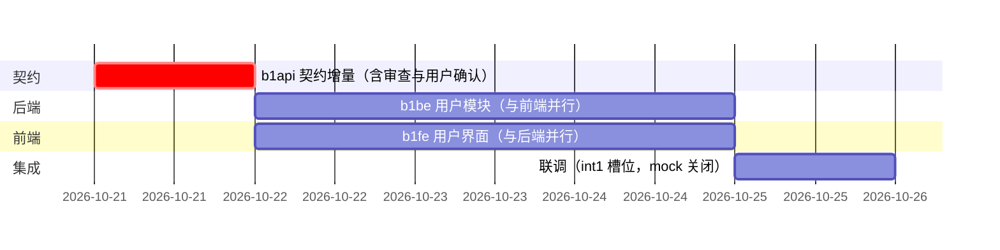

# b1 批次计划 · 用户域

_版本 v1.0 · 2026-10-20 · 编写：主 agent · 状态：**待用户批准** · 基线：[需求分析](../需求分析.md) v1.1 · [项目规范](00-项目规范.md) v0.5 · 契约 [openapi.yaml](../api/openapi.yaml) 0.1.0_

---

## 📋 批次定位

b1 是第一个业务批次，在 b0 骨架（统一响应、错误码表、Swagger 路由、迁移基线、前端四态守卫与 mock 机制）之上交付**用户域**：注册 / 登录 / JWT / 登出 / 密码、个人资料、校园认证、学校校区。同时落地两项跨批次地基：

1. **JWT 鉴权三装饰器与同校作用域上下文**（`common/`，批次 2 起的商品域直接复用）；
2. **图片表与鉴权访问路由** `GET /api/images/{id}`（契约 ImageRef 已承诺随批次 1 落地；b2 商品图、b4 聊天图复用）。

### 范围与 FR 映射

| FR | 内容 | 本批次落实 |
| --- | --- | --- |
| FR-USR-01 | 注册（用户名/密码/邮箱/学号，唯一性与强度） | ✅ b1be + b1fe |
| FR-USR-02 | 登录（用户名或学号，JWT，5 次失败限流 10 分钟） | ✅ |
| FR-USR-03 | 登出（jti 黑名单直至过期） | ✅ |
| FR-USR-04 | 个人资料（昵称/头像/邮箱/手机号；学号用户名不可改） | ✅ |
| FR-USR-05 | 修改密码（校验原密码） | ✅ |
| FR-USR-06 | 密码重置（用户名 + 学号或邮箱，不发邮件短信） | ✅ |
| FR-USR-07 | 认证提交（选校/校区、真实姓名、学生证照片） | ✅ |
| FR-USR-08 | 认证状态查询（四态 + 驳回原因） | ✅ |
| FR-USR-09 | 认证材料重提（历史申请保留） | ✅ |
| FR-USR-10 | 展示名生成（approved 后 `昵称-学校[校区]`） | ✅ |
| FR-USR-11 | 用户主页（展示名/信誉分/在售数/评价） | ❌ **不在 b1**：依赖 b2 在售商品数与 b3 评价，建议随 b3 契约增量定义 `GET /api/users/{id}`（b4 聊天发起依赖它，届时必须就位）——**待用户确认** |
| NFR-05/07/08 | bcrypt、上传四件套、学生证照片访问控制 | ✅ 随本批次落地 |
| AC-04 / AC-05 | 多校区展示名、认证闭环 | 提交→待审核→驳回展示与重提在本批次可验；**审核通过动作属 b5 管理域**，b1 联调以造数方式验证 approved 态 |

### 明确排除（防止范围蔓延）

- 管理端认证审核、学校维护（FR-ADM-01/06/07）→ b5；
- 商品域接口与 1004 准入实测（AC-02 完整验证）→ b2（装饰器本批次先落地并测试）；
- 正式种子数据脚本 → b6（b1 联调用最小 SQL 造学校数据，见「联调准备」）；
- 用户主页（FR-USR-11）→ b3。

---

## 🔧 任务拆分与可并发编排

三个任务，契约先行、双端真并行：

| 代号 | 端 | 任务 | 分支 | worktree | 槽位/隔离 | 计划文档 |
| --- | --- | --- | --- | --- | --- | --- |
| b1api | 契约 | openapi.yaml 0.1.0 → **0.2.0**：用户域 12 接口 + 20xx 错误码 + schema + 文档修订 | `feat/api/b1-user-domain` | `.worktree/b1api` | 无隔离参数 | 本文档「契约增量全案」节 |
| b1be | 后端 | 用户域全部接口实现 + 鉴权横切件 + 迁移 + 测试 | `feat/be/b1-user` | `.worktree/b1be` | 端口 5010 · Redis 基址 4 · 前缀 `b1be-` | [backend/01-用户模块](backend/01-用户模块.md) |
| b1fe | 前端 | 登录注册/找回密码/认证提交与状态/个人中心 | `feat/fe/b1-user-ui` | `.worktree/b1fe` | 端口 5180 · `VITE_USE_MOCK=true` | [frontend/01-用户界面](frontend/01-用户界面.md) |



**并发要点（本期可并发性的落实）：**

> gantt 中日期为示意（批准次日开工），实际派发日由主 agent 记入看板，相对次序不变。

1. **唯一串行点是 b1api**：契约增量小而急（纯 yaml + CHANGELOG + 校验），完成后契约冻结为 0.2.0，记入看板「契约冻结版本」列。
2. **b1be 与 b1fe 完全并行**：两者代码、worktree、目录互不相交（`campus_backend/` vs `campus_frontend/`）；b1fe 全程 `VITE_USE_MOCK=true`，对后端零依赖；b1be 全程 pytest/ruff，对前端零依赖。两份任务计划各自自足，**互不引用对方内容**，只共同引用冻结契约。
3. **b1api 不占槽位**（不起服务，仅 yaml 校验）；b1be/b1fe 共用开发槽位 A（后端 5010 / 前端 5180，端口不冲突）；联调起 int1 集成槽位（5030 / 5200 / Redis 12 / 前缀 `int1-`）。
4. 契约冻结后任一端发现契约缺陷 → 停手上报 → 契约修订任务（`feat/api/b1-<主题>`，代号 `b1api2`）→ 双端同步，**不得私改**。

### 审查与合并（按项目规范生命周期执行）

每个任务：派发 → 开发自检（后端 ruff+pytest；前端 build+oxlint）→ 审查（阻断/建议分级）→ 修复循环至零阻断 → **汇报即停，用户确认** → 并入 `integration/b1-user`（自 main 检出，集成 worktree `.worktree/int1`）→ 联调 → 用户确认 → 合入 main → 全部 worktree/分支清理 + 隔离数据核验（`b1be-` 前缀表 DROP、`int1-` 前缀表 DROP；Mongo/Chroma 本批次不涉及）。

---

## 📜 契约增量全案（b1api 任务规格）

> 本节是 `b1api` 任务的完整规格：执行 agent 据此修改 `docs/api/openapi.yaml` 与 `docs/api/CHANGELOG.md`，**不得偏离**；实现端按冻结后的 yaml 为准。版本 0.1.0 → **0.2.0**。

### 1. 文档级修订（顺手清账）

| 位置 | 修订 |
| --- | --- |
| `info.description` 基线列表 | 「项目规范 v0.4」→「项目规范 v0.5」（看板遗留待办：`docs/api/openapi.yaml:22`） |
| `info.description` 错误码表 | 20xx 行由「批次 1 定义」改为列出下方 6 个具体码；补「本批次新增 20xx 段」说明 |
| `tags:` 段 | 新增 `auth` `users` `certification` `schools` `images` 五个 tag 及一句话描述 |
| 标签规划行 | 标注 `auth/users/certification/schools/images` 已于批次 1 建立其中用户域部分；`images` 的商品图用途批次 2 扩展 |
| `bearerAuth.description` | 「批次 1 落地」→「由 `POST /api/auth/login` 签发」 |
| `ImageRef.description` | 「该接口随批次 1 落地」→「见 `GET /api/images/{id}`」 |
| `SchoolRef` / `CampusRef` | 复用为公开列表元素，无需改结构；`UserSummary.credit_score` 描述补「批次 3 起有评价后非空」 |

### 2. 业务错误码 20xx（用户域，本批次定义）

| code | HTTP | 含义 | 触发场景 |
| --- | --- | --- | --- |
| 2001 | 409 | 用户名已存在 | 注册 |
| 2002 | 409 | 学号已被注册 | 注册 |
| 2003 | 400 | 原密码错误 | 修改密码 |
| 2004 | 422 | 重置凭证不匹配 | 用户名与学号/邮箱对不上 |
| 2005 | 401 | 用户名或密码错误 | 登录失败（连续 5 次后转 429/1006） |
| 2006 | 403 | 账号已被封禁 | `status = banned` 用户登录 |

学校/校区不存在或停用、认证表单字段校验、学生证学号与注册学号不一致 → 复用 `9001`（`data.fields` 字段级错误）；重复提交认证、非未认证/已驳回状态提交 → 复用 `9003`。

### 3. 新增接口（12 个，全部落 `paths:`）

统一响应体、错误响应 `$ref`、分页规则沿用既有 components。标注 **公开** 的接口在路径内 `security: []`。

#### 3.0 字段校验对照表（双端同源，前后端均须独立落实）

> 下表是本批次全部常用字段的**唯一口径**：pattern 写入 openapi.yaml 对应 schema；**后端**在 routes/service 独立复验（绝不信任客户端）；**前端**在表单预检（提升体验，不替代后端）。任一端校验失败统一走 `9001`（`data.fields` 字段级错误），前端内联展示。

| 字段 | 必填 | 规则 | pattern / 约束 | 出现位置 |
| --- | --- | --- | --- | --- |
| `username` | ✅ | 1–32 位，字母开头，仅字母/数字/下划线 | `^[A-Za-z][A-Za-z0-9_]{0,31}$` | register；注册后不可改 |
| `password`（含 new_password / 重置新密码） | ✅ | 8–64 位，须同时含字母与数字 | `^(?=.*[A-Za-z])(?=.*\d).{8,64}$` | register / me/password / password/reset |
| `phone` | ⬜ 可空 | 填写时须为 **1 开头的 11 位纯数字**；空串 = 清除 | `^1\d{10}$`（空串放行） | users/me（更新） |
| `email` | 注册✅ / 资料⬜ | 标准 email 格式 | OpenAPI `format: email` | register / users/me |
| `student_no` | ✅ | 1–32 字符；注册后不可改；认证提交须与注册值完全一致 | 长度 1–32 | register / certification |
| `nickname` | ⬜ | 1–32 字符；注册缺省取 `username` | 长度 1–32 | register / users/me |
| `real_name` | ✅ | 1–32 字符 | 长度 1–32 | certification |
| 上传文件 | 按接口 | jpg/png/webp，≤ 5 MB；服务端四件套（扩展名 + MIME + 大小 + 哈希改名） | — | avatar / certification |

存储纪律（NFR-05，用户 2026-10-20 确认维持）：`password` 落库为 **bcrypt 加盐哈希**——任何链路不得明文、不得可逆加密、**不得以 sha256 等无盐快速哈希替代**（sha256 仅用于上传文件的内容哈希改名，与密码无关）。

#### 3.1 auth（4 个）

**`POST /api/auth/register`** · 公开
- body `application/json` `RegisterInput`：
  - `username`: string, 1–32，字母开头，仅字母/数字/下划线（pattern `^[A-Za-z][A-Za-z0-9_]{0,31}$`）
  - `password`: string, 8–64，须含字母与数字（pattern `^(?=.*[A-Za-z])(?=.*\d).{8,64}$`）
  - `email`: string, format email
  - `student_no`: string, 1–32（不限定纯数字）
  - `nickname`: string, 1–32，**可选**，缺省取 `username`
- 200 → `data: UserProfile`（注册后需再登录，不签发令牌）
- 错误：`9001`（字段校验，`data.fields`）、`2001`、`2002`

**`POST /api/auth/login`** · 公开
- body `LoginInput`：`account`（string 1–32，用户名或学号，服务端先按 `username` 精确匹配、未命中按 `student_no`）、`password`（string）
- 200 → `data: LoginData`：
  - `access_token`: string（flask-jwt-extended 签发，identity = 用户 id）
  - `token_type`: `"Bearer"`
  - `expires_in`: integer（秒，`JWT_EXPIRE_MINUTES × 60`）
  - `user`: UserProfile
- 错误：`2005`、`2006`、`1006`（连续 5 次失败后 10 分钟内 429；键 `rate:login:{ip}`，登录成功清零计数）
- description 注明：封禁用户即使密码正确也返回 `2006`，且不消耗限流计数之外的额外语义（按一次失败计）

**`POST /api/auth/logout`** · 需登录（不要求校园认证状态）
- 无 body；将当前令牌 `jti` 写入 Redis `auth:blacklist:{jti}`，TTL = 令牌剩余有效期
- 200 → `data: object`（正常为 `{}`）；Redis 故障时仍 200，`data: { degraded: true, degraded_reason: string }`（黑名单未落，令牌仍有效至自然过期；日志告警）——**降级显式可见**
- 错误：`401/1001–1003`

**`POST /api/auth/password/reset`** · 公开
- body `PasswordResetInput`：`username`（string）、`reset_channel`: enum `[student_no, email]`、`reset_value`（string；channel 为 student_no 时须与注册学号一致，为 email 时须与注册邮箱一致）、`new_password`（同注册密码规则）
- 200 → `data: null`；成功后不清除已签发令牌（无会话管理需求，YAGNI）
- 错误：`2004`（凭证不匹配；用户名不存在同样返回 `2004`，**不泄露用户名存在性**）、`9001`

#### 3.2 users（4 个）

**`GET /api/users/me`** · 需登录 → `data: UserProfile`
**`PUT /api/users/me`** · 需登录
- body `ProfileUpdateInput`：`nickname`（1–32）、`email`（email）、`phone`（**`^1\d{10}$`，可空串表示清除**，nullable）——三字段均可选，仅更新出现的字段；`username` / `student_no` 不在请求体中（不可改）；字段规则以「3.0 字段校验对照表」为唯一口径
- 200 → `data: UserProfile`；错误：`9001`

**`PUT /api/users/me/password`** · 需登录
- body `PasswordChangeInput`：`old_password`、`new_password`（同注册密码规则）
- 200 → `data: null`；错误：`2003`（原密码错误）、`9001`

**`POST /api/users/me/avatar`** · 需登录 · `multipart/form-data`
- form 字段 `file`：单文件 jpg/png/webp，≤ 5 MB（服务端四件套校验：扩展名 + MIME + 大小 + 内容哈希改名，落 `uploads/avatar/<年月>/`）
- 200 → `data: UserProfile`（avatar 字段更新）；旧头像文件保留不删（images 表仅增不改，YAGNI）
- 错误：`9001`（类型/大小不符，`data.fields.file`）

#### 3.3 certification（2 个）

**`POST /api/certification/applications`** · 需登录且 `role = student` 且 `auth_status ∈ {unverified, rejected}` · `multipart/form-data`
- form 字段：`school_id`（integer）、`campus_id`（integer，**多校区学校必填**，单校区须省略）、`real_name`（1–32）、`student_no`（须与注册学号**完全一致**，防代认证）、`file`（学生证照片，同上传四件套，落 `uploads/student_card/<年月>/`）
- 200 → `data: AuthApplication`（status = pending）；同时用户 `auth_status` → pending
- 错误：`9001`（缺校区/学号不一致/学校停用或不存在/文件不符）、`9003`（当前状态不允许提交：pending / approved）、`403/1005` 语义不适用（管理员提交返回 `9003` 并在 message 说明管理员无需认证）

**`GET /api/certification/applications/mine`** · 需登录
- 200 → `data: AuthApplication[]`，按 `created_at` 倒序，**不分页**（个人历史申请量小；description 注明该取舍）
- 错误：`401/1001–1003`

#### 3.4 schools（1 个）

**`GET /api/schools`** · 公开（权限矩阵：游客即可查）
- 200 → `data: SchoolWithCampuses[]`：`SchoolRef` + `campuses: CampusRef[]`；仅返回**启用**状态的学校与校区，按名称排序，不分页（数据量小，注册/认证页需一次取全）
- 错误：无业务错误

#### 3.5 images（1 个）

**`GET /api/images/{id}`** · 需登录 · path 参数 `id`（int64）
- 返回图片实体（`image/jpeg|png|webp`，非 envelope——description 明确本接口**不走统一响应体**，直接二进制）
- 访问控制（NFR-08）：`purpose = student_card` 的图片**仅上传者本人与管理员**可读；其余（本批次仅 `avatar`）登录即可读
- 错误：越权 / 不存在一律 `404 / 9002`（防探测，不走 envelope 的错误体结构由实现按 ErrorEnvelope 输出——description 说明 JSON 错误仍遵循 envelope）
- description 注明：批次 2 起商品图、批次 4 聊天图复用本接口，`purpose` 值域随批次扩展

### 4. 新增 schemas（`components/schemas:`）

```yaml
UserProfile:        # 个人资料完整形态（与 UserSummary 概要形态并存）
  required: [id, username, student_no, email, nickname, display_name,
             role, auth_status, status, created_at]
  properties:
    id: {type: integer, format: int64}
    username: {type: string}
    student_no: {type: string}
    email: {type: string, format: email}
    nickname: {type: string}
    display_name: {type: string}        # 规则同 UserSummary（FR-USR-10）
    phone: {type: string, nullable: true, pattern: '^1\d{10}$', description: 1 开头的 11 位纯数字；未设置为 null}
    avatar: {allOf: [{$ref: ImageRef}], nullable: true}
    school: {allOf: [{$ref: SchoolRef}], nullable: true}   # 未认证为 null
    campus: {allOf: [{$ref: CampusRef}], nullable: true}   # 未认证/单校区为 null
    role: {$ref: Role}
    auth_status: {$ref: AuthStatus}
    status: {$ref: UserAccountStatus}
    credit_score: {type: number, nullable: true}           # 批次 3 起非空
    created_at: {type: string, format: date-time}

LoginData:
  required: [access_token, token_type, expires_in, user]
  properties:
    access_token: {type: string}
    token_type: {type: string, example: Bearer}
    expires_in: {type: integer, description: 令牌有效期（秒）}
    user: {$ref: UserProfile}

AuthApplication:
  required: [id, school, student_no, real_name, student_card, status, created_at]
  properties:
    id: {type: integer, format: int64}
    school: {$ref: SchoolRef}
    campus: {allOf: [{$ref: CampusRef}], nullable: true}
    student_no: {type: string}
    real_name: {type: string}
    student_card: {$ref: ImageRef}
    status: {$ref: AuthStatus}          # 本接口只会出现 pending（历史含 rejected）
    reject_reason: {type: string, nullable: true}
    reviewed_at: {type: string, format: date-time, nullable: true}
    created_at: {type: string, format: date-time}

SchoolWithCampuses:
  allOf:
    - $ref: SchoolRef
    - type: object
      required: [campuses]
      properties:
        campuses: {type: array, items: {$ref: CampusRef}}
```

请求体 schema（`RegisterInput` / `LoginInput` / `PasswordResetInput` / `ProfileUpdateInput` / `PasswordChangeInput`）按第 3 节字段定义内联于各 path 并以组件复用；每个接口给出 1 个成功 example 与关键错误 example（9001 字段级、2001/2005/1006 至少各一处），保证 Swagger UI 可直接试读。

### 5. CHANGELOG 0.2.0 条目

- 新增：auth 4 + users 4 + certification 2 + schools 1 + images 1，共 12 接口；20xx 六码；UserProfile / LoginData / AuthApplication / SchoolWithCampuses 及五个请求体 schema；tags 五个。
- 修订：规范引用 v0.4→v0.5、错误码表 20xx 行、标签规划、bearerAuth 与 ImageRef 描述。
- 影响端：双端（前端重新生成 `types.ts` 并同步 mock；后端按新段实现）。
- 冻结：本版本即 b1 双端开发基线，记入看板「契约冻结版本」。

### 6. b1api 验收标准

- [ ] `openapi.yaml` 通过 YAML 解析与 OpenAPI 3.0 结构校验（`python -c "import yaml,json;json.dumps(yaml.safe_load(open('docs/api/openapi.yaml')))"` 无错；`npx openapi-typescript docs/api/openapi.yaml -o /tmp/types.ts` 生成成功）；
- [ ] 12 个 path、6 个 20xx 码、4 个新 schema、5 个 tag 齐备；所有 `$ref` 可解析（无悬空引用）；
- [ ] 遗留修订三项完成（v0.5 引用、bearerAuth、ImageRef 描述）；
- [ ] `CHANGELOG.md` 登记 0.2.0（时间、内容、影响端、冻结说明）；
- [ ] 未改动契约三件之外的任何文件；提交信息 `feat(api): b1 用户域契约增量（0.2.0）`。

---

## 🧪 批次联调（int1）

**前置数据（联调 agent 造数，非代码交付物）**：集成库（`int1-` 前缀表）手工 SQL 插入 2 所学校：①多校区（2 个校区）②单校区各 1；再插 1 名 `approved` 学生与 1 名 `rejected`（含驳回原因）申请记录用于展示态验证。正式种子脚本 b6 交付。管理员审核动作属 b5，approved 态一律造数。

**契约冒烟清单**（12 接口 × 正例 ≥1 + 反例）：

| 用例 | 期望 |
| --- | --- |
| 未登录 `GET /users/me` | 401 / 1001 |
| 注册（合法 / 用户名重复 / 学号重复 / 弱密码） | 200 / 2001 / 2002 / 9001(fields) |
| 登录（用户名 / 学号 / 错密码 / 连续 5 次错） | 200 / 200 / 2005 / 429+1006 |
| 登出后再用旧令牌 | 200 → 401 / 1003 |
| 重置密码（学号渠道 / 邮箱渠道 / 凭证不匹配 / 用户名不存在） | 200 ×2 / 2004 / 2004 |
| `GET /schools`（游客） | 200，含校区数组 |
| `PUT /users/me` 改昵称 + phone（合法 / 10 位 / 含字母）后查询 | approved 造数用户展示名联动重算（AC-04）；非法 phone → 9001(fields)、合法生效、空串清除 |
| 修改密码（原密码错 / 正确后新密码登录） | 2003 / 200 |
| 头像上传（png / 超 5MB / txt 伪装） | 200 / 9001 / 9001 |
| 认证提交（多校区缺 campus_id / 学号不一致 / 重复提交 / rejected 重提） | 9001 / 9001 / 9003 / 200+pending |
| `mine` 列表含历史申请与驳回原因 | 200 |
| `GET /images/{id}`（本人 / 他人访问学生证 / 管理员） | 200 二进制 / 404+9002 / 200 |
| Swagger UI `/api/docs` | 12 个新接口可见可试调 |

**批次验收四项**（对应需求 AC 与演示脚本 2–4 步）：① 游客→注册→登录全链路；② 未认证态登录后仅个人域可用；③ 认证提交→pending 展示→造数 approved 后重新登录展示名为 `昵称-学校(校区)`；④ 驳回原因展示与重提闭环。

**集成态自检**：ruff ✅ · pytest 全绿 ✅ · oxlint ✅ · build ✅ · 迁移 `int1-` 前缀 5 表 ✅。

---

## ⚠️ 决策点与风险（开工前请用户过目）

| # | 事项 | 建议 | 影响 |
| --- | --- | --- | --- |
| 1 | **新包申报：`bcrypt`**（后端） | NFR-05 钉死 bcrypt 加盐哈希，清单未含 → 需用户 `cd campus_backend && uv add bcrypt`（主仓与 b1be worktree 各一次；先装主仓，worktree 检出后 `uv sync`） | b1be 开工前置 |
| 2 | `common/` 扩充 **Redis 客户端**（懒初始化）与 **bcrypt/上传校验助手** | 骨架规则「新横切关注点扩充 common/ 需用户确认」——鉴权装饰器与作用域属规范既定 common 职责，Redis 客户端为新增项（登录限流 + jti 黑名单需要） | b1be 结构 |
| 3 | `users` 表新增 **phone 列** | 需求 ER 图漏列，但 FR-USR-04 明确手机号；以 FR 为准补列（nullable） | 模型与契约 |
| 4 | **FR-USR-11 用户主页排期** | 建议随 b3 契约增量定义（依赖 b2 商品数、b3 评价；b4 聊天发起依赖它），本批次不做 | 批次排期 |
| 5 | Redis 故障降级语义 | 黑名单：logout 仍 200 + `degraded` 标记（令牌有效至自然过期）；限流：Redis 不可用放行登录并日志告警（可用性优先） | 契约与实现 |
| 6 | 前端 **AuthDemoSwitcher 移除** | b0 的演示态切换器在真实登录可用后属调试遗留物；mock 模式下登录走 mock 数据即可验证四态 | b1fe |
| 7 | 认证 approved 态在 b1 无法经接口达成 | 属预期（审核在 b5）；联调以造数验证展示名与驳回展示，AC-05 完整闭环在 b5 复验 | 联调预期 |

---

## 📎 任务计划索引

- 后端任务卡：[backend/01-用户模块](backend/01-用户模块.md)（b1be）
- 前端任务卡：[frontend/01-用户界面](frontend/01-用户界面.md)（b1fe）
- 契约任务规格：即本文档「契约增量全案」节（b1api）
