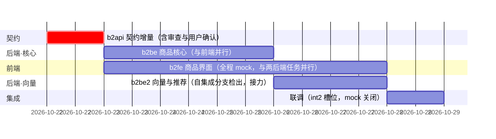

# b2 批次计划 · 商品域

_版本 v1.0 · 2026-10-21 · 编写：主 agent · 状态：**待用户批准** · 基线：[需求分析](../需求分析.md) v1.1 · [项目规范](00-项目规范.md) v0.5 · 契约 [openapi.yaml](../api/openapi.yaml) 0.2.0（本批增量至 0.3.0）_

---

## 📋 批次定位

b2 在 b1（鉴权三装饰器 + 同校作用域 + 图片表与访问路由）之上交付**商品域**：商品发布/编辑/状态/删除、图片上传、分类、收藏、列表筛选、向量搜索、首页推荐、画像行为。同时消化四条指向 b2 的跨批次遗留（图片懒加载、上传孤儿清理、认证页 9001 渲染位、logout 降级可见性）与一条 b1 联调观察项（上传魔数契约澄清），并修复一项 b1 遗留缺陷（图片 `` 鉴权链路，见决策点 2）。

**四存储首次全部投产**：MySQL（4 张新表）、MongoDB（画像/行为/向量副本）、Chroma（向量索引）、Redis（商品缓存 + 向量重试队列）；Embedding 走本地侧车（`tools/local_embedding/`，端口 8010，**使用前需自行启动**，不由常驻进程承载）。

### 范围与 FR 映射

| FR | 内容 | 本批次落实 |
| --- | --- | --- |
| FR-GDS-01 | 商品发布（标题/描述/价格/分类/成色/1–9 图必填，发布即上架） | ✅ b2be + b2fe |
| FR-GDS-02 | 商品编辑（仅发布者；异步重建向量与失效缓存） | ✅ b2be（编辑+缓存失效）+ b2be2（text_hash 判变重建向量） |
| FR-GDS-03 | 商品列表（本校在售分页；分类/价格区间/成色/关键词/排序筛选） | ✅ |
| FR-GDS-04 | 商品详情（轮播/价格/描述/卖家展示名与信誉分/收藏数；非本校 404） | ✅ 卖家卡片仅展示 `UserSummary`，跳主页待 b3 `GET /users/{id}` |
| FR-GDS-05 | 商品搜索（向量化 → Chroma 余弦召回 → 分类价格二次过滤） | ✅ b2be2（LIKE 降级路径含） |
| FR-GDS-06 | 首页推荐（40 个 = 5×8 宫格；80% 画像 + 20% 随机；冷启动全随机） | ✅ b2be2 |
| FR-GDS-07 | 商品状态管理（上架/交易中/已售/已下架四态流转） | ✅ 本批落地卖家侧全部边（上下架/删除）；`trading/sold` 流入边属 b3 订单、管理员强下边属 b5 |
| FR-GDS-08 | 商品收藏（收藏/取消/收藏列表；收藏触发画像更新） | ✅ |
| FR-GDS-09 | 分类管理（管理员维护） | ❌ 管理 CRUD 属 b5（FR-ADM-08）；本批仅 `GET /api/categories` 读侧 |
| FR-GDS-10 | 我的商品（按状态筛选，可编辑/上下架/删除） | ✅ |
| FR-GDS-11 | 图片上传（≤5MB、jpg/png/webp、落本地、库存 id 与相对路径） | ✅ 上传五件套（含 b1 联调补充的魔数嗅探） |
| FR-ADM-04（写入侧） | 发布时敏感词命中 → `pending_review` | 🟡 本批仅建 `moderation_status` 列 + 匹配钩子占位（no-op）；词库/匹配/复核队列整体 b5（决策点 6） |
| NFR-01/02/04 | 推荐 P95<1.5s / 详情缓存命中 P95<100ms / 列表搜索 P95<500ms | ✅ 联调轻量实测（日志耗时抽样 + 可选 20 并发） |
| NFR-10（前半） | 向量写入失败进重试队列补偿 | ✅ b2be2（60s 补偿线程，开关可控） |
| AC-02/03/07/08/09/17 | 准入 403 / 同校隔离 / 推荐配比 / 画像更新 / 语义搜索 / 降级可见 | ✅ 联调验收主项 |

### 明确排除（防止范围蔓延）

- 分类管理 CRUD、商品处置（强制下架/恢复）、待复核队列 → b5；
- 订单/支付/评价（`trading/sold` 状态的流入流转、`sold_at` 写入、购买行为画像权重 0.55 的触发端）→ b3；
- `GET /api/users/{id}` 用户主页 → **b3**（2026-10-21 用户确认，看板已登记）；商品详情卖家卡片本批不可跳转；
- 敏感词词库与匹配逻辑 → b5（本批 `moderation_status` 建列 + 钩子 no-op）；
- 正式种子数据脚本 → b6（联调造数走发布接口，见「联调准备」）；
- 跨请求曝光去重、消息类功能 → 明确不做（需求已显式取舍 / 属 b4）。

---

## 🔧 任务拆分与可并发编排

四个任务，契约先行、核心与前端并行、向量任务接力：

| 代号 | 端 | 任务 | 分支 | worktree | 槽位/隔离 | 计划文档 |
| --- | --- | --- | --- | --- | --- | --- |
| b2api | 契约 | openapi.yaml 0.2.0 → **0.3.0**：商品域 14 接口 + 30xx 错误码 + schema + 文档修订（含图片 Cookie 通道澄清） | `feat/api/b2-product-domain` | `.worktree/b2api` | 无隔离参数 | 本文档「契约增量全案」节 |
| b2be | 后端 | 商品核心：4 表迁移 + 商品 CRUD/状态/删除 + 图片上传与孤儿清理 + 分类 + 收藏 + 列表/我的商品 + 缓存 + 事件钩子占位 + b1 三处微改（图片 Cookie、405、auth Set-Cookie） | `feat/be/b2-product-core` | `.worktree/b2be` | 端口 5010 · Redis 基址 4 · 前缀 `b2be-` | [backend/02-商品模块](backend/02-商品模块.md) |
| b2be2 | 后端（接力） | 向量与画像：Mongo/Chroma/Embedding 三客户端 + 发布链路向量同步 + 向量搜索 + 首页推荐 + 行为画像 + 降级矩阵 + 60s 补偿线程 | `feat/be/b2-product-vector` | `.worktree/b2be2` | 端口 5020 · Redis 基址 8 · 前缀 `b2be2-` · Mongo 库 `campus_market_b2be2` · Chroma 后缀 `b2be2` | [backend/02-向量与推荐](backend/02-向量与推荐.md) |
| b2fe | 前端 | 首页推荐宫格、列表筛选、详情、发布编辑、我的商品、收藏、搜索 + 图片懒加载等四条遗留 | `feat/fe/b2-product-ui` | `.worktree/b2fe` | 端口 5180 · `VITE_USE_MOCK=true` | [frontend/02-商品界面](frontend/02-商品界面.md) |



**并发要点（本期可并发性的落实）：**

> gantt 中日期为示意（批准次日开工），实际派发日由主 agent 记入看板，相对次序不变。

1. **唯一串行点是 b2api**：契约增量完成后冻结 **0.3.0**，记入看板「契约冻结版本」列。
2. **b2be ∥ b2fe 完全并行**（b2api 冻结后）：代码、worktree、目录互不相交；b2fe 全程 `VITE_USE_MOCK=true` 对后端零依赖；两份任务计划各自自足，只共同引用冻结契约。共用开发槽位 A（5010/5180，端口不冲突）。
3. **b2be2 是接力任务而非并行任务**：其代码基线**自集成分支 `integration/b2-product` 检出**（此时 b2be 已并入）——这是对项目规范「worktree 自 main 最新提交建立」的一处**显式扩展**，已经用户确认（2026-10-21 编排决策）。理由：b2be2 的全部事件订阅、搜索/推荐路由都建立在 b2be 的模型、服务与事件总线上，自 main 检出将拿不到这些代码；同库并行改 `model.py`/`router.py` 必然冲突（否决完全并行方案 C 的原因）。b2be2 占开发槽位 B（5020），与 b2fe 后半程（修复轮/审查）并行不冲突。
4. **b2be → b2be2 的内部接口**由两份任务卡的「Interfaces」节双向钉死：b2be 产出 `src/services/events.py` 事件总线与 6 个事件点（本任务内 no-op 安全）；b2be2 产出订阅者并接线。b2api 冻结后任一端发现设计缺陷 → 停手上报 → 契约/计划修订 → 双端同步，**不得私改**。
5. b2api 不占槽位；联调起 int2 集成槽位（5030 / 5200 / Redis 基址 12 / 前缀 `int2-` / Mongo 库 `campus_market_int2` / Chroma 后缀 `int2`）。
6. **存储隔离**：b2be（纯 MySQL+Redis）不产生 Mongo/Chroma 数据；b2be2 独占 Mongo 库 `campus_market_b2be2` 与 Chroma 集合 `product_vectors_b2be2`，收尾清理责任各自承担。

### 审查与合并（按项目规范生命周期执行）

每个任务：派发 → 开发自检（后端 ruff+pytest；前端 build+oxlint）→ 审查（阻断/建议分级）→ 修复循环至零阻断 → **汇报即停，用户确认** → 并入 `integration/b2-product`（自 main 检出，集成 worktree `.worktree/int2`；**b2be2 并入前先并 b2be**，b2be2 的分支基线即集成分支）→ 联调 → 用户确认 → 合入 main → 全部 worktree/分支清理 + 隔离数据核验（`b2be-`/`b2be2-`/`int2-` 前缀表 DROP；`campus_market_b2be2`/`campus_market_int2` 库与 Chroma 集合删除）。

---

## 📜 契约增量全案（b2api 任务规格）

> 本节是 `b2api` 任务的完整规格：执行 agent 据此修改 `docs/api/openapi.yaml` 与 `docs/api/CHANGELOG.md`，**不得偏离**；实现端按冻结后的 yaml 为准。版本 0.2.0 → **0.3.0**。

### 1. 文档级修订（顺手清账）

| 位置 | 修订 | 来源 |
| --- | --- | --- |
| `info.description` 错误码表 | 30xx 行由「批次 2 定义」改为列出下方 2 码 + 补「30xx 段为本版本新增」；新增 `9007 \| 405 \| 方法不支持`（复用错误响应 405 场景统一走 envelope） | b0 联调观察项 |
| `info.description` 上传约定行 | 「四件套」表述升级为**五件套**：扩展名 + MIME + 大小（≤5MB）+ **内容魔数嗅探**（PNG 8 字节签名 / JPEG SOI / WEBP RIFF+WEBP）+ 哈希改名 | b1 联调 P2 澄清 |
| `info.description` 鉴权节 | 补一段「图片 Cookie 通道」：登录成功 `Set-Cookie img_token`（httpOnly、SameSite=Lax、Path=/api/images、TTL 同令牌，值为同一 JWT）；`GET /api/images/{id}` 优先 `Authorization` 头，缺失时回退该 Cookie，二者走同一 JWT 校验与黑名单；登出清除。仅图片路由接受 Cookie 认证，其余接口一律 Bearer | b1 遗留缺陷修复（2026-10-21 用户确认方案 A） |
| `tags:` 段 | 新增 `products` `categories` `favorites` `recommendations` `uploads` 五个 tag 及一句话描述 | 标签规划既定 + uploads 扩充 |
| 标签规划行 | 标注批次 2 已建立商品域部分；`uploads` 为新增通用 tag（b4 聊天图复用） | — |
| `ProductSummary.condition` | `type: string`（留白）→ `$ref: ProductCondition`（新枚举，见 §4） | 0.2.0 预留的批次 2 定稿项 |
| `GET /api/images/{id}` description | 补「鉴权：Bearer 或图片 Cookie（见总则）双通道；`purpose` 值域本版本扩展 `product`」 | 决策点 2 |
| `POST /api/auth/login` responses | 补 `Set-Cookie: img_token=...` 响应头说明（`logout` 对应清除） | 决策点 2 |
| `ImageRef.description` | 补「同源相对路径，`` 标签经图片 Cookie 通道直接可渲染」 | 决策点 2 |
| `UserSummary.credit_score` | 保持不变（b3 前恒 null） | — |

### 2. 业务错误码 30xx（商品域，本批次定义）

| code | HTTP | 含义 | 触发场景 |
| --- | --- | --- | --- |
| 3001 | 409 | 商品状态不允许该操作 | 编辑/删除/上架/下架/收藏的前置状态不满足（如编辑 `trading` 商品、删除 `sold` 商品、收藏非 `on_sale` 商品）；`message` 说明当前状态与允许的操作 |
| 3002 | 403 | 商品已被管理员强制下架 | 卖家对 `forced_off` 商品请求重新上架（仅管理员可恢复，b5 场景前置） |

复用既有码：商品/校区/图片 id 类参数问题（不存在、停用、非本人上传、数量越界）→ `9001`（`data.fields` 字段级）；非本校或不存在商品 → `404/9002`；重复收藏 → `9003`；未通过认证访问商品域 → `403/1004`；Embedding/Chroma 降级后无法完成本操作 → `9004`（本批仅搜索在「向量降级且 LIKE 也不可用」极端场景使用，正常降级一律 200+`degraded`）。

### 3. 新增接口（14 个，全部落 `paths:`）

统一响应体、错误响应 `$ref`、分页规则沿用既有 components。商品域全部接口要求**已通过校园认证**（`verified`：学生 `approved` 或管理员；未认证 → `403/1004`，AC-02 最硬准入线）。管理员对本校跨校区可见全部商品（`g.scope_all`），但**发布/编辑/收藏/上传对管理员一律拒绝**（`9001` 或 `9003`，message 说明管理员无交易能力——与 b1 认证提交对管理员的处理口径一致）。

#### 3.0 字段校验对照表（双端同源，前后端均须独立落实）

> 本表是本批次全部常用字段的**唯一口径**：pattern/约束写入 openapi.yaml 对应 schema；**后端**在 routes/service 独立复验（绝不信任客户端）；**前端**在表单预检（提升体验，不替代后端）。任一端校验失败统一走 `9001`（`data.fields` 字段级错误），前端内联展示。与 b1 3.0 节同源延续：`phone ^1\d{10}$`、密码 bcrypt 等用户域纪律不变（本批无新用户字段接口）。

| 字段 | 必填 | 规则 | pattern / 约束 | 出现位置 |
| --- | --- | --- | --- | --- |
| `title` | ✅ | 1–50 字符 | 长度 1–50 | 发布/编辑 |
| `description` | ✅ | 1–2000 字符 | 长度 1–2000 | 发布/编辑 |
| `price` | ✅ | 0.01–99999.99 元，最多两位小数 | `minimum: 0.01` / `maximum: 99999.99` / `multipleOf: 0.01`（OpenAPI 3.0 表达；后端 Decimal 校验两位小数，前端 `^\d{1,5}(\.\d{1,2})?$` 且数值 ≥0.01） | 发布/编辑 |
| `original_price` | ⬜ | 可空；填写时同 `price` 约束 | 同上（nullable） | 发布/编辑 |
| `category_id` | ✅ | 存在且 `status=enabled` 的分类（服务端查库复验） | int64 | 发布/编辑；列表/搜索筛选参数（填写时须有效，否则 9001） |
| `condition` | ✅ | `ProductCondition` 枚举 5 档 | enum | 发布/编辑；列表/搜索筛选 |
| `campus_id` | ⬜ | 缺省取发布者校区；填写时须为发布者学校的启用校区 | int64 | 发布/编辑；列表/搜索筛选 |
| `image_ids` | ✅ | 1–9 个；元素须存在、`purpose=product`、上传者本人（服务端复验）；**数组顺序即展示排序；编辑为全量替换** | `minItems: 1` / `maxItems: 9` / `uniqueItems: true` | 发布/编辑 |
| `q`（搜索词） | ✅ | 1–100 字符；空白视为未填写 → 9001 | 长度 1–100 | search |
| `keyword`（列表关键词） | ⬜ | 0–100 字符，LIKE 标题匹配 | 长度 ≤100 | 列表 |
| `price_min` / `price_max` | ⬜ | 数值 ≥0；`price_min ≤ price_max`（违反 → 9001 fields） | `minimum: 0` | 列表/搜索 |
| `sort` | ⬜ | `newest` / `price_asc` / `price_desc`，缺省 `newest` | enum | 列表 |
| `status`（PATCH body） | ✅ | 仅 `on_sale` / `off_sale` 二值 | enum | 上下架 |
| `page` / `page_size` | ⬜ | 契约分页约定（1 起 / 默认 20 / 上限 100） | 既有 PageParam | 全部分页接口 |
| 上传文件 | ✅ | jpg/png/webp、≤5MB、**五件套**（扩展名+MIME+大小+魔数+哈希改名） | — | uploads |

存储纪律（延续 b1，NFR-05 口径）：`price` 落库 `DECIMAL(10,2)`，计算/比较一律 Decimal，禁 float 直比；密码 bcrypt 纪律本批不涉及新链路但审查照查存量；sha256 仅用于上传文件内容哈希。

#### 3.1 products（8 个）

**`GET /api/products`** · verified —— 本校在售商品分页列表
- query：`category_id`?、`condition`?（ProductCondition）、`price_min`?、`price_max`?、`campus_id`?、`keyword`?（LIKE 标题，全角不转义直配）、`sort`?（newest/price_asc/price_desc，默认 newest）、`page`/`page_size`
- 200 → `data: PaginatedData`（`items: ProductSummary[]`）；仅 `status=on_sale` 且本校（管理员全校区）；列表缓存 `product:list:{school}:{hash}` TTL 120s 为**可选优化**（NFR-04 达标不强制；实现则编辑/状态/删除须同步失效），description 注明该取舍
- 错误：`9001`（筛选参数无效）、`403/1004`

**`POST /api/products`** · verified（学生）—— 发布
- body `application/json` `ProductCreateInput`：`title`、`description`、`price`、`original_price`?、`category_id`、`condition`、`campus_id`?、`image_ids`（1–9）
- 200 → `data: ProductDetail`（status = `on_sale`，`moderation_status = normal`——词库 b5 接入）；发布成功**不依赖向量写入结果**（向量异步，失败进重试队列）
- 错误：`9001`（字段校验含 `image_ids` 归属/数量、`category_id`/`campus_id` 无效）、`1004`

**`GET /api/products/{id}`** · verified —— 详情
- 200 → `data: ProductDetail`（含 `is_favorited`、`view_count`、图集数组）
- **服务端顺带记录点击行为**（写行为流水 + 画像更新，异步允许失败、不影响响应延迟；实现细节见 b2be2 任务卡，description 注明该副作用）
- 可见性：本校 `on_sale` 对全员；`trading` 仅买卖双方（本批无订单，恒不满足）与管理员；`off_sale` 仅卖家与管理员；`sold/deleted` 无人可见；非本校/越权/不存在一律 `404/9002`（防探测）
- 错误：`404/9002`、`403/1004`

**`PUT /api/products/{id}`** · verified（学生，仅发布者）—— 编辑
- body `ProductCreateInput`（全量字段；`image_ids` 全量替换，排序即数组序）
- 200 → `data: ProductDetail`；编辑后失效 `product:detail` 缓存并触发向量重建事件（`text_hash` 未变则订阅方跳过，b2be2）
- 错误：`404/9002`（非本人/非本校/不存在，不区分）、`3001`（status ∈ trading/sold/off_sale——**编辑仅限 on_sale**；off_sale 需先上架？否：off_sale 编辑后仍 off_sale，合理。定：`on_sale/off_sale` 可编辑，`trading/sold` → 3001，`deleted` → 404）、`9001`

**`PATCH /api/products/{id}/status`** · verified（学生，仅发布者）—— 上下架
- body `ProductStatusActionInput`：`status`（`on_sale` | `off_sale`）
- 流转：`on_sale→off_sale`（卖家下架）、`off_sale→on_sale`（重新上架；`forced_off=true` 时 → `3002`）；其余源状态 → `3001`
- 200 → `data: ProductSummary`；失效 detail/列表相关缓存 + 向量状态同步事件
- 错误：`404/9002`、`3001`、`3002`、`9001`

**`DELETE /api/products/{id}`** · verified（学生，仅发布者）—— 删除（软删）
- `on_sale/off_sale` 可删；`trading/sold` → `3001`；已删/非本人/非本校 → `404/9002`
- 200 → `data: null`；`status=deleted`，图片与收藏记录保留（不可见，YAGNI）；触发向量删除事件与缓存失效
- 错误：`404/9002`、`3001`

**`GET /api/products/mine`** · verified（学生）—— 我的商品
- query：`status`?（ProductStatus 多选单值；缺省返回除 `deleted` 外全部）、`page`/`page_size`
- 200 → `data: PaginatedData`（`items: ProductSummary[]`，按 `created_at` 倒序；**不受本校过滤限制之外的 scope 影响**——只看自己的）
- 错误：`9001`

**`GET /api/products/search`** · verified —— 向量搜索
- query：`q`（必填 1–100）、`category_id`?、`condition`?、`price_min`?、`price_max`?、`campus_id`?、`page`/`page_size`
- 流程：`q` 拼指令前缀向量化 → Chroma 余弦召回 top 60（where：本校 + `on_sale`）→ MySQL 按 id 与业务条件精筛 → **按原始相似度降序**分页；`n_results` 取召回上限 1.5 倍（90）供过滤损耗
- 降级：Embedding 或 Chroma 不可用 → MySQL `LIKE` 标题匹配（按 `created_at` 倒序），`data.degraded: true` + `degraded_reason`；两者皆不可用且 LIKE 可用则同前（LIKE 恒可用，故本接口实际不触达 9004）
- 200 → `data: { items: ProductSummary[], page, page_size, total, degraded?: true, degraded_reason?: string }`（PaginatedData 扩展可选降级字段）；**不写缓存**（条件组合爆炸）
- 错误：`9001`（q 空/非法筛选）、`403/1004`

#### 3.2 favorites（3 个）

**`POST /api/products/{id}/favorite`** · verified（学生）—— 收藏
- 无 body；仅本校 `on_sale` 商品（非 on_sale → `3001`；非本校/不存在 → `404/9002`）
- 200 → `data: { favorited: true, favorite_count: integer }`（`favorite_count` 为该商品最新收藏数）
- 错误：`9003`（重复收藏）、`3001`、`404/9002`；**收藏关系写库必须成功**，画像更新允许失败重试（需求「收藏与画像」节）

**`DELETE /api/products/{id}/favorite`** · verified（学生）—— 取消收藏（幂等）
- 200 → `data: { favorited: false, favorite_count: integer }`；未收藏同样 200（幂等），非本校商品已收藏的边界：收藏时已校验同校，取消时按 (user, product) 直查本校记录，无记录 → 200
- 错误：`404/9002`（商品非本校/不存在时仍防探测）

**`GET /api/favorites/mine`** · verified（学生）—— 收藏列表
- query：`page`/`page_size`
- 200 → `data: PaginatedData`（`items: (ProductSummary & { favorited_at })[]`，按收藏时间倒序；含 `off_sale/sold/trading` 商品条目——前端按 status 置灰并提供取消入口；`deleted` 商品条目不返回）
- 错误：`403/1004`

#### 3.3 categories（1 个）

**`GET /api/categories`** · verified —— 分类列表
- 200 → `data: CategoryRef[]`（仅 `enabled`，按 `sort_order` 升序、id 升序；**不分页**，全局分类量小）；缓存 `product:category:all` TTL 3600s（管理员维护后失效——b5 接手）
- 错误：`403/1004`；鉴权口径为 verified（2026-10-21 用户确认，与商品域准入线一致）

#### 3.4 uploads（1 个）

**`POST /api/uploads`** · verified（学生）—— 通用图片上传（本批次 `purpose=product`）
- `multipart/form-data`：`file`（单文件，五件套校验）+ `purpose`（form 字段，本批次仅 `product`）
- 200 → `data: ImageRef`；实体落 `uploads/product/<年月>/`，哈希改名；`owner_id` 记录，**发布前图片无商品关联**（孤儿，见清理策略）
- 错误：`9001`（类型/大小/魔数不符，`data.fields.file`）、`1004`
- description 注明：b4 聊天图复用本接口扩展 `purpose=image_message`

#### 3.5 recommendations（1 个）

**`GET /api/recommendations/home`** · verified（学生；管理员 → 空列表 200，无推荐语义）
- query：`refresh`?（`"true"` 时绕过缓存强制重算，支撑「换一批」）
- 200 → `data: { items: ProductSummary[], degraded?: true, degraded_reason?: string }`（≤40 个；本校 `on_sale`、排除自己发布、批内按 id 去重）
- 配比：有画像 32 画像召回 + 8 随机补足（召回不足以随机补齐缺口）；冷启动（无 `user_profiles` 文档）全随机 40；缓存 `product:home:{school}:{user}` TTL 300s
- 降级：Embedding/Chroma/Mongo 任一不可用 → 全随机 + `degraded: true`（Redis 不可用 → 不缓存直算，不算 degraded）
- 错误：`403/1004`

### 4. 新增/修订 schemas（`components/schemas:`）

```yaml
ProductCondition:      # 新增枚举（0.2.0 留白的批次 2 定稿项，2026-10-21 用户确认 5 档）
  type: string
  enum: [brand_new, as_new, excellent, good, fair]
  description: |
    成色：brand_new 全新（未拆封/未使用）/ as_new 99 新（几乎无使用痕迹）/
    excellent 九成新（轻微使用痕迹）/ good 八成新（少量磨损，功能完好）/
    fair 七成新及以下（明显使用痕迹）。中文仅出现在展示文案。

ProductDetail:         # 新增：详情完整形态（ProductSummary 全字段继承）
  allOf:
    - $ref: '#/components/schemas/ProductSummary'
    - type: object
      required: [description, images, view_count, is_favorited, updated_at]
      properties:
        description: {type: string}
        images: {type: array, minItems: 1, maxItems: 9, items: {$ref: '#/components/schemas/ImageRef'},
                 description: 图集，数组顺序即展示排序}
        view_count: {type: integer, minimum: 0}
        is_favorited: {type: boolean, description: 当前用户是否已收藏（管理员恒 false）}
        updated_at: {type: string, format: date-time}

ProductCreateInput:    # 新增请求体（发布/编辑共用，编辑为全量替换）
  required: [title, description, price, category_id, condition, image_ids]
  properties:
    title: {type: string, minLength: 1, maxLength: 50}
    description: {type: string, minLength: 1, maxLength: 2000}
    price: {type: number, minimum: 0.01, maximum: 99999.99, multipleOf: 0.01}
    original_price: {type: number, nullable: true, minimum: 0.01, maximum: 99999.99, multipleOf: 0.01}
    category_id: {type: integer, format: int64}
    condition: {$ref: '#/components/schemas/ProductCondition'}
    campus_id: {type: integer, format: int64, nullable: true,
                description: 缺省取发布者校区；填写须为本人学校启用校区}
    image_ids: {type: array, minItems: 1, maxItems: 9, uniqueItems: true,
                items: {type: integer, format: int64},
                description: 已上传图片 id；须为本人 purpose=product 上传；数组序=排序}

ProductStatusActionInput:
  required: [status]
  properties:
    status: {type: string, enum: [on_sale, off_sale]}

FavoriteActionData:
  required: [favorited, favorite_count]
  properties:
    favorited: {type: boolean}
    favorite_count: {type: integer, minimum: 0}

ProductSummary:        # 修订：condition 由留白 string 改为枚举引用（字段余部不动）
  # ...（0.2.0 原文不变）...
  condition: {$ref: '#/components/schemas/ProductCondition'}
```

`ProductStatus` / `ModerationStatus` 枚举不动（0.1.0 已按需求状态机定死）。每个新接口给出 1 个成功 example 与关键错误 example（9001 字段级、1004、3001/3002、9003、404/9002 至少各一处），保证 Swagger UI 可直接试读。

### 5. CHANGELOG 0.3.0 条目

- 新增：products 8 + favorites 3 + categories 1 + uploads 1 + recommendations 1，共 14 接口；30xx 二码（3001/3002）与 9007（405）；`ProductCondition` / `ProductDetail` / `ProductCreateInput` / `ProductStatusActionInput` / `FavoriteActionData` schema；tags 五个（`uploads` 为标签规划扩充）。
- 修订：上传五件套表述（魔数）、图片 Cookie 鉴权通道（login `Set-Cookie` / images 双通道 / logout 清除）、`ProductSummary.condition` 枚举定稿、错误码表 30xx 具体化。
- 影响端：双端（前端重新生成 `types.ts` 并同步 5 个 mock 模块；后端按新段实现，且 b1 存量三处微改：auth Set-Cookie、images 双通道、405 全局错误）。
- 冻结：本版本即 b2 双端开发基线，记入看板「契约冻结版本」。

### 6. b2api 验收标准

- [ ] `openapi.yaml` 通过 YAML 解析与 OpenAPI 3.0 结构校验（`python -c "import yaml,json;json.dumps(yaml.safe_load(open('docs/api/openapi.yaml')))"` 无错；`npx openapi-typescript docs/api/openapi.yaml -o /tmp/types.ts` 生成成功）；
- [ ] 14 个 path、30xx 二码 + 9007、5 个新 schema、5 个新 tag 齐备；所有 `$ref` 可解析（无悬空引用）；
- [ ] 修订 6 项完成（上传五件套、图片 Cookie 三处、condition 枚举、30xx 行、标签规划行、错误码 9007）；
- [ ] `ProductCondition` 5 档与 2026-10-21 用户确认值域逐字一致；
- [ ] `CHANGELOG.md` 登记 0.3.0（时间、内容、影响端、冻结说明）；
- [ ] 未改动契约三件之外的任何文件；提交信息 `feat(api): b2 商品域契约增量（0.3.0）`。

---

## 🧪 批次联调（int2）

**前置数据（联调 agent 经 API 造数，非代码交付物）**：

1. 集成库迁移后，SQL 直插：分类 6 个（数码电子/图书教材/生活用品/运动户外/服饰鞋包/其他，`enabled`）；学校与 approved 用户复用 b1 造数方式（A 校多校区 2 校区 + B 校单校区；A 校 2 学生 + B 校 1 学生）。
2. 商品经 `POST /api/products` 发布（**走完整链路，自然产出向量与缓存**）：A 校 ≥ 50 件（覆盖 5 档成色、多价格区间、全部分类，标题模板化且含「机械键盘」语义近义描述若干供 AC-09）；B 校 5 件。Embedding 走本地侧车 8010（运行中，联调 agent 只读探活）。
3. 正式种子脚本 b6 交付；本批造数脚本（curl 循环）属联调 agent 工作产物，不入仓库。

**契约冒烟清单**（14 接口 × 正例 ≥1 + 反例）：

| 用例 | 期望 |
| --- | --- |
| 未认证用户 `GET /products` / `/{id}` / `/search?q=键盘` / `/recommendations/home` / `POST /{id}/favorite` / `POST /uploads` | 全部 403 / 1004（AC-02 六入口） |
| 游客直连 `GET /api/images/{id}`（无 Cookie 无 Bearer） | 401 / 1001 |
| 登录后 `` 直载商品图（Cookie 通道） | 200 二进制（b1 缺陷修复验证） |
| 发布：合法 / 缺图 / 10 张图 / price=0 / price 三位小数 / 非本人 image_id / 不存在 category_id / 管理员发布 | 200 / 9001(fields.image_ids) ×2 / 9001 ×3 / 9001 / 9003 |
| 上传：png / txt 伪装 .png / 超 5MB / webp | 200 / 9001（魔数）/ 9001 / 200 |
| 编辑：改价格+描述 / image_ids 全量替换 / 他人商品 / trading 态（造数） | 200 且详情联动 / 200 图集重排 / 404+9002 / 3001 |
| 上下架：on_sale→off_sale→on_sale / off_sale+forced_off（造数）→on_sale / trading→off_sale | 200 ×2 / 3002 / 3001 |
| 删除：on_sale 删除后详情 / mine 不可见 / sold（造数）删除 | 404+9002 / 200 / 3001 |
| 列表：分类+价格区间+成色+keyword / sort=price_asc / price_min>price_max / B 校商品不可见 | 200 过滤正确 / 升序 / 9001(fields) / 仅本校（AC-03） |
| B 校用户构造 A 校商品 id 详情/收藏 | 404 / 9002（AC-03 直构 id） |
| 搜索：q=机械键盘 召回标题不含词描述相关商品 / 结果全同校 / q 空 / 降级（EMBEDDING_BASE_URL 指向不可达端口重启）| AC-09 语义召回 / 全 A 校 / 9001 / LIKE 结果 + degraded:true（AC-17） |
| 推荐：新用户（冷启动）40 全随机 / 点击+收藏数件后 refresh=true 画像召回为主 / B 校商品绝迹 / 停侧车降级 | AC-07 配比（32+8 或冷启动全随机）/ AC-08 Mongo 画像模长=1 / 全本校 / degraded 全随机 |
| 收藏：收藏→重复收藏 / 取消→幂等再取消 / 非 on_sale（造数）收藏 / mine 列表含已下架置灰数据 | 200 / 9003 / 200×2 / 3001 / 200 |
| 分类：verified 列表 / 未认证 | 200 按 sort_order / 1004 |
| mine：按状态筛选 / 分页 | 200 |
| Swagger UI `/api/docs` | 14 个新接口可见可试调 |

**批次验收项**（对应 AC 与演示脚本 4–7 步）：① 认证用户首页 40 宫格出现（演示步 4）；② 推荐配比与画像更新（AC-07/08，演示步 5–6）；③ 语义搜索（AC-09，演示步 7）；④ 同校隔离与准入（AC-02/03）；⑤ 降级可见（AC-17，不动用户侧车，仅改集成 `.env` 端口）。
**性能抽样**（NFR-01/02/04 轻量）：日志耗时抽样首页 P95<1.5s、详情缓存命中 P95<100ms、列表/搜索 P95<500ms；可选 20 并发压测脚本复核首页。
**集成态自检**：ruff ✅ · pytest 全绿 ✅ · oxlint ✅ · build ✅ · 迁移 `int2-` 前缀 4 新表 ✅ · Mongo `campus_market_int2` 三集合 ✅ · Chroma `product_vectors_int2` ✅。

---

## ⚠️ 决策点与风险（开工前请用户过目；前 8 项已于 2026-10-21 经用户确认）

| # | 事项 | 结论 / 建议 | 影响 |
| --- | --- | --- | --- |
| 1 | **后端编排：核心→向量串行拆分** | b2be ∥ b2fe，b2be2 自集成分支检出接力（对规范「自 main 检出」的显式扩展） | 批次结构 |
| 2 | **图片鉴权：Cookie 补充通道**（b1 缺陷：`` 不带 Bearer → 裂图） | login `Set-Cookie img_token`（httpOnly/SameSite=Lax/Path=/api/images/TTL 同令牌）；images 路由 Bearer 优先、Cookie 回退、同一 JWT 校验与黑名单；logout 清除；仅图片路由接受 Cookie | 契约 §1、b2be、b2fe 零改动 |
| 3 | **`GET /api/users/{id}` 归期** | **b3**（用户确认 2026-10-21，看板已同步）；b2 详情卖家卡片仅 `UserSummary` 不跳转 | 批次排期 |
| 4 | **商品图上传形态** | 独立 `POST /api/uploads` + `image_ids` 引用（全量替换、数组序=排序） | 契约 §3.4、孤儿清理配套 |
| 5 | **成色枚举 5 档** | `brand_new/as_new/excellent/good/fair`（中文见 schema description） | 契约 ProductCondition |
| 6 | **敏感词时机** | b2 建 `moderation_status` 列 + 匹配钩子 no-op；词库/匹配/复核队列 b5 | 模型与发布链路 |
| 7 | **点击画像触发** | `GET /products/{id}` 服务端顺带记录（异步允许失败） | 契约 §3.1、b2be2 |
| 8 | **分类列表鉴权** | verified（与商品域准入线一致） | 契约 §3.3 |
| 9 | 字段上限裁量 | title 1–50、description 1–2000、price 0.01–99999.99 两位小数、q/keyword ≤100（需求未定，按常见基线定稿写入契约） | 契约 3.0 表 |
| 10 | 30xx 仅两码 + 9007 | 3001（状态冲突）/3002（强下禁自恢复）；重复收藏复用 9003；405 补 9007 清 b0 遗留 | 错误码表 |
| 11 | **`common/` 扩充三存储客户端**（mongo/chroma/embedding） | 类比 b1 `redis_client.py` 先例（懒初始化单例，仅对应模块 import 客户端库）；本计划批准即视为确认 | b2be2 结构 |
| 12 | 向量补偿线程 | 进程内 daemon 线程每 60s 重放 `queue:vector:retry`，`VECTOR_RETRY_WORKER` 开关（默认开，`.env.example` 补一行） | b2be2、配置模板 |
| 13 | 删除=软删 | `deleted` 态图片与收藏记录保留不清理（不可见即可，YAGNI） | 模型语义 |
| 14 | b1 存量三处微改归 b2be | auth 路由 Set-Cookie/Clear-Cookie、images 路由换双通道装饰器、app 全局 405 处理——改动点在 b1 模块但均为契约 0.3.0 驱动，列入 b2be 交付物与审查范围 | b2be 范围知情 |
| 15 | 侧车依赖 | Embedding 默认纯本地（`EMBEDDING_MODE=local`，8010）；联调降级演练改集成 `.env` 指向不可达端口，**不动用户侧车进程** | 联调 |
| 16 | 收藏列表含非在售条目 | `favorites/mine` 返回 off_sale/sold/trading（前端置灰+可取消），deleted 不返回 | 契约 §3.2 |

---

## 📎 任务计划索引

- 后端任务卡（核心）：[backend/02-商品模块](backend/02-商品模块.md)（b2be）
- 后端任务卡（向量）：[backend/02-向量与推荐](backend/02-向量与推荐.md)（b2be2）
- 前端任务卡：[frontend/02-商品界面](frontend/02-商品界面.md)（b2fe）
- 契约任务规格：即本文档「契约增量全案」节（b2api）
