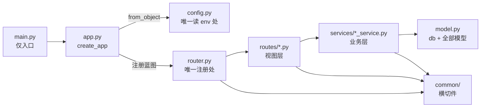

# 校园二手交易平台 · 后端骨架与契约

_版本 v1.1 · 2026-10-20 · 适用范围：`campus_backend/` 全部开发任务 · 基线：[需求分析](../../需求分析.md) v1.1 · [项目规范](../00-项目规范.md) v0.5 · 契约 [openapi.yaml](../../api/openapi.yaml) 0.1.0_

---

## 📋 文档定位

本文档是后端工程 `campus_backend/` 的**端内总纲**：只定约束——工程结构、分层与依赖方向、契约对接纪律、横切技术规则、环境隔离与质量线；**不含任何具体任务**。任务计划（做什么、验收什么）由本目录 `01-` 起的文档承担，模板与编号规则见项目规范「计划文档结构」。

### 效力顺序

| 序 | 文档 | 冲突处理 |
| --- | --- | --- |
| 1 | [需求分析](../../需求分析.md) v1.1（已确认基线） | 任何下位文档与之冲突 → 停下向用户澄清 |
| 2 | [项目规范](../00-项目规范.md) v0.5 | 本文档与之冲突时，以项目规范为准 |
| 3 | [docs/api/](../../api/) 契约（接口行为唯一事实源） | 实现与契约不符视为缺陷 |
| 4 | 本文档 | 本目录任务计划不得违反 |

### 并行开发边界

- 本工程与仓库内**其他工程目录并行开发、互不依赖**：代码、脚本、配置不得引用、读取或假设其他工程目录的任何内容；也不得以"看对方实现"为由推迟或变更本端设计。
- 对外交界只有一处：`docs/api/` 契约三件——[openapi.yaml](../../api/openapi.yaml)（REST）、[websocket-事件.md](../../api/websocket-事件.md)（Socket.IO 事件）、[CHANGELOG.md](../../api/CHANGELOG.md)（变更记录）。
- 实现中发现契约缺陷或缺项：**不得直接修改契约文件**，上报主 agent 走 `feat/api/b<批次>-<主题>` 修订流程（项目规范「API 契约规范」）；修订合入前不得按私改版本实现。

### 范围基线

- P0 + P1 全部交付；P2（FR-CHT-08 输入中提示）不实现：`typing` 事件不落地（契约仅预留命名）。
- 需求分析「反目标」四条（未认证可见商品、跨校泄漏、聊天消息仅存内存、随机冒充推荐）视为硬红线。

---

## 🧱 技术栈与工具链

| 项 | 约定 |
| --- | --- |
| 语言 / 运行时 | Python 3.12，uv 工程管理（`pyproject.toml` + `.venv`，已就绪） |
| Web 框架 | Flask：应用工厂 + 蓝图分层；实时通道 flask-socketio（批次 4 起） |
| 结构基线 | `flask-backend` 规范（项目规范决策 7）；本文档「分层与依赖方向」是其在本项目的落地版 |
| 包管理 | uv（`uv run` / `uv add`）。**任何包的安装一律由用户执行，agent 只申报** |
| 质量工具 | ruff（lint + format）、pytest |
| 启动 | `uv run python main.py`（host / port 由配置决定，主仓默认 `5000`） |

已装基线依赖：`flask` `flask-cors` `flask-sqlalchemy` `flask-migrate` `flask-jwt-extended` `python-dotenv` `pymysql` `cryptography` `pyyaml` `flask-swagger-ui`、`pytest` `ruff`（dev）、`chromadb-client` `openai` `redis` `pymongo`、`flask-socketio` `simple-websocket`、`openpyxl`。各包首次用到的批次见项目规范对照表；清单外新包须停下申报，经用户批准并安装后才能继续。

存储容器（MySQL / MongoDB / Redis / Chroma）由用户启停；agent 仅可 `docker compose ps` 与只读探活，发现未运行即报告，不得自行操作容器。

---

## 📁 目录骨架

```text
campus_backend/
├── main.py               # 仅入口：import + main()，main() 内只有 app.run()
├── pyproject.toml        # uv 工程与依赖（依赖变更仅由用户执行）
├── .env                  # 应用配置（不入 git；worktree 内按任务卡生成）
├── .env.example          # 配置模板（入 git）
├── uploads/              # 运行时上传目录（不入 git，各检出独立）
├── migrations/           # flask-migrate（Alembic）迁移脚本
├── src/
│   ├── __init__.py
│   ├── app.py            # create_app()：初始化扩展、注册蓝图与错误处理
│   ├── config.py         # 唯一读环境变量的地方
│   ├── model.py          # db = SQLAlchemy() + 全部 ORM 模型（单文件集中）
│   ├── router.py         # 唯一蓝图注册处
│   ├── common/           # 横切件（职责见「分层与依赖方向」）
│   ├── routes/           # web 层：每资源一文件，导出 bp
│   └── services/         # 业务层：业务逻辑 + 数据库操作，每资源一文件
└── tests/                # pytest，目录与 routes/ services/ 对应
```

骨架规则：

- 分层位置**只增不改**：新能力只能以 `routes/<name>.py` + `services/<name>_service.py` 成对新增，不得新造平级目录或把逻辑放错层。
- 仅两类调整需用户确认：模型数 > 15 时 `model.py` 升级为 `models/` 包；出现新的横切关注点时扩充 `common/`。
- `uploads/`、`.env`、`.venv/` 不入 git；`.env.example`、`migrations/` 入 git。

---

## ⚖️ 分层与依赖方向

最重要规则：**依赖单向、从外到内，禁止反向依赖与循环导入。**



各层职责与禁则：

| 层 | 只做 | 禁止 |
| --- | --- | --- |
| `main.py` | import 语句 + `main()`（内仅 `app.run()`）；模块级 `app = create_app()` 仅供 WSGI 引用 | 初始化扩展、注册蓝图、定义路由、任何业务逻辑 |
| `src/app.py` | 应用工厂：创建 Flask、`config.from_object`、`db.init_app`、`register_routes`、注册全局错误处理（按契约输出错误 envelope） | 定义模型 / 路由 / 业务；创建 `db` 实例（必须从 `model.py` import） |
| `src/config.py` | 加载 `.env`、集中定义全部配置项（含隔离参数）；`FLASK_ENV` 选择开发 / 生产配置 | 被其他模块绕过而直接读环境变量 |
| `src/model.py` | 顶部创建 `db`；集中定义全部模型；`__tablename__ = prefix("...")`；仅放单行数据行为（`to_dict()` 等） | import 本项目任何模块；编写业务逻辑与跨行业务查询 |
| `src/router.py` | import 各 `routes/*.bp` 并注册（`url_prefix="/api/<资源>"`） | 任何其他逻辑 |
| `src/common/` | 鉴权装饰器（`login_required` / `verified_required` / `admin_required`）、同校作用域（`scoped_query` / `scoped_key` / `g.school_id`）、统一响应封装与错误码表、分页助手、Swagger 文档路由 | import `routes/` `services/` `router.py` `app.py`；包含业务逻辑 |
| `src/routes/` | 解析 / 校验请求 → 调 service → 组装响应；蓝图统一命名 `bp` | 业务逻辑、`db.session` / SQL、`from src.app import ...`（需要当前应用用 `flask.current_app`）、抛裸异常给框架 |
| `src/services/` | 业务逻辑 + 数据库操作 + 事务边界（一个函数完成一个完整业务动作并 commit）；返回模型对象或裸数据 | 返回 Flask Response / `jsonify`；import `routes/` `router.py` |

新增资源固定顺序（审查对照项）：

1. `src/model.py`：添加模型（需要时配合迁移建表）；
2. `src/services/<name>_service.py`：实现业务函数；
3. `src/routes/<name>.py`：定义 `bp` 与视图函数；
4. `src/router.py`：加一行注册。

`main.py`、`app.py`、`config.py` 通常不动。

WebSocket 事件层（批次 4 起）遵循同一分层：事件处理器视同 routes 层——解析事件载荷 → 调 service → 组装推送；持久化与业务规则全部在 `services/`。事件名、载荷与回执以 [websocket-事件.md](../../api/websocket-事件.md) 为准。

---

## 🌐 契约对接纪律

契约现状：[openapi.yaml](../../api/openapi.yaml) v0.1.0 已定总则（统一响应体、分段错误码、分页、公共 schema、业务枚举）与批次 0 骨架接口（`/health`、`/openapi.json`、`/docs`），后续接口按其「标签规划」随批次增量追加。**本文档不复述契约内容，一切以文件为准。**

端内落地规则：

1. **统一响应**：所有接口（含错误）经 `common/` 封装输出 `{ code, message, data }`；HTTP 状态码语义与契约逐条对齐。
2. **错误码**：`common/` 维护与契约分段一致的错误码表（10xx 认证权限、20xx–60xx 各业务域、90xx 通用）；需要新码时先进契约、再进代码。
3. **准入与隔离语义**（契约已定死，实现不得偏离）：
   - 未登录 / 令牌无效 / 已注销 → 401（1001 / 1002 / 1003），注销走 `jti` 黑名单；
   - 已登录未通过校园认证访问商品域 → 403 / 1004（平台最硬准入线）；
   - 管理接口角色不符 → 403 / 1005；登录限流 → 429 / 1006；
   - 非本校资源与资源不存在**一律** 404 / 9002，不区分两种情况（防跨校探测）。
4. **分页**：`page`（从 1 起）/ `page_size`（默认 20、上限 100），容器结构按契约 `PaginatedData`。
5. **格式**：时间 ISO 8601 含 `+08:00`；金额两位小数；枚举值英文小写，中文只出现在 `message` 文案。
6. **降级可见**：依赖故障时业务仍可用的接口照常 200，`data` 内附加 `degraded: true` 与 `degraded_reason`，同时落日志。
7. **文档路由**：`GET /api/openapi.json` 读取仓库内 `docs/api/openapi.yaml`（pyyaml）转 JSON 输出；`GET /api/docs` 由 flask-swagger-ui 蓝图渲染（静态资源随包分发，离线可用）；两者必须与仓库内 yaml 保持同步。
8. **变更纪律**：契约缺陷 / 缺项 → 上报主 agent；修订合入前不得按私改版本实现。`docs/api/` 下文件只能由契约任务变更。

---

## 🛡️ 横切技术约束

贯穿全部批次的实现纪律（括号内为需求分析编号，供追溯）：

### 鉴权与角色（NFR-06）

- 全部受保护接口校验 JWT（`Authorization: Bearer`，flask-jwt-extended）；管理接口叠加角色校验。
- 管理员跨校可见，但只读与处置，不具备交易能力（不能发布商品或下单）。

### 同校隔离（AC-03）

三件套缺一不可：

1. **准入装饰器**：`@login_required` → `@verified_required`（管理接口 `@admin_required`）；
2. **作用域上下文**：请求进入即解析 `school_id` 注入 `g.school_id`，管理员置 `g.scope_all = True`；
3. **查询改写**：商品域查询只接受 `scoped_query(model)` 返回的过滤查询，**禁止裸 `Model.query`**；Chroma 查询统一注入 `school_id` 条件；Redis 键一律经 `scoped_key()` 生成（含 `school_id`）。

多校区不构成隔离边界；校区只影响展示与可选筛选。

### 数据与文件安全（NFR-05 / 07 / 08 / 09）

- 密码 bcrypt 加盐哈希，禁止明文与可逆加密。
- 数据库访问统一 ORM 参数化查询，禁止字符串拼接 SQL。
- 上传校验四件套：扩展名（jpg / png / webp）+ MIME + 大小（≤ 5 MB）+ 文件名重写为内容哈希；实体文件落 `uploads/<用途>/<年月>/`。
- 图片经鉴权路由转发访问，不暴露可枚举静态目录；学生证照片仅本人与管理员可读（越权同样 404 / 9002）。

### 日志（NFR-14）

- 关键链路输出结构化日志：请求 id、用户 id、耗时；降级与告警必须落日志。

### 一致性与降级（NFR-10 / 11，AC-17）

- 下单加锁（`lock:product:{id}`）杜绝并发双卖；
- 向量写入失败进重试队列补偿；各依赖故障按需求分析「降级策略」执行，且显式可见。

---

## ⚙️ 配置与环境隔离

### 配置读取

- 环境变量只在 `config.py` 读取一次，其他模块从 `app.config` 取值。
- `campus_backend/.env` 由 `.env.example` 复制，凭据取自根目录 `.env`（根目录那份仅供 docker-compose 变量插值，本工程**不读取、不可删移**）；两份 `.env` 均不入 git。
- 变量清单与默认值以项目规范「配置管理」为准（`FLASK_ENV` / `PORT` / `SECRET_KEY` / `JWT_EXPIRE_MINUTES`、`MYSQL_*`、`MONGO_*`、`REDIS_*`、`CHROMA_*`、`EMBEDDING_*`、`UPLOAD_DIR` / `MAX_UPLOAD_MB`、`DB_TABLE_PREFIX`）。

### worktree 隔离（防并行互踩）

| 存储 | 主仓（main） | worktree | 载体变量 |
| --- | --- | --- | --- |
| MySQL | `campus_trading`，表名无前缀 | 同库，全部表（含 Alembic 版本表）加 `<任务代号>-` 前缀；集成为 `int<批次>-` | `DB_TABLE_PREFIX` |
| MongoDB | `campus_market` | 独立库 `<MONGO_DB>_<任务代号>` | `MONGO_DB` |
| Redis | `REDIS_DB_BASE=0`（db0–3：聊天 / 评价 / 商品 / 系统） | 开发槽位 `4` / `8`，集成槽位 `12`（每组 4 库） | `REDIS_DB_BASE` |
| Chroma | `product_vectors` | 集合名加任务代号后缀 | `CHROMA_COLLECTION_SUFFIX` |
| 上传文件 | `uploads/` | worktree 自带独立 `uploads/` | 天然隔离 |

- 表前缀在 `model.py` 统一实现（`prefix()` 助手），业务代码无感知；前缀与 `school_id` 作用域正交。
- worktree 的 `.env` 按任务卡参数生成；**主仓 `.env` 永不加前缀**。
- **任务收尾必须清理**：DROP 本前缀全部 MySQL 表、删除独立 Mongo 库与 Chroma 集合（集成 worktree 同理）；主 agent 合并时核验。

### 端口

主仓 `5000`；开发槽位 `5010` / `5020`；集成 `5030`（占用情况以[进度看板](../进度看板.md)为准）。

---

## ✅ 质量基线

### 交付自检（每任务必须全绿）

```bash
uv run ruff check .   # lint 零报错
uv run pytest         # 全部通过；新功能有对应测试
```

- 测试放 `tests/`，目录结构与 `routes/` `services/` 对应；断言覆盖主路径与异常路径（含 401 / 403 / 404 反例场景）。
- 提交粒度清晰、信息规范（`feat:` / `fix:` + 模块）；无调试遗留物。

### DoD 要点（完整表见项目规范「DoD 与审查清单」）

未安装清单外包；未直接修改契约文件；实现与 `openapi.yaml` 一致；flask-backend 分层与依赖方向合规；隔离三件套落实；worktree 隔离参数正确且收尾清理完成。

### 审查对照（审查 agent 逐项过）

1. 反模式清单（下节）逐条零命中；
2. 契约一致性：路径 / 方法 / 状态码 / 响应结构 / 分页逐条对齐；
3. 隔离与安全：403 / 404 语义、缓存键含 `school_id`、bcrypt、上传四件套、参数化查询、管理接口角色校验；
4. 测试质量：断言有效、覆盖主路径与异常路径。

---

## 🚫 反模式清单（审查逐条对照）

| 反模式 | 正确做法 |
| --- | --- |
| `main.py` 出现 `create_app` 之外的逻辑 | 全部移进 `app.py` 或对应层 |
| 视图函数写 `db.session` / SQL / 业务逻辑 | 移到对应 service |
| service 返回 `jsonify(...)` / Response | service 返回数据，routes 组装响应 |
| `db = SQLAlchemy()` 写在 `app.py` | 只在 `model.py` 顶部创建 |
| `model.py` import 项目内模块 | model 零项目内依赖 |
| 到处 `os.getenv(...)` | 环境变量只在 `config.py` 读一次 |
| 所有路由堆在一个文件 | 按资源拆 `routes/` |
| `routes/` 里 `from src.app import ...` | 用 `flask.current_app` |
| `common/` 反向 import routes / services / router | common 是横切底层，只被引用 |
| 业务代码裸 `Model.query`、自拼缓存键 | 一律 `scoped_query()` / `scoped_key()` |
| 非本校与不存在返回不同语义 | 统一 404 / 9002，防探测 |
| `.env` 提交 git；主仓 `.env` 加前缀 | 只提交 `.env.example`；前缀只进 worktree `.env` |
| worktree 收尾不清理隔离数据 | DROP 表、删库、删集合后再并入 |
| 绕过契约私改接口行为 / 直接改契约文件 | 上报主 agent 走契约修订流程 |

---

## 📎 与任务计划的衔接

- 本目录 `01-` 起为任务计划（如 `01-用户模块.md`），只写"做什么"：目标与范围、FR / NFR 编号、前置条件（契约节选、环境参数）、验收标准、审查重点（模板见项目规范「计划文档结构」）。
- 任务计划与本档冲突 → 以本档为准；本档与项目规范冲突 → 以项目规范为准。
- 分支命名（`feat/be/b<批次>-<模块>`）、worktree、汇报停等与审查循环均按项目规范执行；每个任务开工前必读本档 + 当批契约节选。
