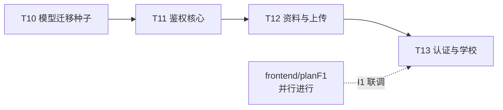

# planB1 · 后端：用户认证与学校

_课程设计项目 · 2026-10-19 · 版本 v1.0 · 状态：待执行_

> **定位**：backend 线第一个域计划。用户域与校园域的后端全量实现，是后续全部域的依赖地基（JWT / `g.school_id` / 图片上传为横切件）。
> **上游**：[plan0](../plan0-项目规范.md)（v1.3）· [plan2](../plan2-API契约.md)（T07 已定稿）· [plan1](../plan1-基础设施与工程基线.md) T02/T04 已合并
> **对端**：[frontend/planF1](../frontend/planF1-框架布局与鉴权流.md) —— 与本计划**并行**，互不依赖，于**联调点 I1** 汇合（plan0 §12.3）。

---

## 0. 目标与范围

### 目标

1. FR-USR-01 ~ FR-USR-10 的后端全部实现（FR-USR-11 用户主页在 planB4，依赖商品与评价数据）；
2. 建立三项横切能力，供 B2+ 全线复用：JWT 鉴权链（`@login_required` / `@verified_required` / `g.school_id` 注入）、统一图片上传、Redis 系统库（db3 黑名单与限流键）；
3. 校园域模型（schools / campuses）与公开查询落地，认证申请流闭环到"提交与查询"（**审核动作属 planB6**）。

### 范围内

`models/campus.py`、`models/user.py`（含 `Image`）、首个业务迁移、种子填充（campus + user 域）、注册/登录/登出/密码重置/限流、个人资料与头像、统一上传、认证申请、学校公开列表、本域 pytest。

### 范围外（明确不做）

- 认证审核、封禁、撤销（B6）；`GET /api/users/{id}` 用户主页（B4）；
- 商品及之后全部域；敏感词；Embedding 任何逻辑；
- `scoped_query` 的商品域改写（B2 落地，本计划只留骨架不启用）。

---

## 1. 契约引用（锚点 = `docs/api/openapi.yaml`）

`/api/auth/register` · `/api/auth/login` · `/api/auth/logout` · `/api/auth/password/reset` · `/api/users/me`（GET/PUT）· `/api/users/me/password` · `/api/users/me/avatar` · `/api/uploads`（POST）· `/api/uploads/{id}`（GET）· `/api/certification/applications`（POST）· `/api/certification/applications/mine` · `/api/schools`；WS 不涉及。

## 2. 对端对应关系

| 本计划任务 | 对端消费 | 汇合点 |
| --- | --- | --- |
| T11 鉴权核心 | F1·T41 鉴权流页面 | I1 |
| T12 资料与上传 | F1·T42 个人中心/认证提交 | I1 |
| T13 认证申请与学校 | F1·T42 认证提交页 | I1 |

---

## 3. 任务卡（线内串行：T10 → T11 → T12 → T13）

### T10 数据模型、迁移与种子

- **目标**：用户域 + 校园域 ORM 与首个业务迁移；种子框架填充本域数据
- **前置依赖**：plan1 T02（骨架）、T04（种子框架）已合并
- **required_skills**：flask-backend
- **owns**：`campus_backend/src/models/campus.py`、`campus_backend/src/models/user.py`、`campus_backend/migrations/versions/<首个业务迁移>`、`scripts/seedlib/campus_user.py`
- **reads**：需求 §数据设计（用户与校园域 ER 图、索引要点）；plan2 schemas（User/School/Campus/AuthApplication/Image 字段口径）
- **forbidden**：`campus_backend/src/routes/**`、`campus_backend/src/services/**`、`campus_frontend/**`、`docs/**`
- **验收标准**：
  1. 五张表（schools / campuses / users / auth_applications / images）字段与需求 ER 图一致，唯一索引 `uk_username`、`uk_student_no`、`idx_school_auth` 就位；
  2. `uv run flask --app src.app db upgrade && … db downgrade && … db upgrade` 全部可执行，`db heads` 单头；
  3. `uv run python ../scripts/seed.py --only campus,user` 幂等：连跑两遍，各表行数不变；含 3 校（2 多校区共 5–6 校区、1 单校区）、2 管理员、每校 5 学生（覆盖 unverified / pending / approved / rejected 四态）、头像与学生证占位图落 `uploads/`；
  4. 枚举值集中于 `common/constants.py`，与 plan2 §2 枚举表逐字一致；
  5. `uv run pytest -q` 全绿（模型层冒烟：唯一约束冲突用例至少 2 个）。
- **门禁命令**：§9 L1 + L2（迁移单头）
- **交付物**：代码 + 迁移 + 种子模块 + 报告
- **规模预期**：约 400 行

### T11 鉴权核心

- **目标**：FR-USR-01/02/03/06 + NFR-05/06；JWT 链与限流、黑名单
- **前置依赖**：T10
- **required_skills**：flask-backend
- **owns**：`campus_backend/src/routes/auth.py`、`campus_backend/src/services/auth_service.py`、`campus_backend/src/common/decorators.py`、`campus_backend/tests/test_auth.py`
- **reads**：plan2 锚点（§1 认证四接口）；需求 §角色与权限；plan0 §6.2
- **forbidden**：`campus_backend/src/models/**`、`migrations/**`、`campus_frontend/**`
- **验收标准**：
  1. 注册：用户名/学号重复返回 409（`USR1002/USR1003`）；密码弱返回 400 且 message 含字段名；成功返回 201 envelope；
  2. 登录：用户名或学号均可；JWT 载荷含 `sub/role/auth_status/jti/exp`；**连续 5 次失败后第 6 次返回 429**（Redis db3 `rate:login:{ip}`，TTL 10 分钟，经 `scoped_key`）；
  3. 登出：`jti` 入黑名单（TTL=令牌剩余期），此后同 token 调 `/api/users/me` 返回 401；
  4. 密码重置：用户名+学号 或 用户名+注册邮箱 匹配方可重置；不匹配 404（不暴露存在性）；重置后旧密码失效；
  5. 密码 bcrypt 加盐（NFR-05），日志无明文密码；
  6. `@login_required` 装饰器就位并单测（无 token 401 / 过期 401 / 黑名单 401）；
  7. `uv run pytest tests/test_auth.py -q` 全绿；smoke.py 认证组断言 PASS。
- **门禁命令**：§9 L1 + L2
- **规模预期**：约 350 行

### T12 个人资料与统一上传

- **目标**：FR-USR-04/05 + FR-GDS-11 的通用半边；统一上传供全线复用
- **前置依赖**：T11
- **required_skills**：flask-backend
- **owns**：`campus_backend/src/routes/users.py`、`campus_backend/src/routes/uploads.py`、`campus_backend/src/services/user_service.py`、`campus_backend/src/services/upload_service.py`、`campus_backend/tests/test_users.py`、`campus_backend/tests/test_uploads.py`
- **reads**：plan2 锚点（§1 用户与上传五接口）；需求 §图片；plan0 §6.2
- **forbidden**：`models/**`、`migrations/**`、`campus_frontend/**`
- **验收标准**：
  1. GET/PUT `/api/users/me`：昵称/邮箱/手机号可改，用户名与学号不可改（尝试改返回 400）；`display_name` 只读返回；
  2. 修改密码：原密码错 401（`USR1004`），成功后旧 token 不失效、新密码可登录；
  3. `POST /api/uploads`：仅 jpg/png/webp、≤5MB（超限 400 `SYS1001`）、文件名重写为 sha256、落 `uploads/<用途>/<年月>/`、images 表落库；`purpose` 不合法 400；
  4. `GET /api/uploads/{id}` 按权限矩阵：avatar→任何登录用户；student_card→**仅本人与管理员，他人 404**（NFR-08）；product/chat→仅认证学生（未认证 403）；
  5. 头像设置接口接受 `image_id` 并校验 purpose=avatar；
  6. pytest 两文件全绿，含越权读取学生证用例。
- **门禁命令**：§9 L1 + L2
- **规模预期**：约 350 行

### T13 校园认证申请与学校查询

- **目标**：FR-USR-07/08/09/10 + 学校公开列表；认证状态机"提交侧"闭环
- **前置依赖**：T12
- **required_skills**：flask-backend
- **owns**：`campus_backend/src/routes/certification.py`、`campus_backend/src/routes/schools.py`、`campus_backend/src/services/certification_service.py`、`campus_backend/src/services/school_service.py`、`campus_backend/tests/test_certification.py`
- **reads**：plan2 锚点（§1 认证申请与学校三接口）；需求 §校园认证、§学校与校区
- **forbidden**：`models/**`、`migrations/**`、`campus_frontend/**`
- **验收标准**：
  1. 提交申请：申请学号 ≠ 注册学号返回 400（`USR1005`，防代认证）；多校区学校未选校区 400；单校区学校校区置空；已有 pending 申请再提交 409；rejected 后重提生成**新记录**且历史保留（FR-USR-09）；
  2. `GET /mine` 返回全部历史申请（倒序）与当前状态；rejected 带 `reject_reason`；
  3. 状态机合法迁移单测覆盖：unverified→pending、rejected→pending、pending→*（转mock仅测服务层拒绝非法提交，approved 落库由 B6 审核触发——本任务只提供 `approve(application, admin)` 服务函数供 B6 调用，含 `display_name` 重算：`昵称-学校` 或 `昵称-学校(校区)`（AC-04））；
  4. `GET /api/schools` **无需登录**：仅返回启用学校，多校区含校区列表，单校区校区为空数组；
  5. 未登录调受保护接口 401、登录未认证调认证外接口不拦截（本域无 403 场景，商品域 403 在 B2 验证）；
  6. pytest 全绿。
- **门禁命令**：§9 L1 + L2
- **规模预期**：约 300 行

---

## 4. 依赖与顺序

线内严格串行（迁移任务同时最多 1 个，plan0 §5.7）；每张卡走 plan0 §5 完整审查循环。

## 5. 验收映射

| 需求/验收 | 承载 |
| --- | --- |
| FR-USR-01~10（除 11） | T10–T13 |
| AC-04 展示名格式 | T13（生成）+ F1（展示） |
| AC-05 认证闭环（提交半边） | T13（审核半边 B6，闭环 I4 验） |
| NFR-05 bcrypt / NFR-06 JWT 校验 | T11 |
| NFR-07 上传校验 / NFR-08 学生证越权 | T12 |

## 6. 退出条件

1. T10–T13 全部 `merged`，L1/L2 在 main 全绿；
2. I1 联调点通过（检查单见 plan0 §12.3，含前端关 mock 全真实链路）；
3. 交付的 `@login_required`、`POST /api/uploads`、`scoped_key` 可被 B2 直接复用，无已知阻塞项。

## 7. 风险

| 风险 | 对策 |
| --- | --- |
| JWT 载荷设计不当导致 B2+ 反复改 | 载荷字段以 plan2 §2 为准，T11 验收 2 锁死 |
| 上传目录权限/路径穿越 | sha256 重命名 + purpose 白名单 + 测试含 `../` 用例 |
| 种子密码哈希慢（bcrypt 17 账号） | 种子用低 cost rounds 并注明，仅演示环境 |
