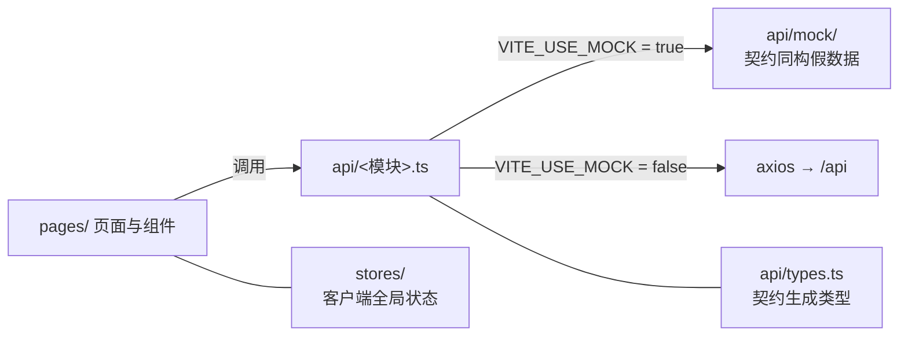

# 校园二手交易平台 · 前端骨架与契约

_版本 v1.1 · 2026-10-20 · 适用范围：`campus_frontend/` 全部开发任务 · 基线：[需求分析](../../需求分析.md) v1.0 · [项目规范](../00-项目规范.md) v0.5 · 契约 [openapi.yaml](../../api/openapi.yaml) 0.1.0_

> 变更（v1.1）：环境变量拆为三开关（`VITE_API_BASE` 与 `VITE_PROXY_TARGET` 语义分离），修订依据为批次 0 联调 P1 缺陷；对应提交 `6911e6bf`。

---

## 📋 文档定位

本文档是前端工程 `campus_frontend/` 的**端内总纲**：只定约束——工程结构、数据流、契约消费纪律、设计规范（frontend-designer）、环境与质量线；**不含任何具体任务**。任务计划（做什么、验收什么）由本目录 `01-` 起的文档承担，模板与编号规则见项目规范「计划文档结构」。

### 效力顺序

| 序 | 文档 | 冲突处理 |
| --- | --- | --- |
| 1 | [需求分析](../../需求分析.md) v1.0（已确认基线） | 任何下位文档与之冲突 → 停下向用户澄清 |
| 2 | [项目规范](../00-项目规范.md) v0.5 | 本文档与之冲突时，以项目规范为准 |
| 3 | [docs/api/](../../api/) 契约（接口行为唯一事实源） | 实现与契约不符视为缺陷 |
| 4 | 本文档 | 本目录任务计划不得违反 |

### 并行开发边界

- 本工程与仓库内**其他工程目录并行开发、互不依赖**：组件、页面、脚本不得引用或假设其他工程目录的任何内容；接口行为一律以契约为准，不做任何"对方大概会这样实现"的假设。
- 对外交界只有一处：`docs/api/` 契约三件——[openapi.yaml](../../api/openapi.yaml)（REST）、[websocket-事件.md](../../api/websocket-事件.md)（Socket.IO 事件）、[CHANGELOG.md](../../api/CHANGELOG.md)（变更记录）。
- 开发中发现契约缺陷或缺失字段：**不得直接修改契约文件**，也不得在代码里绕过契约自造字段 / 路径；上报主 agent 走契约修订流程，变更合入后先更新生成类型与 mock，再改页面。

### 范围基线

- P0 + P1 全部交付；P2（FR-CHT-08 输入中提示）不实现：界面不出现"正在输入"类功能点（契约已将 `typing` 标记为仅预留命名）。
- 需求分析「反目标」中与界面相关的条目（未认证可见商品入口、跨校内容出现）视为红线：入口与展示层不得提供任何绕过途径。

---

## 🧱 技术栈与工具链

| 项 | 约定 |
| --- | --- |
| 框架 | React 19 + TypeScript（strict）+ Vite；脚手架已就绪，以已装版本为准、不降级 |
| 包管理 | pnpm（禁用 npm）。**任何包的安装一律由用户执行，agent 只申报** |
| 路由 | react-router-dom（路由表集中 + 守卫） |
| UI 组件库 | antd（配 dayjs）；主题经 `ConfigProvider` 对齐设计令牌 |
| 客户端状态 | zustand（仅存客户端全局态） |
| HTTP | axios（只允许出现在 `src/api/`） |
| WebSocket | socket.io-client（**批次 4 起才允许接入**，契约见 [websocket-事件.md](../../api/websocket-事件.md)） |
| 类型生成 | openapi-typescript（dev 依赖）：由契约生成 `src/api/types.ts` |
| 质量工具 | `pnpm build`（tsc + vite）零错误；oxlint 零报错；暂不引入单测框架（项目规范决策 4） |

已装依赖基线与"首次用到"批次见项目规范「包管理规范」；清单外新包须停下申报，经用户批准并安装后方可使用。

---

## 📁 目录骨架

```text
campus_frontend/src/
├── api/          # 契约客户端：按契约 tag 一模块一文件；types.ts 为生成物；mock/ 为契约同构假数据
├── components/   # 跨页面通用组件（Button / Card / Input 等，按可达性模式实现）
├── layouts/      # 布局：用户端布局、管理端布局
├── pages/        # 页面，按模块分目录（auth/ product/ order/ chat/ admin/ …）
├── router/       # 路由表与四态守卫；路由级 lazy 分割
├── stores/       # 全局客户端状态（zustand，如 authStore）
├── hooks/        # 自定义 hooks
├── types/        # 业务类型入口（仅 re-export 生成的契约类型）
├── utils/        # 纯函数工具（时间 / 金额格式化等）
└── styles/       # 全局样式与 tokens.css（设计令牌）
```

骨架规则：

- 职责不串位：请求只在 `api/`；通用组件不含业务语义；页面不直接发请求、不手写契约类型。
- 新增页面进 `pages/<模块>/`；通用组件以"跨页面复用"为准入条件，避免 `components/` 膨胀。
- `node_modules/` 不入 git；worktree 检出后先 `pnpm install` 恢复依赖，不得借机引入新包。

---

## 🔀 数据流与分层规则



1. **请求只经 `src/api/`**：组件、页面、hooks 一律不得出现 `fetch` / `axios`；api 模块按契约 tag 划分文件（`auth.ts`、`users.ts`、`products.ts`…），函数签名直接消费生成类型。
2. **类型只来自生成物**：`openapi-typescript docs/api/openapi.yaml -o src/api/types.ts` 脚本化进 `package.json`；契约更新后重新生成；`types/` 只做 re-export。组件禁止手写契约结构、禁止 `any` 与非必要 `as`。
3. **mock 同构**：`VITE_USE_MOCK=true` 时 api 层切换到 `mock/`，数据结构与契约 schema 一致——这是并行开发的支撑机制；契约变更必须同步 mock，漂移视为阻断缺陷。
4. **状态分层**：服务器数据以"请求 → 页面局部状态"为主；仅登录态等客户端全局态进 `stores/`（zustand），禁止把接口缓存散落成多个 store。
5. **路由与守卫**：路由表集中在 `router/`；按权限矩阵四态守卫（见下表）；路由级 `React.lazy` + `Suspense` 代码分割。

### 路由四态（权限矩阵的界面落点）

| 态 | 判定 | 可访问 |
| --- | --- | --- |
| 游客 | 未持有令牌 | 注册 / 登录 / 找回密码、学校与校区查询 |
| 未认证用户 | 已登录且认证状态 ≠ approved | 个人信息、认证提交与状态；商品域一律不可见（入口拦截） |
| 认证学生 | 已登录且 approved | 全部用户端功能（本校范围） |
| 管理员 | role = admin | 管理端页面；不出现发布 / 下单入口 |

- 守卫在**路由层与页面入口双层**生效；认证状态与角色以接口返回的用户信息为准，不本地推测。
- 令牌失效（契约 1002）→ 清除本地令牌并引导重新登录；未通过校园认证（1004）→ 引导前往认证页。

---

## 🌐 契约消费纪律

契约现状：[openapi.yaml](../../api/openapi.yaml) v0.1.0 已定总则（响应外层、分段错误码、分页、公共 schema、业务枚举）与批次 0 骨架接口（`/health`、`/openapi.json`、`/docs`），后续接口按其「标签规划」随批次增量追加。**本文档不复述契约内容，一切以文件为准。**

消费规则：

1. **响应外层** `{ code, message, data }`：`code != 0` 必须产生用户可见反馈（提示文案或表单字段错误），不得静默吞掉。
2. **错误码处理至少覆盖**：1002 清令牌引导登录；1004 引导完成校园认证；9001 展示字段级错误（`data.fields`）；9003 展示状态冲突提示；1006 / 9006 展示限流提示。
3. **分页**：列表页统一 `page` / `page_size`（默认 20、上限 100），分页容器字段按契约 `PaginatedData`。
4. **格式**：时间 ISO 8601（`+08:00`）经 dayjs 解析后展示；金额 number 保留两位小数；枚举值英文小写，中文只做展示映射，不得改写值本身。
5. **降级可见**：`data.degraded = true` 时展示降级提示（含 `degraded_reason`），不阻断页面可用。
6. **图片**：一律使用契约 `ImageRef.url`（同源鉴权相对路径），不得拼接、猜测其他地址；上传走 `multipart/form-data`、单文件 ≤ 5 MB、仅 jpg / png / webp，提交前做客户端预检，最终以接口校验为准。
7. **WebSocket**：批次 4 前不得依赖任何 `C → S` 事件；接入时握手（`auth: { token }`）、重连与 `connect_error` 处理按 [websocket-事件.md](../../api/websocket-事件.md)；`typing` 为 P2，界面不得实现或展示。
8. **变更纪律**：契约缺陷 / 缺项 → 上报主 agent；变更合入后先重新生成 `types.ts` 并同步 mock，再改页面。

---

## 🎨 前端设计规范（frontend-designer，强制）

以下基线为全部前端任务的实现与审查标准（已纳入 DoD 与审查清单）。

### 设计令牌（styles/tokens.css）

- 色彩、间距（8px 基）、字号阶、圆角、阴影、过渡时长统一定义为 CSS 自定义属性。
- antd 主题经 `ConfigProvider` 对齐令牌（品牌色、圆角、字号）。
- **组件内禁止硬编码色值与魔法间距**；暗色模式经令牌切换支持。

### 可达性（WCAG 2.1 AA）

- 语义化 HTML；交互控件键盘可达，`:focus-visible` 焦点样式可见；触控目标 ≥ 44px。
- 图标按钮带 `aria-label`；加载态 `aria-busy`；错误提示 `role="alert"`。
- 表单 `label` 与控件 `id` 关联，`aria-invalid` / `aria-describedby` 齐全。
- 文本色彩对比度达 AA；图片一律有 `alt`。

### 移动优先响应式

- 从 320px 起设计可用，断点 768px / 1024px 渐进增强。
- 栅格优先 `grid auto-fit` / flex；文字尺寸用相对单位；列表与宫格在窄屏自动减列，不出横向滚动。

### 组件模式

- 组合优于继承；props 驱动变体（variant / size）。
- 每个通用组件完整处理 `loading` / `disabled` / `error` 三态。
- Modal 管理焦点：打开时聚焦首个可聚焦元素，关闭时还原焦点，标记 `aria-modal`。

### 状态呈现

- 每个数据页面四态齐备：加载中、空态、错误（可重试）、正常。
- 错误反馈用户可见（对应「契约消费纪律」第 1 条）。

### 性能基线

- 路由级 `React.lazy` + `Suspense` 代码分割。
- 图片 `loading="lazy"` + `decoding="async"` 且有 `alt`。
- 不引入未使用的大体积依赖；构建产物异常膨胀须在自检中说明。

---

## ⚙️ 配置与环境

| 变量 | 作用 |
| --- | --- |
| `VITE_USE_MOCK` | `true` 走 `api/mock/`（契约未就绪的开发期默认）；`false` 走真实接口。**联调前置 `false`**，否则看似连通实为假数据 |
| `VITE_API_BASE` | axios 基址（**含 `/api` 后缀**）；留空 = 同源 `/api`（dev 由 vite 代理转发）。直连/生产填 `http://host:port/api`；**禁止填纯主机地址**（会缺 `/api` 前缀） |
| `VITE_PROXY_TARGET` | **仅 dev server** 的代理目标（`/api` 与 `/socket.io`），默认 `http://127.0.0.1:5010`；不进入构建产物 |

> ⚠️ `VITE_API_BASE` 与 `VITE_PROXY_TARGET` 语义不同、不可混用：前者是浏览器端请求基址（会被打进产物），后者只在开发服务器生效。批次 0 联调曾因两者混用导致请求缺 `/api` 前缀而 404（P1），已修复。

- 前端无其他必需环境变量；不得在代码里写死接口地址。
- dev server 显式绑定 `127.0.0.1`（不绑定则 Node 可能只听 `[::1]`，`127.0.0.1` 直连被拒）；联调命令统一用 `127.0.0.1` 字面地址。
- 端口：主仓 `5173`；开发槽位 `5180` / `5190`；集成 `5200`（占用情况以[进度看板](../进度看板.md)为准）。
- `node_modules/` 不入 git；worktree 检出后 `pnpm install` 恢复，不新增包。

---

## ✅ 质量基线

### 交付自检（每任务必须全绿）

```bash
pnpm build   # tsc + vite 构建通过
oxlint       # 零报错（命令以工程脚本为准）
```

- 提交粒度清晰、信息规范（`feat:` / `fix:` + 模块）；无调试遗留（console.log、注释掉的代码）。

### DoD 要点（完整表见项目规范「DoD 与审查清单」）

未安装清单外包；未直接修改契约文件；请求仅出自 `src/api/` 且类型来自生成物；路由守卫符合四态；mock 与契约同步；设计规范基线（可达性 / 令牌 / 响应式 / 性能）满足。

### 审查对照（审查 agent 逐项过）

1. 类型纪律：无契约外私改字段、`any` / `as` 滥用；组件不含请求逻辑；全局状态不散落。
2. 四态守卫在路由与页面入口均正确拦截。
3. 错误处理：`code != 0` 有用户可见反馈；加载 / 空态齐全。
4. mock 数据结构与契约一致。
5. 可达性、响应式与令牌、性能（见「前端设计规范」节）逐项过。

---

## 🚫 反模式清单（DON'T）

| 反模式 | 正确做法 |
| --- | --- |
| 组件 / 页面里直接 `fetch` / `axios` | 一律走 `src/api/` 模块 |
| 手写接口类型、私改生成类型 | 重新生成 `types.ts`，`types/` 只 re-export |
| `any` / 滥用 `as` 绕过类型 | 按契约类型修正数据流 |
| mock 与契约漂移 | 契约变更即同步 mock |
| 硬编码色值 / 魔法间距 / 写死接口地址 | `tokens.css` 令牌 + `VITE_API_BASE` |
| div 当按钮、缺焦点样式、图标按钮无 `aria-label` | 语义化控件 + 无障碍属性 |
| 图片缺 `alt` / 不懒加载 | `loading="lazy"` + `alt` |
| 数据页缺加载 / 空 / 错误态 | 四态齐备 |
| `code != 0` 静默吞掉 | 用户可见反馈 |
| 路由只在单层拦截或无守卫 | 路由 + 页面入口双层四态守卫 |
| 引入清单外包、实现 P2 功能点（如"正在输入"） | 先申报；P2 从界面移除 |

---

## 📎 与任务计划的衔接

- 本目录 `01-` 起为任务计划（如 `01-用户界面.md`），只写"做什么"：目标与范围、FR / NFR 编号、前置条件（契约节选、环境参数）、验收标准、审查重点（模板见项目规范「计划文档结构」）。
- 任务计划与本档冲突 → 以本档为准；本档与项目规范冲突 → 以项目规范为准。
- 分支命名（`feat/fe/b<批次>-<界面>`）、worktree、汇报停等与审查循环均按项目规范执行；每个任务开工前必读本档 + 当批契约节选。
