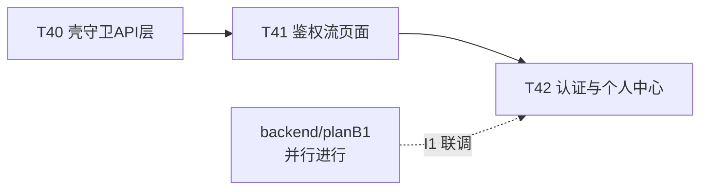

# planF1 · 前端：框架布局与鉴权流

_课程设计项目 · 2026-10-19 · 版本 v1.0 · 状态：待执行_

> **定位**：frontend 线第一个域计划。应用壳、路由守卫、API 层与鉴权流全部页面，建立前端全线复用的地基（client.ts / 守卫 / 设计令牌落地页）。
> **上游**：[plan0](../plan0-项目规范.md)（v1.3）· [plan2](../plan2-API契约.md)（T07 已定稿）· [plan1](../plan1-基础设施与工程基线.md) T03 已合并
> **对端**：[backend/planB1](../backend/planB1-用户认证与学校.md) —— 与本计划**并行**，互不依赖，于**联调点 I1** 汇合。

---

## 0. 目标与范围

### 目标

1. FR-USR-01 ~ FR-USR-10 的前端全部页面（注册 / 登录 / 忘记密码 / 个人中心 / 认证提交与状态）；
2. 建立三项横切能力，供 F2+ 复用：`api/client.ts`（envelope 解包 + 401/403/404/5xx 全局处理）、路由守卫（`RequireLogin` / `RequireVerified`）、登录态 store（token 持久化 + 当前用户 query）；
3. 应用壳（顶栏 / 语义布局 / skip link）与认证引导体验：未认证访问商品域入口时**跳转引导页并说明原因**（plan0 §6.3）。

### 范围外（明确不做）

- 商品 / 搜索 / 推荐 / 交易 / 聊天 / 管理的一切页面（F2–F5）与路由占位以外的实现；
- 消息中心、通知（F4）；
- WebSocket 任何逻辑（F4）。

---

## 1. 契约引用（锚点 = `docs/api/openapi.yaml`）

`/api/auth/register` · `/api/auth/login` · `/api/auth/logout` · `/api/auth/password/reset` · `/api/users/me`（GET/PUT）· `/api/users/me/password` · `/api/users/me/avatar` · `/api/uploads`（POST）· `/api/certification/applications`（POST）· `/api/certification/applications/mine` · `/api/schools`。

## 2. 对端对应关系

| 本计划任务 | 对端实现 | 汇合点 |
| --- | --- | --- |
| T41 鉴权流页面 | B1·T11 | I1 |
| T42 认证与个人中心 | B1·T12/T13 | I1 |

## 3. mock 边界（本线特有字段，plan0 §12）

- B1 合并前：`VITE_USE_MOCK=true` 时 `api/` 层返回手写 mock（每接口最小可用数据 + 一个错误分支），mock 实现放 `src/api/mocks/`，**生产构建剔除**（动态 import + 环境守卫）；
- mock 数据结构必须逐字段对照 openapi schema，不得凭感觉造——mock 本身就是前端对契约的第一次消费；
- B1 合并后：`VITE_USE_MOCK=false` 走真实接口，I1 联调全程真实。

---

## 4. 任务卡（线内串行：T40 → T41 → T42）

### T40 应用壳、守卫与 API 层

- **目标**：全线复用的三项横切能力 + 应用壳
- **前置依赖**：plan1 T03 已合并
- **required_skills**：frontend-designer
- **owns**：`campus_frontend/src/api/client.ts`、`campus_frontend/src/api/types.ts`、`campus_frontend/src/store/auth.ts`、`campus_frontend/src/components/AppLayout.tsx`、`campus_frontend/src/components/guards.tsx`、`campus_frontend/src/App.tsx`、`campus_frontend/src/api/mocks/**`
- **reads**：plan2 §2 全局约定（envelope/分页/错误映射）；plan0 §6.3
- **forbidden**：`campus_backend/**`、`docs/**`、业务页面文件
- **验收标准**：
  1. `client.ts`：自动附 Bearer 头；解包 envelope，`code≠0` 抛业务错误（含 code/message）；**401 清 token 跳 `/login?next=`；403 跳 `/certify?reason=`；404 渲染空态；5xx 全局 message 提示**（plan0 §6.3 逐条落地）；请求失败有 request_id 透传（响应头有则记录）；
  2. 守卫：`RequireLogin`（未登录重定向并带 next）、`RequireVerified`（未认证重定向 `/certify`，页面说明原因 + 入口按钮）；管理员路由占位（F5 填充）；
  3. `auth.ts`：token 持久化（localStorage），当前用户 React Query（`/users/me`），登出清缓存并跳首页；
  4. AppLayout：顶栏（logo、商品入口占位、消息图标占位带 aria-label、用户菜单含登出）、skip link、`<main>` 语义结构、焦点样式可见；
  5. 错误码→界面文案映射表 `src/api/errorText.ts`（`USR1001`→中文提示），未知码兜底显示 message；
  6. `pnpm lint && pnpm typecheck && pnpm format:check && pnpm build && pnpm test --run` 全绿；client.ts 单测覆盖 401/403/404/5xx 四分支（vitest mock fetch）。
- **门禁命令**：§9 L1
- **规模预期**：约 450 行
- **备注**：`VITE_USE_MOCK` 的默认值在 `.env.example` 与 `.env.development` 中显式写出。

### T41 鉴权流页面

- **目标**：FR-USR-01/02/03/06 前端
- **前置依赖**：T40
- **required_skills**：frontend-designer
- **owns**：`campus_frontend/src/pages/Login.tsx`、`src/pages/Register.tsx`、`src/pages/ForgotPassword.tsx`、`src/api/auth.ts`、相关 `.types.ts` / 测试
- **reads**：plan2 锚点（认证四接口）；需求 FR-USR-01/02/03/06
- **forbidden**：`campus_backend/**`、`src/api/client.ts`（只读消费）
- **验收标准**：
  1. 注册：用户名/学号/邮箱/密码必填，密码强度前端提示（≥8 位含字母数字），确认密码一致校验；提交冲突（409）时按错误码区分"用户名已存在/学号已存在"文案；
  2. 登录：用户名或学号单输入框；错误提示不区分"账号不存在/密码错误"；429 时提示限流与剩余时间；
  3. 忘记密码：用户名 + （学号或邮箱二选一）→ 设置新密码；成功跳登录；
  4. 登出：菜单触发，调 logout 接口（失败也本地清态）；
  5. 三态齐全：每页提交有 loading、失败有 message、成功有跳转；
  6. 表单可访问性：label 关联、错误提示 `aria-describedby`、提交按钮 ≥44px；
  7. 门禁全绿 + 每页至少 1 个组件测试（成功与失败两分支）。
- **门禁命令**：§9 L1
- **规模预期**：约 400 行

### T42 认证提交与个人中心

- **目标**：FR-USR-04/05/07/08/09/10 前端
- **前置依赖**：T41
- **required_skills**：frontend-designer
- **owns**：`campus_frontend/src/pages/Certify.tsx`、`src/pages/Profile.tsx`、`src/api/certification.ts`、`src/api/schools.ts`、`src/api/user.ts`、`src/api/uploads.ts`、相关测试
- **reads**：plan2 锚点（认证申请/学校/用户/上传）；需求 §校园认证、§学校与校区
- **forbidden**：`campus_backend/**`
- **验收标准**：
  1. 认证引导页：说明"完成校园认证后才能浏览与交易"并给提交入口（plan0 §6.3 的 403 落点）；
  2. 认证提交：学校下拉（仅启用学校）→ 多校区学校出现校区下拉（必选），单校区隐藏；真实姓名；学生证图片上传（预览、5MB/格式前端校验、复用 `api/uploads`）；学号一致性前端先校验（与注册学号不同则禁提交并说明）；驳回态展示 `reject_reason` 与重提入口；
  3. 认证状态页四态：unverified（引导提交）/ pending（等待审核文案）/ approved（展示名 `昵称-学校(校区)`，AC-04）/ rejected（原因 + 重提）；
  4. 个人中心：资料编辑（用户名/学号只读灰显）、头像上传替换、修改密码（原密码错误显示后端 message）；
  5. 三态齐全 + 可访问性（同 T41 标准）；
  6. 门禁全绿 + 组件测试（校区级联逻辑、驳回重提分支）。
- **门禁命令**：§9 L1
- **规模预期**：约 500 行

---

## 5. 依赖与顺序

## 6. 验收映射

| 需求/验收 | 承载 |
| --- | --- |
| FR-USR-01~10 前端半边 | T40–T42 |
| AC-04 展示名展示 | T42 |
| AC-05 提交→驳回原因展示→重提（前端） | T42 |
| plan0 §6.3 前端硬规则首批落地 | T40 |

## 7. 退出条件

1. T40–T42 全部 `merged`，L1 在 main 全绿；
2. I1 联调点通过：**关 mock**，注册→登录→me→认证提交→状态查询全程真实接口（plan0 §12.3）；
3. `client.ts` / 守卫 / `AppLayout` 可被 F2 直接复用，无已知阻塞项。

## 8. 风险

| 风险 | 对策 |
| --- | --- |
| mock 与真实契约不一致 | mock 逐字段对照 openapi schema（§3），I1 前置检查 |
| antd 表单错误展示与错误码映射脱节 | T40 的 errorText 映射表统一承载，页面不得绕过 |
| 校区级联状态边界（切学校忘清校区） | T42 组件测试覆盖"多校区→单校区切换清空"用例 |
