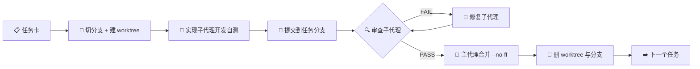
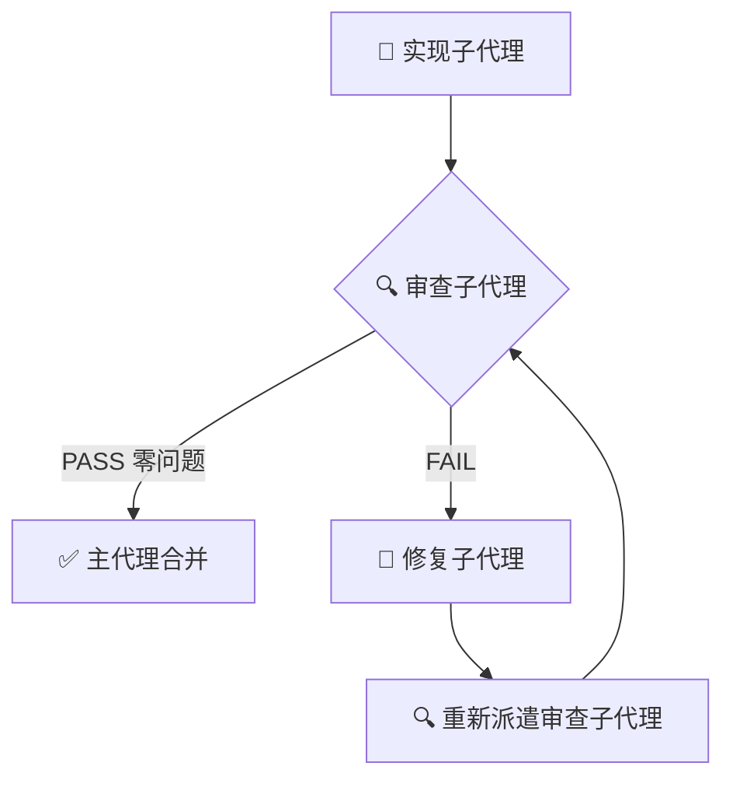

# plan0 · 项目规范

_课程设计项目 · 2026-10-19 · 版本 v1.3 · 状态：已定稿_

> **定位**：本文档规定"怎么做"，不规定"做什么"。做什么以 [`需求分析.md`](../需求分析.md) 为基线。
> **适用**：从 plan1 开始的全部开发任务，以及参与开发的每一个代理（主代理、实现子代理、审查子代理、修复子代理）。
> **效力**：用户口头指令 > 需求分析.md（需求基线）> 本文档（工程约束）> 各 plan 文档 > 代码注释。本文档与需求冲突时以需求为准，并须同步修订本文档。

---

## 0. 这份文档解决什么问题

本项目采用**主代理编排 + 子代理实现 + worktree 隔离**的开发方式。这套方式能显著提升吞吐，但它有三个典型失败模式：

| 失败模式 | 表现 | 后果 |
| --- | --- | --- |
| 各自为政 | 两个子代理改同一个文件、同一条路由、同一个迁移 | 合并冲突，返工 |
| 自说自话 | 子代理报告"已完成"，但没有可复现的证据 | 无法验收，问题后置到演示现场 |
| 环境污染 | 多个 worktree 共用一个数据库、抢同一个端口 | 环境问题伪装成代码问题，排查成本极高 |

本规范的全部条款，都是对这三种失败模式的预防。**凡是不能降低这三种风险的规定，都不写进本文档。**

### 核心原则

1. **一个任务 = 一个 worktree = 一个分支 = 一次审查 = 一次合并。** 不做"顺手改一下"。
2. **没有证据的"完成"等于未完成。** 交付必须附命令输出或可观察行为。
3. **审查者独立于实现者。** 审查子代理不共享实现子代理的会话上下文。
4. **main 永远可运行。** 合并前门禁不通过就不合并，宁可回退。
5. **隔离要隔离到数据。** 只隔离代码目录、不隔离数据库的 worktree 是假隔离。

---

## 1. 交付基线

### 1.1 范围

本期交付 **P0 39 条 + P1 9 条全部实现，P2 1 条明确不实现**。

- 不允许为了"看起来完整"而实现 P2（输入中提示）。
- 不允许以"顺手"为由扩大范围；范围变更必须回写需求文档并记录在 `decisions.md`。
- 每个任务的验收标准必须能映射到 `FR-*` 或 `AC-*` 编号，映射不上的任务不予立项。

### 1.2 反目标（出现即视为失败，不是"待优化"）

- 未认证用户能看到任何商品；
- 跨校商品出现在列表、搜索或推荐中；
- 聊天消息只存在于内存或缓存中，重启即丢；
- 用纯随机结果冒充画像推荐。

### 1.3 完成定义（Definition of Done）

一个任务只有同时满足以下五条才算完成：

1. 任务卡中列出的验收标准逐条通过，且有证据；
2. 门禁命令全绿（§9）；
3. 审查子代理给出 PASS，且报告中没有未关闭的阻塞项；
4. 代码已提交在任务分支上，提交信息符合 §10；
5. 若引入了契约变更、迁移或新配置项，相关文档已同步更新。

---

## 2. 仓库结构与所有权

### 2.1 目标结构

```text
.
├── campus_backend/               Flask 应用（结构遵循 flask-backend skill）
│   ├── main.py                   入口：只有 import 与 main()，main() 里只有 app.run()
│   ├── src/
│   │   ├── app.py                应用工厂 create_app()：初始化扩展、注册路由
│   │   ├── config.py             配置中心：唯一读环境变量的地方
│   │   ├── model.py              db 实例与公共 Mixin（模型类在 models/ 包，见 D7）
│   │   ├── models/               ORM 模型，按域一文件（campus / user / product / trade / chat / admin）
│   │   ├── router.py             唯一注册蓝图的地方
│   │   ├── routes/               web 层：每资源一文件，蓝图统一命名 bp
│   │   ├── services/             服务层：业务逻辑 + 数据库操作 + 事务边界
│   │   ├── extensions.py         非 ORM 扩展：redis / mongo / chroma / socketio / jwt
│   │   ├── realtime/             Socket.IO 事件处理
│   │   ├── tasks/                定时任务（超时关单、向量重试、在线续期）
│   │   └── common/               错误码、装饰器、scope、分页、日志、响应封装
│   ├── migrations/               Alembic 迁移
│   ├── tests/                    pytest
│   ├── uploads/                  运行期图片，gitignore
│   ├── pyproject.toml
│   ├── uv.lock
│   └── .env.example
├── campus_frontend/              React + Vite（react-ts 模板）
│   ├── src/
│   │   ├── api/                  统一请求客户端与各域接口封装
│   │   ├── components/           可复用组件
│   │   ├── pages/                路由页面
│   │   ├── hooks/                自定义 hooks
│   │   ├── store/                全局状态
│   │   ├── types/                类型定义
│   │   └── styles/               设计令牌 tokens.css 与全局样式（frontend-designer）
│   ├── package.json
│   ├── pnpm-lock.yaml
│   ├── vite.config.ts
│   └── .env.example
├── scripts/                      种子数据、演示脚本、冒烟检查、向量重建
├── docker/                       compose 附属文件与 MySQL 初始化 SQL
├── docs/                         需求与计划
├── .worktree/                    子代理工作区，gitignore
├── .uvcache/                     uv 下载缓存，uv 自建内部 .gitignore
└── docker-compose.yml            仅承载四个存储服务
```

> 📌 **目录命名**：前后端目录使用 `campus_` 前缀（`campus_backend/`、`campus_frontend/`），与需求文档中 `.mysql` / `.mongodb` 等存储目录的命名风格一致。**规范与所有任务卡一律使用这两个名称**，不再使用 `backend/` / `frontend/` 简写，避免与历史上已删除的同名目录混淆。

> 📌 **结构权威**（D8）：后端目录结构与依赖方向以 **flask-backend skill** 为准；前端组件模式与可访问性规范以 **frontend-designer skill** 为准。skill 与本文档冲突时以 skill 为准，并同步修订本文档。

### 2.2 所有权声明

每个任务卡必须声明三组路径：

| 字段 | 含义 | 约束 |
| --- | --- | --- |
| `owns` | 本任务可以新建/修改的文件或目录 | 与其他并行任务的 `owns` 不得有交集 |
| `reads` | 只读参考的文件 | 不限 |
| `forbidden` | 明确禁止触碰的区域 | 出现改动即审查不通过 |

**共享文件**（`pyproject.toml`、`package.json`、`pnpm-lock.yaml`、`uv.lock`、`docker-compose.yml`、`src/router.py` 的蓝图注册、`migrations/versions/`）默认**串行修改**：由主代理在合并时统一处理，或指定单一任务独占。

---

## 3. 技术栈锁定

### 3.1 选型

| 层 | 选型 | 版本口径 |
| --- | --- | --- |
| 前端 | React 19 + Vite 8 | `campus_frontend/package.json` 锁定，`pnpm` 管理 |
| 前端语言 | TypeScript 6 | 见下方"待补齐项"，当前模板**未开启 `strict`** |
| 前端 Lint | oxlint | 模板自带，替代 eslint |
| 前端路由 | React Router | D6 已确认，plan1 安装 |
| 前端格式化 | Prettier | D5 已确认，接入 L1 门禁 |
| 后端 | Python 3.12 + Flask | 应用工厂 + 蓝图 |
| 后端包管理 | uv（`campus_backend/uv.lock`） | `UV_CACHE_DIR` 指向工作区 `.uvcache/` |
| ORM / 迁移 | Flask-SQLAlchemy + Flask-Migrate(Alembic) | |
| 实时 | Flask-SocketIO | 连接握手校验 JWT |
| 认证 | Flask-JWT-Extended + bcrypt | |
| MySQL | 8.0 + PyMySQL | 结构化主数据 |
| MongoDB | 7 + PyMongo | 画像、行为、商品向量副本 |
| 向量检索 | Chroma（HTTP 客户端） | cosine，集合名 `product_vectors` |
| 缓存 | Redis 7 + redis-py | db0–db3 分库 |
| 向量模型 | Qwen3-Embedding（OpenAI 兼容） | 云端优先、本地兜底 |
| 定时任务 | APScheduler | 进程内，测试环境禁用 |
| 部署 | Docker Compose | **仅四个存储服务** |

> 📌 **版本口径说明**：需求文档写的是 "React 18 + Vite"，实际脚手架为 **React 19.3 + Vite 8.3 + TypeScript 6.0**。以实际脚手架为准，需求文档的版本描述按"React + Vite"理解，不构成约束。D1 已确认使用 TypeScript，与现有模板一致。
>
> 📌 **skill 强制要求**（用户指令，2026-10-19，D8）：后端实现类任务必须加载 `flask-backend` skill，前端实现类任务必须加载 `frontend-designer` skill，跨端任务两者都加载。执行细节见 §5.2。

### 3.2 现有脚手架的待补齐项

`campus_frontend/` 与 `campus_backend/` 均为刚生成的空模板，**下列项在 plan1 中必须补齐**，属于基础设施任务的一部分：

| 项 | 现状 | 要求 |
| --- | --- | --- |
| `tsconfig.app.json` 的 `strict` | **缺失** | 开启 `strict: true`，并补 `noUncheckedIndexedAccess` |
| 前端测试 | **无 test 脚本** | 引入 Vitest + Testing Library，提供 `pnpm test` |
| 前端状态库 | 未安装 | 按 D2 装 `@tanstack/react-query` |
| 前端 UI 库 | 未安装 | 按 D3 装 Ant Design |
| 前端路由 | 未安装 | 按 D6 装 React Router |
| 代码格式化 | 前端无 Prettier | 按 D5 装 Prettier，L1 加 `pnpm format:check` |
| Vite 代理 | **无 `/api` 与 `/socket.io` 代理** | 按需求文档补代理配置，目标指向后端端口 |
| 前端 `.env.example` | **不存在** | 提供 `VITE_*` 变量示例 |
| 后端结构 | **仅 `main.py` 的 Hello** | 按 flask-backend skill 建 `src/` 结构（D7：模型用 `models/` 包） |
| 后端依赖 | **`dependencies = []`** | 按 §3.1 补 Flask 全家桶 |
| 后端 `uv.lock` | **不存在** | 首次 `uv sync` 后提交 |
| 后端 `.env.example` | **不存在** | 按需求文档"环境变量清单"提供 |
| 根 `.gitignore` | 已较完整 | 补 `campus_backend/uploads/`、`.uvcache/` 说明 |
| 根 `README.md` | 只有一句话 | plan1 补首次运行与启动步骤 |

### 3.3 依赖纪律

- 新增依赖必须在任务卡中写明**用途与替代方案**，并在同一提交内更新锁文件。
- 禁止引入需求文档未出现的重型框架（Django、FastAPI、Celery、Kafka 等）。
- 版本必须锁定，禁止 `latest`、`^` 浮动到未验证的大版本。
- 与机器强相关的包（PyTorch 等）不得由代理自行安装，须向用户提出（见全局约定）。
- 前端一律 `pnpm`，后端一律 `uv`；禁止 `npm`、`pip install`。
- `campus_frontend/package.json` 缺 `packageManager` 字段，plan1 补上并锁定 pnpm 主版本。

---

## 4. 分支与 worktree 规范

### 4.1 分支模型

| 分支 | 用途 | 谁能写 |
| --- | --- | --- |
| `main` | 永远可运行，随时能演示 | **只有主代理**，且只通过合并写入 |
| `feat/T<编号>-<slug>` | 单个任务 | 对应任务的实现/修复子代理 |

- 任务分支从**最新 main** 切出，不允许从其他任务分支切出。
- 一个任务只对应一个分支；任务结束后分支即删除。
- 合并统一使用 `git merge --no-ff`，保留任务边界，便于追溯与答辩展示。
- 禁止对 `main` 执行 `push --force`。

### 4.2 目录与命名

worktree 固定在 `.worktree/`（已在 `.gitignore` 中，不会污染仓库）：

```text
.worktree/
└── T03-product-crud/        # 与分支同名，去掉 feat/ 前缀
```

```bash
# 创建
git worktree add .worktree/T03-product-crud -b feat/T03-product-crud main

# 合并后清理（两条都要执行，缺一条会留下孤儿分支或空目录）
git worktree remove .worktree/T03-product-crud
git branch -d feat/T03-product-crud
```

### 4.3 环境隔离矩阵

> ⚠️ **这是最容易翻车的一节。** worktree 只隔离了文件，数据库、Redis、Chroma 默认是共享的。若不做隔离，两个子代理的种子数据、缓存与向量会互相污染，表现为"我的测试昨天还是绿的"。

| 资源 | 主 worktree | 任务 worktree | 做法 |
| --- | --- | --- | --- |
| Docker Compose | **唯一运行者** | **禁止启动** | 任务 worktree 连 `127.0.0.1` |
| MySQL 库名 | `campus_market` | `campus_market_t03` | `MYSQL_DB` 环境变量 |
| MongoDB 库名 | `campus_market` | `campus_market_t03` | `MONGO_DB` 环境变量 |
| Redis | db0–db3 | 同实例，**键前缀** `wt_t03:` | `REDIS_KEY_PREFIX` 环境变量 |
| Chroma | 集合 `product_vectors` | 集合 `wt_t03_product_vectors` | `CHROMA_COLLECTION_PREFIX` 环境变量 |
| 后端端口 | 5000 | `5100 + 任务号`（T03 → 5103） | `PORT` 环境变量 |
| 前端端口 | 5173 | `5200 + 任务号`（T03 → 5203） | Vite `server.port` + 代理目标 |
| uploads | `campus_backend/uploads` | 各自 worktree 内 | 天然隔离 |
| uv 缓存 | `.uvcache/`（工作区内） | **共用同一目录** | `UV_CACHE_DIR` 指向工作区根 |
| pnpm store | 全局 store | 共用（只读为主） | 默认即可 |

**配套要求**：plan1 必须实现 `MYSQL_DB`、`MONGO_DB`、`REDIS_KEY_PREFIX`、`CHROMA_COLLECTION_PREFIX`、`PORT` 五个配置项，且默认值等于主 worktree 的取值——**默认路径零配置，隔离时才显式覆盖**。

**例外**：不触碰任何存储的纯前端任务，可只覆盖端口，跳过库隔离。

**串行约束**：需要"全新环境从零重建"的验收（如 AC-01），只能在主 worktree 执行，且同一时间只允许一个任务执行。

#### 依赖缓存的并发约束

`uv` 的默认缓存位于 `~/.cache/uv`，在本机的沙箱策略下**不可写**（表现为 `Could not acquire lock / Operation not permitted`）。统一改为工作区内的 `.uvcache/`：

```bash
# 写入 shell 配置或每个任务的 .envrc
export UV_CACHE_DIR="$PWD/.uvcache"
```

- `.uvcache/` 由 uv 自行生成内部 `.gitignore`（内容为 `*`），不会污染仓库，无需加进根 `.gitignore`。
- **该缓存被主 worktree 与所有任务 worktree 共用**，因此 **uv 命令不得跨 worktree 并发执行**。若两个子代理同时跑 `uv sync` 或 `uv run pytest`，会撞锁失败。
- 规避方式：涉及 `uv` 的任务默认串行；确需并行时，各自设置独立缓存目录 `.uvcache/t03/`，代价是重复下载。
- `pnpm` 的全局 store 是只读为主的内容寻址存储，并发安装安全，无需特殊处理。

### 4.4 worktree 生命周期



### 4.5 worktree 禁止事项

- 禁止在主 worktree 直接写功能代码（主代理只做合并、冲突解决、文档、紧急修复）。
- 禁止在任务 worktree 内执行 `docker compose up`。
- 禁止在 worktree 内切换分支（`git checkout` 到其他任务分支）。
- 禁止两个并行任务声明相同的 `owns` 路径。
- 禁止把 `.venv/`、`node_modules/` 提交或跨 worktree 复制；各自安装，依赖全局缓存加速。

---

## 5. Subagent 协作规范

### 5.1 角色与权限

| 角色 | 职责 | 写权限 | 上下文 |
| --- | --- | --- | --- |
| 主代理 | 拆任务、发任务卡、合并、解冲突、维护文档与决策记录 | 仅 `main` | 全局 |
| 实现子代理 | 在 worktree 内实现、自测、提交、写交付报告 | 自己的 worktree | 任务卡 + 相关代码 |
| 审查子代理 | 只读审查、跑门禁、出审查报告 | **无**（只读） | 任务卡 + diff + 门禁输出 |
| 修复子代理 | 按审查报告修复并补充证据 | 对应 worktree | 审查报告 + 相关文件 |

**独立性要求**：

1. 审查子代理必须是**新起的上下文**，不继承实现子代理的会话。
2. 审查子代理不得收到"这个实现应该没问题"之类的倾向性描述。
3. 修复子代理只拿审查报告与相关文件，不拿实现过程的自辩。
4. 同一个子代理不得同时担任实现与审查。

### 5.2 任务卡（输入契约）

主代理派发任务时必须提供完整任务卡，字段缺一不可：

```markdown
### T03 商品 CRUD 与列表筛选

- **目标**：FR-GDS-01 / 02 / 03 / 10
- **前置依赖**：T01（骨架）、T02（用户与鉴权）
- **required_skills**：flask-backend
- **owns**：campus_backend/src/routes/products.py、campus_backend/src/services/product_service.py、
  campus_backend/src/models/product.py、campus_backend/tests/test_products.py
- **reads**：docs/需求分析.md §商品模块、§同校隔离；campus_backend/src/common/scope.py
- **forbidden**：campus_backend/migrations/（迁移由 T04 统一）、docker-compose.yml、campus_frontend/**
- **验收标准**（必须可执行）：
  1. 未认证用户 GET /api/products 返回 403，响应体含 code/message/data 三键；
  2. 认证用户仅能看到本校商品，构造他校商品 id 请求详情返回 404；
  3. 发布商品缺少任一必填字段返回 400 且 message 指出字段名；
  4. `uv run pytest tests/test_products.py -q` 全绿。
- **门禁命令**：见 §9 L1/L2
- **交付物**：代码 + 交付报告 + 必要的接口文档更新
- **规模预期**：一个会话内可完成；超出则拆卡
```

规则：

- **验收标准必须是命令或可观察行为**，禁止"实现良好""代码优雅"这类描述。
- 单张任务卡控制在"一个子代理一次会话能完成"的规模；预计超过 400 行净新增即拆卡。
- 任务卡本身是文档，随 plan 文档一起提交。
- **skill 强制加载**（D8）：后端任务卡 `required_skills` 至少含 `flask-backend`，前端任务卡至少含 `frontend-designer`，跨端任务两者都列。实现、修复、审查子代理都必须先加载对应 skill；审查子代理按 skill 的清单逐条对照——flask-backend 的反模式表、frontend-designer 的 DO/DON'T 清单。

### 5.3 交付报告（输出契约）

实现/修复子代理完成后，必须回报以下结构，缺项视为未完成：

```markdown
### T03 交付报告

- **提交**：<commit hash>（分支 feat/T03-product-crud）
- **变更摘要**：三句话内说清做了什么
- **改动文件**：逐条列出，标注新增/修改/删除
- **验收自测**：逐条对应任务卡，附命令与关键输出（不是"已通过"四个字）
- **门禁结果**：L1/L2 命令原文与结果
- **契约变更**：新增/修改的接口、字段、配置项；无则写"无"
- **遗留问题**：未做的、打折扣的、需要后续任务的
- **对下游的影响**：是否引入迁移、是否需要重建种子
```

**证据要求**：涉及接口的验收，附 `curl` 或测试输出；涉及界面的，附截图或组件测试结果；涉及数据的，附查询结果。

### 5.4 审查报告（评审契约）

审查结论只有两种：`PASS` 或 `FAIL`。FAIL 必须逐条列出问题：

```markdown
### T03 审查报告 — FAIL

| # | 级别 | 位置 | 问题 | 建议 |
| --- | --- | --- | --- | --- |
| 1 | 阻塞 | src/services/product_service.py:88 | 列表查询未走 scoped_query，存在跨校泄漏 | 改用 scoped_query(Product) |
| 2 | 建议 | src/routes/products.py:12 | 参数校验散落在视图内 | 提取到 common 校验工具 |
```

规则：

- **阻塞项未清零不得 PASS**；建议项可带条件通过，但须记入遗留问题。
- 每条问题必须给出 `文件:行号`，不接受"某处"。
- 审查子代理必须**实际运行门禁命令**，不得凭阅读代码推断"应该能过"。
- 审查范围以任务卡 `owns` 为界，但**发现越界修改必须报阻塞**。
- 审查子代理不得直接改代码；发现问题只能写进报告。

### 5.5 审查清单（每个任务都过一遍）

**通用**

- [ ] 改动范围与 `owns` 一致，无越界修改
- [ ] 无注释掉的死代码、无调试输出、无临时 TODO 遗留在关键路径
- [ ] 提交信息符合 §10，且提交粒度合理
- [ ] 交付报告的证据真实可复现（抽查 1–2 条重跑）

**后端**（按 flask-backend skill 反模式清单逐条对照）

- [ ] 分层未破坏：routes 只做"解析请求 → 调 service → 组装响应"；`db.session` 只出现在 services
- [ ] 依赖方向单向：routes 未 import app.py / router.py，services 未 import routes，model.py 零项目内依赖
- [ ] 环境变量只在 `src/config.py` 读取，业务模块从 `app.config` 取值
- [ ] 商品域查询全部经 `scoped_query`，Redis 键经 `scoped_key`，Chroma 查询带 `school_id`
- [ ] 非本校资源返回 404 而非 403
- [ ] 响应体统一 `{code, message, data}`，错误码符合 §6.2
- [ ] 分页参数校验生效（默认 20、上限 100）
- [ ] 新增迁移可 `upgrade` 且 `alembic heads` 单头
- [ ] 涉及状态机的改动覆盖了全部合法/非法迁移

**前端**（按 frontend-designer skill DO/DON'T 清单对照）

- [ ] 请求统一走 `src/api/client.ts`，无组件内裸 fetch
- [ ] 401/403/404 有明确界面反馈，不是白屏
- [ ] 加载态、空态、错误态三态齐全
- [ ] 无硬编码后端地址与密钥
- [ ] 可访问性：键盘可达、焦点可见、图片有 alt、触控目标 ≥ 44px、对比度达 WCAG 2.1 AA
- [ ] 样式走设计令牌（`src/styles/tokens.css`），无硬编码颜色与魔法间距

**安全**

- [ ] 无明文密码、无密钥入库、日志不含敏感字段
- [ ] 上传接口校验扩展名/MIME/大小
- [ ] 学生证照片仅本人与管理员可读

### 5.6 审查循环：直到零问题为止

**循环终止条件只有一个：某一次审查报告中没有发现任何问题（PASS）。** 修复后必须重新派遣审查子代理，不允许由修复方自行宣布通过，也不允许"上一轮已经查过、这轮跳过"。



规则：

1. 每轮修复后**必须重新审查**，且审查子代理必须是新上下文，不能复用上一轮的判断。
2. 修复子代理必须**新增证据**（复跑的命令与输出），不能只写"已修复"。
3. 每轮审查报告都要留档在任务目录下（`docs/plan/reviews/T03-r1.md`、`r2`……），答辩时可展示迭代过程。
4. **卡死保护**：若连续 3 轮 FAIL 且问题集中在同一处，主代理必须停下来诊断根因——通常是任务卡信息不足、`owns` 划分有误或验收标准不可执行——而不是继续盲目派修复。此时处理方式是**重新拆卡**，不是降低标准。
5. 审查 PASS 后由主代理合并，然后才进入下一个任务。

### 5.7 并行度

| 约束 | 取值 |
| --- | --- |
| 同时运行的实现子代理 | ≤ 3（前后端各占 1 为常态） |
| 并行任务的 `owns` 交集 | 必须为空 |
| 并行任务的前置依赖 | 必须已合并 |
| 共享文件修改 | 串行 |
| 涉及迁移的任务 | 同时最多 1 个 |
| 需要干净环境验证的任务 | 同时最多 1 个 |
| **前后端两条线** | **默认并行**（`campus_backend/**` 与 `campus_frontend/**` 天然无交集；uv 与 pnpm 无锁冲突；端口按 §4.3 隔离） |

**默认策略（D9）：前后端两条线并行推进，线内按域依赖串行。** backend 线与 frontend 线互为并行对；同线内任务存在强依赖（认证 → 商品 → 订单 → 聊天），必须串行。两线通过 `docs/api/` 契约解耦（§7.4），**跨线依赖为零**；每完成一个业务域执行一次联调点（§12.3），域内真实接口对齐后才进入下一域。

### 5.8 主代理的职责边界

主代理**不写功能代码**，但必须：

1. 维护任务清单与依赖顺序；
2. 写任务卡、派发、收集交付报告；
3. 合并前跑一遍 L2 门禁（不信任子代理的自测结论）；
4. 解决合并冲突（冲突解决属于主代理，不退回子代理）；
5. 更新 plan 文档状态、`decisions.md`、需求文档（如有变更）；
6. 在里程碑处跑 L3 验收（§9）。

### 5.9 任务台账

任务状态统一记录在 `docs/plan/status.md`，**主代理是唯一维护者**，子代理不得修改。这份台账是"现在到底做到哪了"的唯一事实来源，也是答辩时展示工程管理能力的材料。

```markdown
| 任务 | 分支 | 状态 | 审查轮次 | 合并提交 | 备注 |
| --- | --- | --- | --- | --- | --- |
| T01 骨架 | feat/T01-skeleton | merged | r1 PASS | a1b2c3d | |
| T02 用户与鉴权 | feat/T02-auth | reviewing | r2 FAIL | — | 同校隔离未覆盖 |
| T03 商品 CRUD | — | blocked | — | — | 等待 T02 合并 |
```

状态取值：`pending` / `in-progress` / `reviewing` / `fixing` / `merged` / `blocked` / `abandoned`。

### 5.10 回退与止损

出现以下情况，主代理必须立即止损，而不是"再修一轮"：

| 情况 | 处理 |
| --- | --- |
| 合并后 L2 门禁失败 | 立即 `git revert` 该合并提交，任务回退到 `fixing` |
| 合并后发现越界修改 | 同上回退，并要求重新派卡，`owns` 重新界定 |
| 发现红线（§11.1）被触碰 | 回退 + 冻结相关任务 + 上报用户 |
| 同一问题连续 3 轮审查 FAIL | 停止循环，重新拆卡（§5.6 第 4 条） |
| 任务规模远超预期（>800 行） | 中断实现子代理，拆成子任务重新派发 |

**回退优于带病前进。** 本项目最终要现场演示，一个潜伏的隔离缺陷比晚半天合并危险得多。

---

## 6. 代码规范

### 6.1 通用

- 标识符用英文，注释与文档用中文。
- 注释解释"为什么"，不复述"做了什么"。
- 单文件建议 ≤ 400 行，单函数建议 ≤ 50 行；超出的先想拆分，不是硬性拦截。
- 禁止 `print` 调试输出，统一 `logging`，带请求 id 与用户 id。
- 禁止提交被注释掉的代码块；删除比注释更好。

### 6.2 后端分层与硬规则

**调用方向**（flask-backend skill，依赖严格单向，禁止反向与循环导入）：

```text
main.py → src/app.py → src/router.py → src/routes/ → src/services/ → src/model.py + src/models/
```

- `routes/` 不得 import `app.py` / `router.py`（需要 current app 时用 `flask.current_app`）；
- `services/` 不得 import `routes/`；`model.py` 与 `models/` 零项目内依赖（`db` 实例定义在 `model.py` 顶部）；
- 环境变量只在 `src/config.py` 读取一次，其他模块一律从 `app.config` 取值；
- 原 `repositories/` 层职责并入 services：CRUD、查询、事务全部在 service 函数内完成。

**同校隔离硬规则**（需求文档"同校过滤层"的代码级落地，违反即阻塞）：

1. 商品域的一切列表与过滤查询必须经 `common/scope.py` 的 `scoped_query(Model)`，**禁止裸 `Model.query`**（主键点查 `db.session.get` 除外）；
2. Redis 键必须经 `scoped_key(...)` 生成，禁止手写字符串拼接键；
3. Chroma 查询必须注入 `where` 的 `school_id` 与 `status = on_sale`；
4. 非本校资源统一返回 **404**；
5. 缓存键必须含 `school_id`，失效逻辑必须覆盖列表、详情、首页三类键。

**事务边界**：一个 service 函数完成一个完整业务动作并 `commit`；service 之外不得出现 `db.session` 写操作。

**统一响应体**：`{code, message, data}`，由 `common/responses.py` 提供 `ok()` / `fail()`（内部封装 `jsonify`），禁止在 routes 手写响应 dict。

**错误码**：`<模块缩写><4 位数字>`，如 `USR1001`、`GDS2003`、`ORD3002`。HTTP 状态码表达协议语义，业务码表达具体原因，两者不混用。

**分页**：全部列表接口接受 `page` / `page_size`，默认 20、上限 100；响应 `data` 含 `items`、`total`、`page`、`page_size`。

**时间**：数据库存 UTC，接口输出 ISO 8601 带时区，前端负责本地化展示。

**事务**：事务边界在 service 层，repository 不 `commit`，不吞异常。

**日志**：结构化输出，至少含 `request_id`、`user_id`、`path`、`duration_ms`；降级路径必须 `warning` 并带原因。

### 6.3 前端规范

- 目录与命名：页面 `PascalCase.tsx`，hooks `useXxx.ts`，工具函数 `camelCase.ts`。
- **所有请求走 `src/api/client.ts`**，统一解包 envelope、统一处理 401（跳登录）、403（跳认证引导）、404（空态）、5xx（错误提示）。
- 禁止组件内裸 `fetch`/`axios`。
- 服务端状态用 React Query（D2 已确认），本地 UI 状态用 `useState`；跨页共享用轻量 store，不引入 Redux。
- 三态齐全：加载、空、错误。列表页必须有骨架屏或 loading 指示。
- 未认证用户访问商品页，跳转认证引导页并说明原因，不展示空白页。
- 不硬编码后端地址，走 Vite 代理与环境变量。
- **TypeScript 必须 `strict`**：禁止 `any`（必要时 `unknown` + 收窄），禁止非空断言 `!` 滥用，禁止 `@ts-ignore`（确需时用 `@ts-expect-error` 并注明原因）。
- 组件文件只导出组件（oxlint `only-export-components` 会告警），类型与常量放同目录的 `.types.ts` / `.constants.ts`。
- 图片资源统一放 `src/assets/`，不引用 `public/` 下的路径拼接。
- **可访问性为硬规则**（frontend-designer skill）：语义 HTML、键盘可达、焦点样式可见、触控目标 ≥ 44px、图片必有 `alt`、对比度达 WCAG 2.1 AA；表单控件必须关联 label 与错误提示（`aria-describedby`）。
- **设计令牌**：间距、字号、色板、圆角、阴影统一在 `src/styles/tokens.css` 以 CSS 自定义属性定义，并与 AntD 主题 token 协同；组件内禁止硬编码颜色与魔法像素。
- **移动优先**：断点从窄到宽书写（`min-width`），核心页面在 320px 宽度可用。
- 自建可复用组件遵循 frontend-designer 的 Button / Card / Input 模式；**不引入 Storybook**（课程项目范围控制，skill 中的 stories 文件不强制）。

### 6.4 格式化与静态检查

| 语言 | 工具 | 配置 |
| --- | --- | --- |
| Python | `ruff format` + `ruff check` | 行宽 100，规则见 `pyproject.toml` |
| TS/JS | `oxlint`（模板自带）+ `prettier` | 见 `campus_frontend/.oxlintrc.json` |
| Markdown | 人工审查 | 表格对齐、代码块标语言 |

> 📌 前端脚手架用的是 **oxlint** 而非 eslint，不要按习惯去装 eslint 全家桶。`pnpm lint` 已是 oxlint；prettier 需在 plan1 补装（模板未带），或在任务卡中明确"不引入 prettier，格式由编辑器负责"。

格式化由工具执行，**不在审查中讨论风格问题**——风格交给工具，审查只看逻辑与风险。

---

## 7. 数据与契约

### 7.1 数据库

- 表名复数 `snake_case`；外键 `<实体>_id`；时间字段 `created_at` / `updated_at`；布尔字段 `is_*` 或明确语义名。
- 枚举值用字符串常量集中定义（`common/constants.py`），禁止散落的魔法字符串。
- 索引按需求文档"MySQL 索引要点"建；新增索引需在交付报告中说明查询场景。

### 7.2 迁移

- 统一 Alembic，禁止手写 DDL 改库。
- 一个任务内产生的迁移文件放在 `migrations/versions/`，合并后必须 `alembic heads` **单头**；出现多头由主代理重排。
- **禁止修改已合并的迁移文件**，需要调整就新增一条。
- 每个迁移必须能 `upgrade` 且 `downgrade` 可执行（确实不可逆的需在文件头注释说明）。

### 7.3 种子数据

- `scripts/seed.py`，幂等：以商品标题哈希等业务键去重，重复执行不产生重复数据。
- 种子必须覆盖需求文档"种子数据"章节的全部要求（学校/校区、商品量、账号、订单评价、会话消息）。
- 种子执行后同步构建 MongoDB 向量与 Chroma 索引；耗时写入 README。

### 7.4 接口契约

- **唯一契约源是 `docs/api/`**（D10，由 plan2 产出并维护）：
  - `docs/api/openapi.yaml` — REST 全量接口规格（请求/响应 schema、错误码、角色、示例），Swagger UI 可浏览；
  - `docs/api/events.md` — Socket.IO 事件契约（OpenAPI 不覆盖 WebSocket）；
  - `docs/api/index.html` — Swagger UI 静态页（后端启动后可直接 Try it out）。
- 需求文档"接口契约"表只是路径级索引；字段级细节一律以 `docs/api/` 为准，两者冲突时先改契约再改代码。
- **任务卡只引用契约锚点**（如 `openapi.yaml #/paths/~1api~1auth~1login`），禁止把契约内容复制进任务卡，防止双源漂移。
- **新增或修改接口必须先改契约、再改代码**，并在交付报告"契约变更"中列出；契约变更若影响另一条线，由主代理在该域联调点之前通知对应 plan。
- 联调点（§12.3）与 L3 验收的 smoke 断言**以 `openapi.yaml` 为准**逐接口校验真实响应，这是防契约漂移的主要机制。
- WebSocket 事件名、载荷字段同样受 `events.md` 约束。

---

## 8. 配置与密钥

- 所有外部地址、账号、密钥走环境变量；**仓库内不得出现任何明文密钥**。
- `.env.example` 提交，`.env` 不提交（`.gitignore` 已覆盖）。
- 新增配置项必须在三处同步：`.env.example`、`campus_backend/src/config.py`（环境变量唯一读取点）、对应 plan 文档的配置清单。
- 配置项命名与需求文档"环境变量清单"保持一致，新增项用大写下划线。
- `JWT_SECRET` 至少 32 字节随机；示例文件中放占位符并注明生成方式。
- 日志禁止输出密码、令牌、密钥、学生证文件路径。
- 本地 Embedding 服务的模型路径与端口同样走配置，不写死。

---

## 9. 质量门禁

门禁是**可执行的命令**，不是口号。分三级：

> ⚠️ **前置条件**：以下命令依赖 plan1 补齐的脚手架（§3.2）。在 plan1 完成前，L1 只要求 `pnpm build` 与 `pnpm lint` 通过；`ruff`、`pytest`、`vitest` 在对应依赖装上后才纳入门禁。**不允许把"工具还没装"当作长期豁免**——plan1 的验收标准就是让 L1 全部可执行。

### L1 · 提交前（每个子代理自查）

```bash
# 后端（plan1 后）
cd campus_backend && uv run ruff format --check . && uv run ruff check . && uv run pytest -q

# 前端（当前即可执行，typecheck 由 build 内的 tsc -b 覆盖）
cd campus_frontend && pnpm lint && pnpm build
```

`campus_frontend/package.json` 当前**没有独立的 `typecheck` 脚本**，类型检查由 `build` 里的 `tsc -b` 承担。plan1 补 `"typecheck": "tsc -b"` 与 `"format:check": "prettier --check ."` 后，L1 改为 `pnpm lint && pnpm typecheck && pnpm format:check && pnpm build`。

### L2 · 合并前（主代理复核）

在 L1 基础上追加：

```bash
# 迁移单头 + 应用可启动 + 路由可枚举
cd campus_backend && uv run flask --app src.app db heads && uv run flask --app src.app routes

# 接口冒烟：health 连通、403 准入、404 跨校、分页、响应体三键
cd campus_backend && uv run python ../scripts/smoke.py

# 前端单元测试
cd campus_frontend && pnpm test --run
```

`pnpm test` 依赖 plan1 引入的 Vitest，此前该项记为"未就绪"，由主代理在任务卡中显式说明豁免范围与到期任务。

### L3 · 里程碑（主代理 + 用户）

按需求文档"验收清单"逐条演练 AC-01 ~ AC-19，重点：

| 验收项 | 门禁形式 |
| --- | --- |
| AC-02 准入隔离 | 冒烟脚本断言 403 |
| AC-03 同校隔离 | 跨校 id 断言 404 + 缓存键不含他校 |
| AC-10 并发下单 | 并发脚本，断言仅一单成功 |
| AC-13 聊天持久化 | 清空 Redis 后历史仍在 |
| AC-17 降级可见 | 停 Embedding，断言 `degraded: true` |

### 测试要求

不追求覆盖率数字，但以下必须有测试，缺一即审查 FAIL：

1. 同校隔离（列表、详情、搜索、推荐、缓存键）；
2. 认证准入（未认证 403）；
3. 订单状态机的合法与非法迁移；
4. 并发下单锁（AC-10）；
5. 卖家信誉分计算（含无评价）；
6. 向量降级路径（`degraded` 标记）。

---

## 10. 提交与文档规范

### 10.1 提交信息

格式：`<type>(<scope>): <中文摘要>`

- `type` ∈ `feat` / `fix` / `refactor` / `test` / `docs` / `chore` / `perf`
- `scope` 用模块名：`auth` / `product` / `order` / `chat` / `admin` / `infra` / `web`
- 正文说明"为什么"，不重复"改了什么"（diff 已经说明）
- 页脚必带任务追溯：

```text
feat(product): 支持按成色与价格区间筛选

列表查询统一走 scoped_query，避免新增筛选条件时绕过同校过滤。

Task: T03
Refs: FR-GDS-03
```

### 10.2 提交纪律

- 一个提交做一件事；禁止"顺手格式化全仓库"混在功能提交里。
- 不提交生成物、`.env`、`uploads/`、`node_modules/`、`.venv/`。
- 合并后 main 上打里程碑 tag（D9 结构下的定义，联调点见 §12.3）：
  `m1-skeleton`（plan1 全合并）、`m2-user`（B1+F1 合并且 I1 通过）、`m3-catalog`（B2+B3+F2 合并且 I2 通过）、`m4-trade`（B4+B5+F3+F4 合并且 I3 通过）、`m5-admin`（B6+F5 合并且 I4 通过）、`m6-demo`（planI1 终验通过）。

### 10.3 文档义务

| 文档 | 何时更新 |
| --- | --- |
| `docs/plan/planN-*.md` | 任务完成时回写状态与产出 |
| `docs/plan/decisions.md` | 任何影响架构或契约的决策 |
| `docs/需求分析.md` | 需求本身变更（需升版本号） |
| `README.md` | 启动方式、首次运行、演示步骤变化 |

**决策记录格式**（答辩时可直接用）：

```markdown
### D-07 向量写入失败采用 Redis 重试队列

- 背景：Chroma 偶发写入失败会导致搜索漏结果
- 选项：A 直接失败 B 同步重试 C 队列异步补偿
- 结论：C，60 秒补偿任务重放，MongoDB 为权威副本
- 影响：需实现队列键与补偿任务；Chroma 可随时全量重建
```

---

## 11. 风险与红线

### 11.1 红线（出现即回退，不允许"下个任务修"）

1. 未认证用户能访问任何商品接口；
2. 跨校数据出现在列表、搜索、推荐、详情或缓存键中；
3. 密码明文或可逆加密存储；
4. 密钥、令牌进入仓库或日志；
5. 聊天消息仅存在于内存/缓存；
6. 随机推荐冒充画像推荐；
7. 主 worktree 被用于功能开发导致 `main` 不可运行。

### 11.2 风险登记

| 风险 | 触发条件 | 应对 |
| --- | --- | --- |
| Embedding 依赖不可用 | 断网、云端欠费、本地模型未下载 | 本地兜底 + 降级路径 + AC-18 双模验证 |
| 并行任务冲突 | `owns` 重叠、共享文件并发改 | §5.7 并行约束，默认串行 |
| 迁移多头 | 两个任务同时加迁移 | 迁移任务串行，合并后检查 `alembic heads` |
| 锁文件冲突 | 两个任务都加依赖 | 依赖变更集中到一个任务或由主代理合并时统一处理 |
| Docker 未启动 | 演示前忘记 `compose up` | README 首次运行章节 + 健康检查脚本 |
| 种子不可重复 | 幂等键设计不当 | 幂等键写进任务卡验收标准 |
| 前后端并行契约漂移 | 两线各自解释接口，联调期集中爆发 | 契约唯一源（§7.4）+ 任务卡只引用锚点 + I1–I4 联调点以 openapi.yaml 断言真实响应 |

---

## 12. 与后续 plan 的接口

- **命名**：顶层 `planN-<主题>.md` 全局连续；子目录用域前缀——后端 `backend/planB<N>-<主题>.md`、前端 `frontend/planF<N>-<主题>.md`、联调 `integration/planI<N>-<主题>.md`。
- 每份 plan 文档必须包含：**目标 / 范围 / 任务拆分（含任务卡）/ 依赖与顺序 / 验收映射 / 退出条件**；双线 plan 额外必须包含：**契约引用（锚点清单）/ 对端对应关系 / 联调检查单**（frontend plan 另加 **mock 边界**）。
- 任务编号全局唯一，跨 plan 不重号；各 plan 的任务号区间见 §12.2。
- plan 之间的依赖必须显式写出（"T14 依赖 T10 合并"）；**跨线依赖禁止**——两线只共同依赖 `docs/api/` 契约。
- 本文档是各 plan 的约束来源；plan 与本文档冲突时，先改本文档再改 plan。

### 12.1 plan 体系结构（D9）

```text
docs/plan/
├── plan0-项目规范.md                # 本文档
├── plan1-基础设施与工程基线.md      # T00–T06
├── plan2-API契约.md                 # T07–T09：产出 docs/api/，双线共同上游
├── backend/                         # 后端线：线内按域串行
│   ├── planB1-用户认证与学校.md
│   ├── planB2-商品与图片.md
│   ├── planB3-搜索推荐与向量.md
│   ├── planB4-交易评价与定时任务.md
│   ├── planB5-实时聊天.md
│   └── planB6-管理后台与统计.md
├── frontend/                        # 前端线：线内按域串行
│   ├── planF1-框架布局与鉴权流.md
│   ├── planF2-商品浏览与发布.md
│   ├── planF3-交易流程.md
│   ├── planF4-实时聊天.md
│   ├── planF5-管理后台.md
│   └── planF6-整合与打磨.md
├── integration/
│   └── planI1-联调与验收.md         # 统一集中测试：AC 全量 + 演示排练
├── reviews/                         # 审查报告存档
├── status.md                        # 任务台账（T06 建，主代理唯一维护）
└── decisions.md                     # 决策记录（T06 建）
```

**推进模型**：plan1 → plan2（契约定稿）→ backend / frontend 两线并行（B1 与 F1 同时开工，此后各线按域递进，**不强制两线节奏对齐**：前端可按契约与 mock 先行，后端某域合并后前端即切真实接口）→ 每域联调点 → planI1 终验。

### 12.2 任务号区间分配

| plan | 区间 | | plan | 区间 |
| --- | --- | --- | --- | --- |
| plan1（已定稿） | T00–T06 | | planF1 | T40–T44 |
| plan2 | T07–T09 | | planF2 | T45–T49 |
| planB1 | T10–T14 | | planF3 | T50–T54 |
| planB2 | T15–T19 | | planF4 | T55–T59 |
| planB3 | T20–T24 | | planF5 | T60–T64 |
| planB4 | T25–T29 | | planF6 | T65–T69 |
| planB5 | T30–T34 | | planI1 | T70–T79 |
| planB6 | T35–T39 | | | |

区间不足时向后顺延空号并在本文档登记，不得挤占他 plan 区间。

### 12.3 联调点（域级轻量门禁）

两线的同一域任务**全部合并进 main 后**，在主 worktree 执行一次联调点；它是该域两个 plan 的共同退出条件，不单独设 plan：

| 点 | 触发（两线均合并到） | 检查内容 |
| --- | --- | --- |
| I1 | B1 + F1 | 注册→登录→JWT→`/users/me`；登出后黑名单生效；登录限流；认证提交与状态查询；前端关 mock 全程真实接口 |
| I2 | B2+B3 + F2 | 商品 CRUD、列表筛选、搜索、推荐全链路（用种子已认证账号）；403 准入与 404 跨校；Embedding 端点可用（用户 .env 就位） |
| I3 | B4+B5 + F3+F4 | 下单→支付→确认→评价；双浏览器实时聊天、已读、在线状态 |
| I4 | B6 + F5 | 认证审核闭环（AC-05）、用户/商品处置、统计、学校导入、操作日志 |
| 终验 | 全部 | planI1：AC-01~19 逐条、8 分钟演示排练、NFR 性能抽查、smoke 全量 |

联调点执行方式：smoke.py 按 `openapi.yaml` 锚点断言 + 手工走查前端关键路径；发现问题按域回派修复任务，清零才算通过。

---

## 13. 本文档的修订

- 修订必须更新头部版本号与状态，并在下方变更记录追加一行。
- 规范条款的增加应回答"它降低了 §0 中哪一种失败模式的风险"，答不上来的不加。

| 版本 | 日期 | 变更 |
| --- | --- | --- |
| v1.0 | 2026-10-18 | 初稿：subagent 协作、worktree 隔离、环境隔离矩阵、门禁与审查闭环 |
| v1.1 | 2026-10-19 | 对齐实际脚手架：目录改为 `campus_backend/` 与 `campus_frontend/`；锁定 React 19 + Vite 8 + TS 6 + oxlint；新增 §3.2 待补齐项；补 uv 缓存并发约束；D1–D4 定稿 |
| v1.2 | 2026-10-19 | 后端结构改为 flask-backend skill 的 `src/` 分层（routes/services，模型用 models/ 包即 D7）；前端纳入 frontend-designer 可访问性与设计令牌硬规则；skill 强制加载写入 §5.2；D5–D8 定稿 |
| v1.3 | 2026-10-19 | 推进结构改为契约先行 + 前后端双线并行（D9）：§5.7 默认并行对、§7.4 契约唯一源 `docs/api/`（D10）、§10.2 里程碑 tag 重定义、§12 重写为 backend/frontend/integration 三线结构与联调点 I1–I4、§11.2 增契约漂移风险、D9–D11 定稿 |

---

## 14. 已确认决策

D1–D4 已于 2026-10-19 确认，正式纳入 §3.1 选型表：

| 编号 | 决策 | 结论 | 落地位置 |
| --- | --- | --- | --- |
| D1 | 前端语言 | **TypeScript**（与现有 react-ts 模板一致） | `campus_frontend/tsconfig.app.json` 开 `strict` |
| D2 | 服务端状态管理 | **React Query** | plan1 安装 `@tanstack/react-query` |
| D3 | UI 组件库 | **Ant Design** | plan1 安装 `antd`，管理后台优先使用 |
| D4 | 测试深度 | **关键路径测试** | 按 §9 六项必测执行 |
| D5 | 代码格式化 | **Prettier**（2026-10-19 确认） | plan1 安装并接入 L1 门禁 `pnpm format:check` |
| D6 | 路由方案 | **React Router**（2026-10-19 确认） | plan1 安装，路由表随各 plan 定义 |
| D7 | 模型文件组织 | **models/ 包**（2026-10-19 确认） | `db` 实例与公共 Mixin 留在 `model.py`，模型类按域拆到 `models/`（campus / user / product / trade / chat / admin） |
| D8 | skill 强制加载 | 后端任务加载 `flask-backend`，前端任务加载 `frontend-designer`（用户指令） | §5.2、§6.2、§6.3 |
| D9 | 推进结构 | **契约先行 + 前后端双线并行 + 域联调点 + 终验集中**（2026-10-19 用户确认） | §5.7、§12 |
| D10 | 契约形态 | **design-first 手写 `docs/api/openapi.yaml` + Swagger UI 静态页 + `events.md`**；不采用代码生成（flask-smorest / APIFlask），避免契约依赖后端代码、破坏并行前提，且与 flask-backend skill 结构冲突 | §7.4、plan2 |
| D11 | 环境准备分工 | **用户负责**：开启 Docker Desktop、预拉四个存储镜像、`.env` 实值、Embedding 端点可用；**仓库交付物**（`docker-compose.yml`、初始化 SQL、`.env.example`）仍由任务承载并提交进仓库 | plan1 T01、README"用户准备项" |

> 当前无待确认项。出现新争议时，先在此表登记编号与结论，再动代码。

---

## 附录 A · 任务卡模板

```markdown
### T<编号> <标题>

- **目标**：FR-xxx / AC-xx
- **前置依赖**：T<编号>（已合并）
- **required_skills**：flask-backend / frontend-designer
- **owns**：
- **reads**：
- **forbidden**：
- **验收标准**：
  1.
  2.
- **门禁命令**：§9 L1 / L2
- **交付物**：
- **规模预期**：
- **备注**：
```

## 附录 B · 交付报告模板

```markdown
### T<编号> 交付报告

- **提交**：<hash>（分支 feat/T<编号>-<slug>）
- **变更摘要**：
- **改动文件**：
- **验收自测**：逐条 + 证据
- **门禁结果**：
- **契约变更**：
- **遗留问题**：
- **对下游的影响**：
```

## 附录 C · 审查报告模板

```markdown
### T<编号> 审查报告 — PASS / FAIL

- **审查范围**：commit <hash>，diff 对照 main
- **门禁复核**：命令 + 结果
- **问题清单**：见表格
- **结论**：
```

## 附录 D · 常用命令

```bash
# 环境
docker compose up -d                      # 仅主 worktree 执行
cd campus_backend && uv sync
cd campus_frontend && pnpm install

# 迁移与种子（注意 UV_CACHE_DIR，见 §4.3）
cd campus_backend && uv run flask --app src.app db upgrade
cd campus_backend && uv run python ../scripts/seed.py

# 启动
cd campus_backend && uv run python main.py        # 端口由 PORT 决定，默认 5000
cd campus_frontend && pnpm dev

# worktree
git worktree add .worktree/T03-product-crud -b feat/T03-product-crud main
git worktree list
git worktree remove .worktree/T03-product-crud
git branch -d feat/T03-product-crud
```
