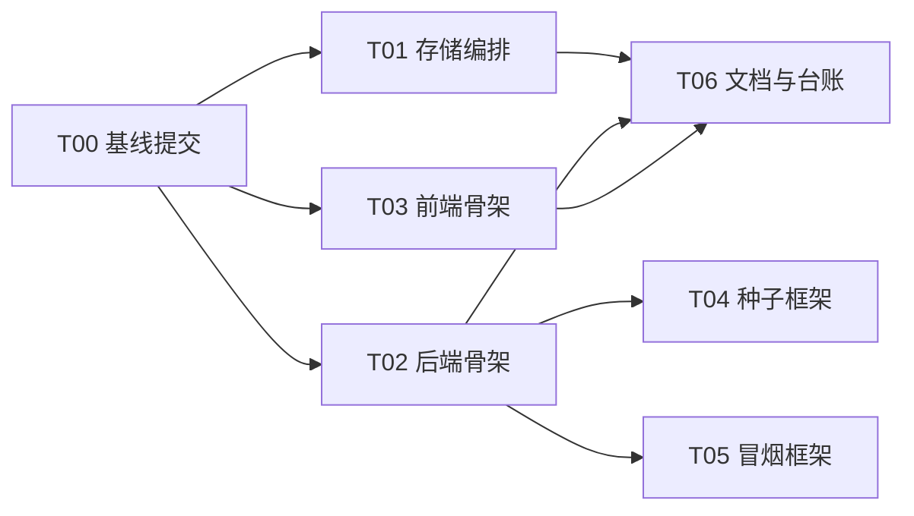

# plan1 · 基础设施与工程基线

_课程设计项目 · 2026-10-19 · 版本 v1.1 · 状态：待执行_

> **定位**：让 AC-01（一键启动）成立、让 plan0 §9 的 L1/L2 门禁全部可执行、并完成 worktree + subagent 全流程的第一次真实演练。
> **上游**：[plan0-项目规范.md](plan0-项目规范.md)（工程约束，v1.3）· [需求分析.md](../需求分析.md)（功能基线）
> **下游**：plan2（API 契约）→ backend / frontend 双线全部业务计划——本计划完成后，契约撰写才允许开工。

---

## 0. 目标与范围

### 目标（三条）

1. **可运行**：全新克隆仓库后，按 README 操作可拉起四个存储服务并访问前端首页（AC-01 前半）。
2. **可门禁**：plan0 §9 的 L1/L2 全部命令在 main 上真实可执行且全绿——不留"工具未装"的豁免。
3. **可协作**：T01–T06 逐个走完 plan0 §5 的完整循环（任务卡 → worktree → 实现 → 审查 → 修复 → 合并 → 清理），验证规范本身可执行。

### 范围内

docker compose 四存储、后端骨架（flask-backend skill 结构）、前端骨架（frontend-designer 规范 + D1–D6 落地）、Alembic 迁移框架、种子脚本框架、冒烟脚本框架、README 与任务台账。

### 范围外（明确不做）

- 任何业务表、任何业务接口、任何业务页面（plan2+）；
- JWT 业务逻辑、密码哈希调用链（plan2）；
- Embedding 探测与向量链路（plan4，本计划只预留 health 的 `embedding.mode` 字段）；
- 生产部署相关（gunicorn、nginx 等）。

---

## 1. 任务总览

| 任务 | 标题 | 执行者 | 前置依赖 | 主要工具 | 可并行 |
| --- | --- | --- | --- | --- | --- |
| T00 | 基线提交 | **主代理** | — | git | — |
| T01 | 存储服务编排 | 实现子代理 | T00 | docker | T02、T03 |
| T02 | 后端骨架 | 实现子代理 | T00 | uv / flask | T01、T03 |
| T03 | 前端骨架 | 实现子代理 | T00 | pnpm / vite | T01、T02 |
| T04 | 种子与占位图框架 | 实现子代理 | T02 | uv / Pillow | T05、T06 |
| T05 | 冒烟脚本框架 | 实现子代理 | T02 | 纯标准库 | T04、T06 |
| T06 | 文档与台账 | 实现子代理 | T01、T02、T03 | — | T04、T05 |

**执行节奏**：

- 第一批：T00（主代理直接做，不走子代理）；
- 第二批：T01、T02、T03 三个 worktree 并行（owns 互不重叠；docker / uv / pnpm 三种工具互不抢锁，但三个任务各自内部仍是串行 uv 或 pnpm）；
- 第三批：T02 合并后，T04、T05、T06 并行（T04 用 uv，与 T05、T06 无共享缓存冲突）；
- 全部任务走 plan0 §5 完整循环，审查报告存档 `docs/plan/reviews/`。

---

## 2. 任务卡

### T00 基线提交（主代理执行，不走子代理流程）

- **目标**：main 成为干净、可直接切 worktree 的基线（plan0 §4.1 的前提）
- **前置依赖**：无
- **required_skills**：无
- **owns**：全仓库现状的一次性提交；`.gitignore` 修正
- **reads**：plan0 §4
- **forbidden**：任何功能性代码改动
- **验收标准**：
  1. `git status` 干净；
  2. 需求文档重命名被 git 识别为 rename（`git log --follow docs/需求分析.md` 历史连续）；
  3. `git ls-files` 中不含 `node_modules`、`.venv`、`.uvcache`、`dist`、`pnpm-lock.yaml` 以外的锁文件副本；
  4. 根 `.gitignore` 的 `backend/uploads/` 修正为 `campus_backend/uploads/`。
- **门禁命令**：无（纯 git 操作）
- **交付物**：一个基线提交（含 plan0、plan1、需求重命名、两个脚手架、.gitignore 修正）
- **规模预期**：无净新增
- **备注**：提交信息用 `chore: 建立工程基线`，此后 main 只接受任务分支合并。

### T01 存储服务编排

- **目标**：AC-01 前半段；需求 §部署与运行的四存储矩阵
- **前置依赖**：T00
- **required_skills**：无（纯基础设施）
- **owns**：`docker-compose.yml`、`docker/`、根 `.env.example`（存储口令部分）
- **reads**：需求 §部署与运行、§种子数据
- **forbidden**：`campus_backend/**`、`campus_frontend/**`、`scripts/**`、`docs/**`
- **验收标准**：
  1. `docker compose up -d` 后 `docker compose ps` 显示 mysql / mongodb / redis / chromadb 四服务 **healthy**（各服务配 healthcheck）；
  2. MySQL 初始化 SQL（挂载 `docker-entrypoint-initdb.d`）创建 `campus_market` 库与应用账号并授权；`docker compose down && up -d` 后数据仍在（持久化于 `.mysql` 等根目录，与库名一致）；
  3. Redis 以自定义 conf 开启 AOF 且 `databases 16`；MongoDB 开启认证（root + 应用账号）；Chroma 数据目录挂载 `.chromadb`；
  4. 端口 3306 / 27017 / 6379 / 8000 与需求一致；`docker compose config` 无告警；
  5. 口令全部来自环境变量，仓库内只有 `.env.example` 占位（NFR-13）。
- **门禁命令**：§9 L1（无代码，跳过 lint/test）+ L2 的 `docker compose ps` 断言
- **交付物**：compose 文件、`docker/mysql/init/*.sql`、redis conf、根 `.env.example`
- **规模预期**：约 150 行
- **备注**：**职责边界（D11）**——用户负责：开启 Docker Desktop、预拉四个存储镜像、准备 `.env` 实值；本任务负责：把 `docker-compose.yml`、初始化 SQL、redis conf、`.env.example` 作为仓库交付物提交进 main（AC-01 要求全新克隆即可拉起）。本任务不启动应用进程。

### T02 后端骨架

- **目标**：flask-backend skill 结构落地；`/api/health` 可用；后端 L1 门禁可执行（plan0 §3.2 待补齐项的后端部分）
- **前置依赖**：T00
- **required_skills**：**flask-backend**
- **owns**：`campus_backend/**`（`main.py`、`pyproject.toml`、`uv.lock`、`src/**`、`tests/**`、`.env.example`）
- **reads**：plan0 §2.1、§6.2、§8；需求 §环境变量清单、§接口契约
- **forbidden**：`docker-compose.yml`、`campus_frontend/**`、`scripts/**`、`docs/**`、`campus_backend/migrations/versions/*`（本任务不产生业务迁移）
- **验收标准**：
  1. **结构与 flask-backend skill 完全一致**：`main.py` 仅 import + `main()`（内只有 `app.run()`）；`src/app.py` 工厂 `create_app()`；`src/config.py` 是唯一读环境变量处；`db` 实例在 `src/model.py` 顶部（含公共 Mixin）；`src/models/` 按域预留空 `__init__`（campus / user / product / trade / chat / admin，D7）；`src/router.py` 统一注册蓝图；`src/routes/health.py` 蓝图命名 `bp`；`src/extensions.py` 只放非 ORM 扩展（redis / mongo / chroma / socketio / jwt 实例）；`src/common/` 含 responses、error_codes、scope（`scoped_query` / `scoped_key` 骨架）、pagination、logging；
  2. `uv sync` 装齐依赖并生成 `uv.lock` 提交：flask、flask-sqlalchemy、flask-migrate、flask-socketio、flask-jwt-extended、flask-cors、pymysql、cryptography、pymongo、redis、chromadb、bcrypt、python-dotenv、apscheduler、openai；dev 组：pytest、ruff；
  3. `GET /api/health` 返回统一响应体 `{code, message, data}`，`data.deps` 含 mysql / mongo / redis / chroma 四项**真实连通探测**（任一不通时该项 `ok: false` 并带原因，响应仍 200 且顶层 `degraded: true`）；`data.embedding.mode` 恒为 `"not_configured"`（探测逻辑 plan4 接入，字段现在就位）；
  4. 404 / 405 / 500 走统一错误处理器，返回三键响应体；错误码段按 §6.2 预留；
  5. 环境隔离五配置项就位：`MYSQL_DB`、`MONGO_DB`、`REDIS_KEY_PREFIX`、`CHROMA_COLLECTION_PREFIX`、`PORT`，默认值等于主 worktree 取值（`campus_market` / `campus_market` / 空 / 空 / `5000`）；
  6. `campus_backend/.env.example` 覆盖需求"环境变量清单"全部变量 + 上述五项；
  7. `uv run flask --app src.app db` 框架就绪（`migrations/` 存在，迁移链为空，`db heads` 可执行）；
  8. **L1 全绿**：`uv run ruff format --check .`、`uv run ruff check .`、`uv run pytest -q`（至少 1 个 health 单测，用测试配置不依赖真实存储，deps 探测可注入 fake）；
  9. flask-backend skill **反模式清单逐条自查**，结果写入交付报告。
- **门禁命令**：§9 L1 + L2（`db heads`、`routes`、smoke 的 health 断言）
- **交付物**：上述代码 + uv.lock + .env.example + 交付报告
- **规模预期**：约 500 行净新增（不含 lock 文件）
- **备注**：不建业务表、不做注册登录（plan2）；CORS 放行 Vite dev 源；`UV_CACHE_DIR` 按 plan0 §4.3 使用工作区缓存。

### T03 前端骨架

- **目标**：frontend-designer 规范落地；D1–D6 全部生效；前端 L1 门禁可执行（plan0 §3.2 待补齐项的前端部分）
- **前置依赖**：T00
- **required_skills**：**frontend-designer**
- **owns**：`campus_frontend/**`
- **reads**：plan0 §6.3、§9；需求 §接口契约、§演示脚本
- **forbidden**：`campus_backend/**`、`docker-compose.yml`、`docs/**`
- **验收标准**：
  1. `tsconfig.app.json` 开启 `strict: true` 与 `noUncheckedIndexedAccess`；`pnpm lint && pnpm build` 全绿；
  2. `package.json` 补 `packageManager` 字段（锁定 pnpm 主版本）；新增脚本 `typecheck`（`tsc -b`）、`test`（`vitest run`）、`format` / `format:check`（prettier）；
  3. 安装 react-router、`@tanstack/react-query`、antd、prettier（dev）、vitest（dev）、`@testing-library/react` + jsdom（dev）；提交 `.prettierrc` 与 `.prettierignore`，并对存量文件执行一次全量格式化；
  4. `vite.config.ts`：`/api` 与 `/socket.io`（`ws: true`）代理到 `http://localhost:<PORT>`；`server.port` 可由 `VITE_PORT` 覆盖，默认 5173；
  5. `src/styles/tokens.css` 按 frontend-designer 设计令牌规范建立（色板 / 间距 / 字号 / 圆角 / 阴影 / 焦点色），AntD `ConfigProvider` 使用 zhCN 并把主色对齐令牌；
  6. App 壳：`QueryClientProvider` + 路由表（`/login`、`/register`、`/certify`、`/` 首页壳、`*` 404 页）；每个占位页**三态齐全**（加载 / 空 / 错误演示位）；全局布局含 skip link 与语义化结构；
  7. **可访问性自查**（frontend-designer DO/DON'T 清单）：键盘可遍历、焦点可见、图标按钮有 `aria-label`、图片有 `alt`、触控目标 ≥ 44px；结果写入交付报告；
  8. Vitest 冒烟测试至少 1 个（App 渲染出路由壳），`pnpm test` 全绿；
  9. `campus_frontend/.env.example`：`VITE_API_BASE=/api`、`VITE_PORT=5173`。
- **门禁命令**：§9 L1（lint + typecheck + format:check + build + test）
- **交付物**：上述代码 + 配置 + 交付报告
- **规模预期**：约 600 行净新增（不含 lock 变更）
- **备注**：**不引入 Storybook**；清理模板残留（`App.css` demo、`hero.png`、react/vite svg）；antd 若对 React 19 报兼容警告，安装官方补丁 `@ant-design/v5-patch-for-react-19` 并记入 decisions.md。

### T04 种子与占位图框架

- **目标**：种子脚本的可执行骨架与占位图生成器（内容随 plan2–7 增量填充）
- **前置依赖**：T02
- **required_skills**：无
- **owns**：`scripts/seed.py`、`scripts/seedlib/**`、`scripts/gen_images.py`
- **reads**：需求 §种子数据；`campus_backend/src/config.py`、`src/app.py`
- **forbidden**：`campus_backend/src/**`（只读调用，不修改）、`campus_frontend/**`
- **验收标准**：
  1. `uv run python scripts/seed.py --check` 在无业务表时输出 `no-op` 并以退出码 0 结束（幂等框架就位）；
  2. `gen_images.py`：按分类配色生成统一尺寸 JPEG 占位图，可指定输出目录 / 数量 / 用途；商品图带标题文字，学生证带醒目"示例材料"水印；纯本地 Pillow 实现，不依赖网络；
  3. 框架支持 `--only <domain>` 分组与 `--fresh` 全量重建；幂等键（业务字段哈希）实现在 `seedlib`，供后续 plan 复用。
- **门禁命令**：§9 L1（scripts 纳入 ruff 检查范围的方式：由 T02 在 pyproject 中包含，或本任务自带最小 ruff 配置——二选一，交付报告说明）
- **交付物**：三个脚本 / 模块 + 使用说明（写入脚本 docstring）
- **规模预期**：约 300 行
- **备注**：Pillow 依赖加入 `campus_backend` 主依赖组（种子经 `uv run` 执行）；不产生任何真实种子数据。

### T05 冒烟脚本框架

- **目标**：L2 门禁中 smoke 命令的真实载体
- **前置依赖**：T02
- **required_skills**：无
- **owns**：`scripts/smoke.py`
- **reads**：需求 §验收清单；plan0 §9
- **forbidden**：`campus_backend/**`、`campus_frontend/**`
- **验收标准**：
  1. `python3 scripts/smoke.py`（**仅标准库** urllib/json，无需虚拟环境）对 `/api/health` 断言 200、`deps` 四项 ok、响应体三键齐全；
  2. 预留 403 准入、404 跨校、分页、响应体三类断言入口，业务未就绪时输出 `SKIP` 并计数；
  3. 退出码规则：任一 `FAIL` → 1；仅 `SKIP` → 0；输出人类可读报告（PASS / SKIP / FAIL 计数）。
- **门禁命令**：自身即门禁
- **交付物**：`scripts/smoke.py`
- **规模预期**：约 150 行
- **备注**：标准库-only 是刻意约束——避免与 T04 争 uv 缓存锁，且可在任何 Python 下直接运行。

### T06 文档与台账

- **目标**：AC-01 的"从零到首页"成文；plan0 要求的台账与决策记录就位
- **前置依赖**：T01、T02、T03
- **required_skills**：无
- **owns**：`README.md`、`docs/plan/status.md`、`docs/plan/decisions.md`
- **reads**：plan0 §5.9、§10.3；需求 §部署与运行
- **forbidden**：代码目录
- **验收标准**：
  1. README 含：项目简介、首次运行（开启 Docker Desktop → `UV_CACHE_DIR` 说明 → `docker compose up -d` → `uv sync` → `pnpm install` → 复制 `.env.example` → 迁移 → 种子 → 启动前后端）、启动顺序图、目录结构说明（含 `docs/plan/` 的 backend / frontend / integration 子目录与 `docs/api/` 契约的定位，见 plan0 §12.1）、**"用户准备项 vs 脚本准备项"两栏清单**（用户：Docker Desktop、四库镜像、`.env` 实值、Embedding 端点；脚本：迁移、种子、向量构建）、常见问题（Docker 未启动 / uv 缓存权限 / 端口占用）；
  2. `status.md` 台账按 plan0 §5.9 建表，含 T00–T06 全部行；
  3. `decisions.md` 按 plan0 §10.3 格式登记 D1–D8（含结论与影响）；
  4. README 的"从零到首页"章节即 AC-01 的演练清单，逐条可照做。
- **门禁命令**：无（纯文档）
- **交付物**：三个文档
- **规模预期**：约 200 行文档

---

## 3. 验收映射

| 验收项 | 本计划覆盖程度 | 承载任务 |
| --- | --- | --- |
| AC-01 一键启动 | **完全覆盖**（全新克隆 → 四存储 → 前端首页可达） | T01 + T02 + T03 + T06 |
| AC-18 端点双模 | 部分：`/api/health` 结构与 deps 上报就位；`embedding.mode` 真实探测在 plan4 | T02 |
| NFR-12 迁移与种子可重复 | 框架就位（迁移链可 upgrade、种子幂等框架、`--fresh`） | T02 + T04 |
| NFR-13 配置外置无明文密钥 | 完全覆盖（`.env.example` 全量 + compose 口令外置） | T01 + T02 + T03 |
| NFR-14 结构化日志 | 骨架就位（`common/logging.py` 含 request id 字段定义） | T02 |

其余 AC（AC-02 ~ AC-17、AC-19）由 plan2+ 覆盖，本计划不触碰。

---

## 4. 退出条件

1. T00–T06 全部 `merged`，`docs/plan/status.md` 无未关闭行；
2. L1 / L2 全部命令在 **main** 上真实执行且全绿（pytest、vitest、ruff、prettier、smoke health）；
3. AC-01 在主 worktree 按 README 完整演练一次，含 `docker compose down -v` 后从零重建（存储数据可重建即算通过）；
4. worktree 全流程（实现 → 审查 → 修复 → 复审 → 合并 → 清理）至少完整跑通一次，审查报告存档于 `docs/plan/reviews/`；
5. plan2（用户与认证）可立即开工：任务卡可写、依赖已合并、无环境阻塞。

---

## 5. 风险与注意事项

| 风险 | 影响 | 对策 |
| --- | --- | --- |
| Docker Desktop 未启动 | T01、L2、AC-01 全部阻塞 | 执行 T01 前请用户开启 Docker（昨夜确认守护进程未运行） |
| `~/.cache/uv` 沙箱不可写 | 所有 uv 命令报 `Could not acquire lock` | 一律 `UV_CACHE_DIR=.uvcache`（plan0 §4.3），README 同步说明 |
| uv 跨 worktree 并发锁 | 并行任务随机失败 | 第一批三任务工具互异（docker/uv/pnpm）；T04 与 T05 并行时 T05 已改为纯标准库 |
| antd × React 19 兼容 | T03 构建告警或运行异常 | 用最新 antd v5；必要时加 `@ant-design/v5-patch-for-react-19` 并记 decisions.md |
| Vite 8 / TS 6 生态较新 | 个别插件不兼容 | 不擅自降级大版本；遇问题在 decisions.md 记录方案后再动 |
| 模板残留（hero.png、demo CSS） | 首页看起来"假" | T03 明确清理；占位页只留骨架 |

---

## 6. 与规范的双向核对

执行完本计划后，回填 plan0 §3.2「待补齐项」表：全部行标记完成或移除；若实际执行中发现规范条款不可执行（如门禁命令跑不通），**先改 plan0 并升版本，再继续**——这是 plan0 §13 的修订纪律。
