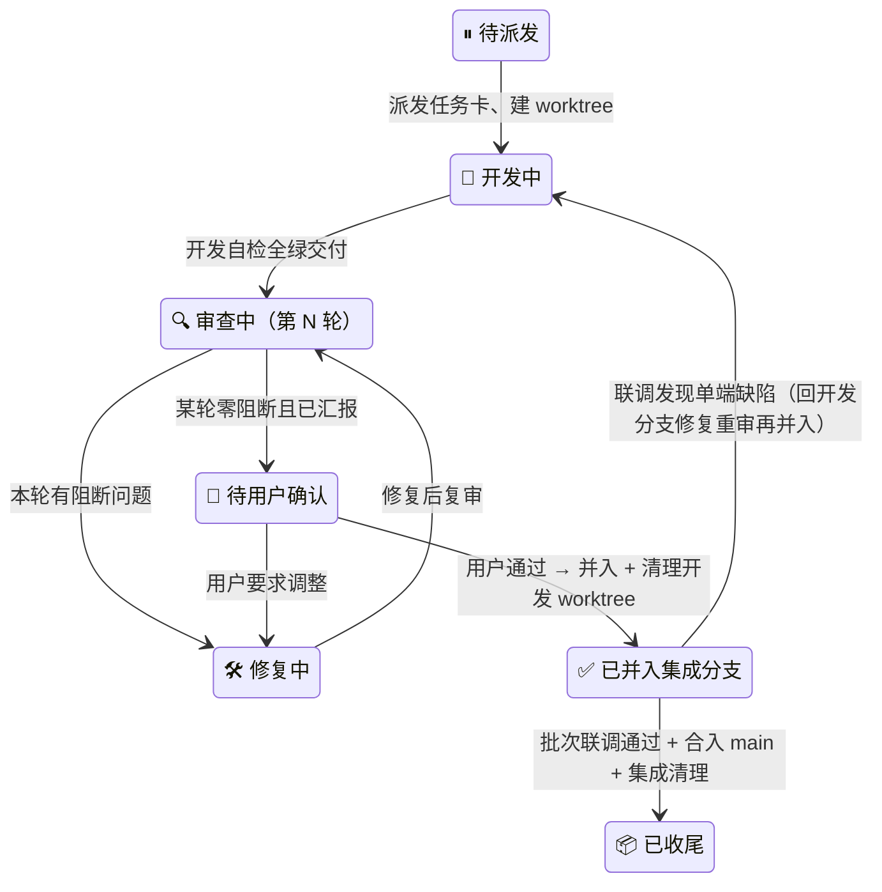

# 校园二手交易平台 · 进度看板

_版本 v0.5（b2 批次计划编写完成）· 建立 2026-10-20 · 最后更新 2026-10-21 · 维护人：主 agent（唯一写入者）· 依据：[项目规范](00-项目规范.md) v0.5 · [需求分析](../需求分析.md) v1.1_

> 变更（v0.5）：**b2 批次计划编写完成**（[02-商品域](02-商品域.md) + 三份任务卡），任务行四枚补入（b2api/b2be/b2be2/b2fe，均待派发）；编排经用户确认：**b2be（核心）∥ b2fe → b2be2（向量，自集成分支检出接力，规范显式扩展）**；b2api 前置遗留同步定稿——上传魔数澄清与图片 Cookie 通道（b1 缺陷：`` 无 Bearer 头裂图，用户确认 Cookie 补充方案）入 0.3.0、`GET /api/users/{id}` **归期 b3（用户确认 2026-10-21）**、405 补 9007；成色 5 档枚举 / 上传形态（独立 uploads + image_ids）/ 敏感词建列占位 / 分类 verified / 点击画像 GET 顺带——均经用户确认入契约全案。契约目标版本 0.3.0。
> 变更（v0.4）：b1api 已合入 main（契约冻结 0.2.0）；经用户指令 **b1be ∥ b1fe 并行派发**（2026-10-21），双 worktree 自 main（41fccb3c）建立，任务行状态与槽位 A 占用同步登记；存储容器已由用户启动。
> 变更（v0.3）：b1 批次计划编写完成（[01-用户域](01-用户域.md) + 双端任务卡），b1 任务行三枚补入，均待派发；快照「下一步」同步。需求分析 v1.0 → v1.1（经用户授权：USER 实体补 phone 列，FR-USR-04 疏漏修正），全库版本引用已同步。

---

## 📋 文档定位与维护规则

本看板是全部开发任务的**调度与状态唯一事实源**：批次进度、任务行、槽位占用、审查轮次、联调结果、收尾核验均以此为准。任何 agent 不得凭对话记忆调度。

1. **主 agent 唯一写入**；开发 / 审查 / 修复 / 联调 agent 与用户只读。
2. **更新时机与任务生命周期同步**：派发时登记任务行 → 每轮审查后追加留痕 → 用户确认后更新状态 → 并入集成分支 / 合入 main 时登记 → 收尾核验逐项打勾。
3. **留痕只追加不删改**：审查与联调记录即使后续被推翻也保留原行，新结论另起一行（保证"审查清零 / 联调通过"凭据链完整）。
4. 任务行 b1 起随该批任务计划定稿逐批补入；本骨架版先固定批次框架、槽位表与状态机。契约修订任务（`feat/api/*`）同样登记任务行，代号 `b<批次>api`，无隔离参数。

## 📌 当前快照

| 项 | 状态 |
| --- | --- |
| 当前批次 | **b1 用户域**（✅ 已合入 main（`03363eeb`），📦 已归档） |
| 已落里程碑 | 需求分析 v1.0 ✅（v1.1 修订 2026-10-20：USER 补 phone 列）· 项目规范 v0.5 ✅ · 契约基线 0.1.0 ✅ · 双端总纲 v1.1 ✅ · 本地 Embedding 侧车 ✅ · **Embedding 默认纯本地** ✅（均 2026-10-20）· **契约 0.2.0** ✅ · **b1 用户域全链路交付**（双端并行 → 审查 6 轮零阻断 → 联调 2 轮 → P2/P3 闭环，2026-10-21） |
| 下一步 | **b2 商品域：批次计划已定稿（[02-商品域](02-商品域.md)），待用户批准后派发**（顺序 b2api → b2be ∥ b2fe → b2be2 → 联调）；`GET /api/users/{id}` 归期已确认 **b3**（用户确认 2026-10-21）；契约目标 0.3.0（含上传魔数澄清、图片 Cookie 通道、9007）；跨批次遗留待办余 7 条见下方集中清单（其中 4 条由 b2 任务卡承接） |
| Embedding 侧车 | `tools/local_embedding` @ 8010 **运行中**（用户确认保留，2026-10-21；b2 推荐/搜索与演示随时可用） |
| 存储容器 | 由用户启停，不在此登记（运行状态用 `docker compose ps` 查看） |

## 📅 批次总表

各批后端 / 前端范围与首次用到的包以[项目规范](00-项目规范.md)「开发批次」为准，此处不重复，只跟踪进度与契约冻结版本。

| 批次 | 域 | 集成分支 | 契约冻结版本 | 状态 | 联调 | 合入 main |
| --- | --- | --- | --- | --- | --- | --- |
| b0 | 骨架与契约 | ~~`integration/b0-skeleton`~~ 已合并删除 | 0.1.0（已冻结） | 📦 已归档 | 2 轮：第 1 轮不通过（P1/P2）→ 第 2 轮 17/17 通过 | ✅ 2026-10-20（`c982b791`） |
| b1 | 用户域 | ~~`integration/b1-user`~~ 已合并删除 | 0.2.0（已冻结） | 📦 已归档 | 2 轮：第 1 轮 12/13（P2 上传魔数缺失）→ P2 修复复测通过 + P3 侧车启动 health overall=ok | ✅ 2026-10-21（`03363eeb`） |
| b2 | 商品域 | `integration/b2-product` | — | ⏳ 未开始 | — | — |
| b3 | 交易域 | `integration/b3-order` | — | ⏳ 未开始 | — | — |
| b4 | 聊天域 | `integration/b4-chat` | — | ⏳ 未开始 | — | — |
| b5 | 管理域 | `integration/b5-admin` | — | ⏳ 未开始 | — | — |
| b6 | 集成收尾 | `integration/b6-release` | — | ⏳ 未开始 | — | — |

- 批次状态枚举：⏳ 未开始 → 🔨 进行中 → 🧪 联调中 → ✅ 已合入 main → 📦 已归档（批次 worktree 全清）。
- b3 / b4 互不依赖，是否并行由用户在 b2 完成后决定；启用并行时在槽位表登记第二集成槽位。
- 契约冻结版本 = 该批双端开工时 [CHANGELOG](../api/CHANGELOG.md) 最新版本号；批次内契约微调走修订流程并同步更新此列。

## 🧩 任务行

**任务代号即隔离键**：MySQL 表前缀 `<代号>-`、MongoDB 库 `<MONGO_DB>_<代号>`、Chroma 集合后缀 `<代号>`；集成 worktree 代号为 `int<批次>`。端口与 Redis 库基址见槽位表。

### b0 · 骨架与契约

| 代号 | 端 | 任务 | 分支 | worktree | 槽位 | 状态 | 备注 |
| --- | --- | --- | --- | --- | --- | --- | --- |
| b0be | 后端 | 工程骨架拉起：公共定义与统一响应、Swagger 路由、`/api/health`、迁移基线、pytest / ruff 基线 | ~~`feat/be/b0-skeleton`~~ 已并入 | ~~`.worktree/b0be`~~ 已清理 | A | ✅ 已并入集成分支 | 用户确认 2026-10-20；2 轮审查零阻断；隔离数据已清理（b0be-alembic_version 已 DROP，Mongo/Chroma 未产生）；约束见 [backend/00-骨架与契约](backend/00-骨架与契约.md) |
| b0fe | 前端 | 工程骨架拉起：路由与四态守卫、布局与设计令牌、api 客户端与 mock 机制、openapi 类型生成脚本 | ~~`feat/fe/b0-skeleton`~~ 已并入 | ~~`.worktree/b0fe`~~ 已清理 | A | ✅ 已并入集成分支 | 首并入后联调发现 P1/P2（前端单端缺陷）→ 回退修复 `6911e6bf`/`abf706f8` → 审查第 4 轮阻断清零 → 并入（fb10c16c）→ 联调第 2 轮通过；约束见 [frontend/00-骨架与契约](frontend/00-骨架与契约.md) |
| b0be2 | 后端（追加） | 本地 Embedding 侧车（Qwen3-Embedding-0.6B @ MPS，OpenAI 兼容 `/v1/embeddings`）+ 后端 health 真双模探活（cloud → local → down） | ~~`feat/be/b0-embedding`~~ 已并入 main | ~~`.worktree/b0be2`~~ 已清理 | B（端口 8010/5010） | ✅ 已合入 main | 4 提交：`41dd38b6`+`0e13a9b2`+`1ea475a9`+`515f0489`；审查 3 轮（第1轮 2 阻断 → 第2轮清零 → 第3轮补3盲区），共 15 个变异测试；用户确认 2026-10-20；隔离数据：b0be2 未跑迁移、Mongo 库未产生；侧车代码 `tools/local_embedding/`（仓库根） |
| b0be3 | 后端（追加） | Embedding 默认改为**纯本地**模式（`EMBEDDING_MODE=local`，保留 `cloud`/`auto` 开关）；顺带修复 Clash 代理劫持回环请求的真实缺陷 | ~~`feat/be/b0-embed-local`~~ 已并入 main | ~~`.worktree/b0be3`~~ 已清理 | B | ✅ 已合入 main | 2 提交：`4cbda20a` feat + `d8b6dae0` test；审查 2 轮（第1轮阻断清零、25 变异中 22 捕获 → 修复 3 个存活变异后全部 KILL）；实测 health 从 auto 的 5–6s 降到 **0.07–0.12s**，local 模式**零云端请求**（日志+探针+sink 三重证明）；用户确认 2026-10-20 |

> 分支名为拟定（b0 范围固定自项目规范批次表），最终以主 agent 任务卡为准；任务卡同时下发隔离参数（端口、`DB_TABLE_PREFIX` 等）。

### b1 · 用户域（✅ 已归档 2026-10-21）

| 代号 | 端 | 任务 | 分支 | worktree | 槽位 | 状态 | 备注 |
| --- | --- | --- | --- | --- | --- | --- | --- |
| b1api | 契约 | openapi.yaml 0.1.0 → 0.2.0：用户域 12 接口 + 20xx 错误码 + schema + 文档修订（规范引用 v0.5 等） | ~~`feat/api/b1-user-domain`~~ 已合入删除（`9884e95f` + `506bc645`） | ~~`.worktree/b1api`~~ 已清理 | 无隔离参数 | ✅ 已合入 main | 规格见 [01-用户域 · 契约增量全案](01-用户域.md)；审查 1 轮 0 阻断 2 建议；处置：S-1 已修（CHANGELOG 日期）、S-2 经用户确认保留；用户确认 2026-10-21，合入 `b70525c1`，**契约冻结 0.2.0** |
| b1be | 后端 | 用户域 12 接口实现 + 鉴权三装饰器与作用域上下文 + 五表迁移 + pytest 全覆盖 | ~~`feat/be/b1-user`~~ 已合并删除（12 提交 `1a0d5636`..`e99dca3f`） | ~~`.worktree/b1be`~~ 已清理 | A | 📦 已收尾 | 任务卡：[backend/01-用户模块](backend/01-用户模块.md)；审查 3 轮全零阻断（第 2 轮修建议①②、第 3 轮验联调 P2 修复）；pytest 227；`b1be-` 表审查阶段已 DROP；建议③ 记看板 |
| b1fe | 前端 | 登录注册/找回密码/认证提交与状态页/个人中心 + 401 统一引导 | ~~`feat/fe/b1-user-ui`~~ 已合并删除（9 提交 `52d6e996`..`3b08890f`） | ~~`.worktree/b1fe`~~ 已清理 | A | 📦 已收尾 | 任务卡：[frontend/01-用户界面](frontend/01-用户界面.md)；审查 3 轮零阻断收尾（B1 修复 + 建议④⑦⑨）；遗留见跨批次待办 |
| b1fe2 | 前端（追加） | mock 认证种子时序修复：ensureSeed 深链盲区（空表不锁 flag）+ 补种仅兜底无记录用户（has 守卫） | ~~`feat/fe/b1-mock-seedfix`~~ 已合并删除（2 提交 `4506dc2d` + `e6182441`） | ~~`.worktree/b1fe2`~~ 已清理 | A | 📦 已收尾 | 用户点名补做的第 3 轮留痕项 + 复审追加边界；审查 2 轮零阻断（node 模拟全场景验证）；直接合入 main `17aa6c3b`（循 b0be3 追加任务先例，用户确认 2026-10-21） |

> b1 并发编排：`b1api`（crit，唯一串行点）→ `b1be` ∥ `b1fe`（共用槽位 A，端口不冲突）→ 集成 `int1`（5030/5200/Redis 12/前缀 `int1-`）。联调需造数学校数据（多校区 + 单校区各 1）与 approved/rejected 用户，正式种子脚本 b6 交付，见批次计划「联调准备」。开工前置申报：`uv add bcrypt`（NFR-05）。

### b2 · 商品域（🔨 b2api 开发中）

| 代号 | 端 | 任务 | 分支 | worktree | 槽位 | 状态 | 备注 |
| --- | --- | --- | --- | --- | --- | --- | --- |
| b2api | 契约 | openapi.yaml 0.2.0 → 0.3.0：商品域 14 接口 + 30xx 错误码（3001/3002）+ 9007 + schema（ProductCondition 5 档/ProductDetail 等）+ 文档修订（上传五件套、图片 Cookie 通道、标签规划） | `feat/api/b2-product-domain` | `.worktree/b2api` | 无隔离参数 | 👤 待用户确认 | 派发 2026-10-21（自 main `39fd7ef2`）；开发 `6d22646b` + 修复 `667b0136`（用户指示 P-S1/P-S2 全修：avatar 五件套文案 + 双接口降级双例）；审查 1 轮 **0 阻断 / 2 建议** → 修复 → 复审 **PASS**；独立复跑 62+27 断言全过；**待确认后合入 main 冻结 0.3.0** |
| b2be | 后端 | 商品核心：4 表迁移 + CRUD/状态/删除/mine + 图片上传与孤儿清理（b1be 建议③）+ 分类 + 收藏 + 列表筛选 + detail/category 缓存 + `scoped_query` 首次落地 + 事件总线占位 + b1 存量三处微改（图片 Cookie/405/auth Set-Cookie） | `feat/be/b2-product-core` | `.worktree/b2be` | A（5010 · Redis 4 · 前缀 `b2be-`） | ⏸ 待派发 | 任务卡：[backend/02-商品模块](backend/02-商品模块.md)；与 b2fe 并行；产出事件总线供 b2be2 订阅 |
| b2be2 | 后端（接力） | 向量与画像：Mongo/Chroma/Embedding 三客户端 + 向量同步与重试队列 + 向量搜索（LIKE 降级）+ 首页推荐（32+8 配比）+ 行为画像（点击/收藏）+ 降级矩阵 + 60s 补偿线程 | `feat/be/b2-product-vector` | `.worktree/b2be2`（**自集成分支检出**） | B（5020 · Redis 8 · 前缀 `b2be2-` · Mongo `campus_market_b2be2` · Chroma 后缀 `b2be2`） | ⏸ 待派发（b2be 并入后） | 任务卡：[backend/02-向量与推荐](backend/02-向量与推荐.md)；自集成分支检出系经用户确认的规范扩展（2026-10-21）；与 b2fe 后半程并行 |
| b2fe | 前端 | 首页推荐 40 宫格、列表与筛选（URL 同步）、详情（收藏乐观更新）、发布编辑、我的商品、收藏、搜索 + 1004 统一引导 + 图片懒加载（b0fe 遗留）+ b1fe 遗留两条（9001 渲染位/logout degraded 可见性） | `feat/fe/b2-product-ui` | `.worktree/b2fe` | A（5180 · mock） | ⏸ 待派发 | 任务卡：[frontend/02-商品界面](frontend/02-商品界面.md)；全程 mock，与双后端任务零依赖 |

> b2 并发编排（用户确认 2026-10-21）：`b2api`（crit，唯一串行点，冻结 0.3.0）→ `b2be` ∥ `b2fe`（共用槽位 A）→ b2be 审查清零并入 `integration/b2-product` → `b2be2`（自集成分支检出，槽位 B）∥ `b2fe` 后半程 → 集成 `int2`（5030/5200/Redis 12/前缀 `int2-`/Mongo `campus_market_int2`/Chroma 后缀 `int2`）。联调造数经发布 API 走完整向量链路；降级演练改集成 `.env` 端口，不动用户侧车。无新包申报。

### b3 – b6

各批任务行随该批任务计划定稿补入（复制上表结构；同端多任务代号加序号，如 `b2be` / `b2be2`）。

## 🔄 任务状态机（任务行「状态」列合法值）



状态标注格式：`🔍 审查中（第 2 轮 · 1 阻断）`——括号内为最新一轮摘要，明细见留痕。

## 🔌 槽位与端口登记

| 槽位 | 后端端口 | 前端端口 | Redis 库基址 | 占用 | 备注 |
| --- | --- | --- | --- | --- | --- |
| 主仓（main） | `5000` | `5173` | `0`（db0–3） | 常驻 | 主仓 `.env` 永不加前缀 |
| 开发 A | `5010` | `5180` | `4` | 空闲 | 同批次配对双端任务默认共用本槽位（端口互不冲突） |
| 开发 B | `5020` | `5190` | `8` | 空闲 | 同端并行多任务时启用 |
| 集成 | `5030` | `5200` | `12` | 空闲 | 集成 worktree `.worktree/int1`（批次收尾后释放） |
| 集成 · 备 | `5040` | `5210` | 届时分配 | 未启用 | 仅 b3/b4 并行时经用户决定启用，存储参数届时登记 |

占用登记格式：`b1be @ 2026-10-22`；任务收尾后改回"空闲"。MySQL / Mongo / Chroma 隔离随任务代号派生（见「任务行」），不在此表登记。

## 🧾 审查留痕（只追加）

每轮审查后由主 agent 摘要登记，修复说明附于同行。

```text
### <代号> · <任务名>
| 轮次 | 时间 | 阻断 / 建议 | 修复摘要 | 结果 |
| --- | --- | --- | --- | --- |
| 1 | | 3 / 2 | | 修复待复审 |
```

### b0be · 后端骨架
| 轮次 | 时间 | 阻断 / 建议 | 修复摘要 | 结果 |
| --- | --- | --- | --- | --- |
| 1 | 2026-10-20 | 0 / 5 | 无需修复 | 零阻断过审；建议项：chroma 探针超时统一、405 错误码语义（留契约修订）、swagger 尾斜杠改写写法、CORS 生产收紧（批次 6 登记）、提交信息双冒号风格——待用户取舍。审查含只读动态验证：openapi.json 与 yaml 深度相等、库内仅 b0be-alembic_version 前缀表、ruff/pytest 复跑全绿 |
| 2 | 2026-10-20 | 0 / 1（极弱） | [C1] 修复：chroma 探针去除 heartbeat 冗余往返 + 超时现状注释（a1aeeb9b） | 零阻断过审；真实容器探活复验 up/387ms 与不可达端口 down 正确；新建议（chroma 降级 error 摘要信息量低，系库包装行为）经用户授权按推荐处置：接受现状不再开修复轮 |

### b0fe · 前端骨架
| 轮次 | 时间 | 阻断 / 建议 | 修复摘要 | 结果 |
| --- | --- | --- | --- | --- |
| 1 | 2026-10-20 | 0 / 6 | 无需修复 | 零阻断过审；建议项：AdminDashboard 二层守卫 403 对齐、antd 暗色主色动态化、401 引导跳转（批次 1）、320px 长昵称溢出防护、图片懒加载（批次 2）、对比度注释数字修正——待用户取舍 |
| 2 | 2026-10-20 | 0 / 0 | 修复 4 条（98995fbb）：管理页二层守卫 403、createAntdTheme(isDark) 暗色主色、顶栏昵称溢出防护、注释 5.85:1 | 零阻断过审；复跑 lint/build 全绿；遗留 2 条前瞻提醒（401 引导跳转→批次 1、图片懒加载→批次 2） |

## 🧪 联调留痕（只追加）

每批次联调后由主 agent 摘要登记：冒烟清单结果、批次验收用例结果、问题分诊、结论与用户确认时间。

```text
### bN · integration/bN-域
- 冒烟：X/Y 通过 · 验收用例：X/Y 通过
- 问题分诊：单端缺陷 → <代号> 回退开发；集成性问题 → 集成分支修复复核
- 结论：<通过 / 不通过> · 用户确认：<时间 / 待确认>
```

### b1 · integration/b1-user（第 2 轮 · P2 修复复测 + P3 姿态验证）
- P2 复测：txt 伪装 .png / .jpg → **422+9001**（文案「文件内容与声明类型不符…」）✅ · 真实 PNG 防误杀 → 200 ✅ · 集成库 pytest **227 passed** ✅
- P3 复测：侧车 8010（MPS，selftest ok）→ `/api/health` embedding `local/up`、四存储 up、**overall ok（不再 degraded）** ✅
- 收尾：后端已停、git status 干净、`int1-` 数据保留
- 结论：**通过（条件闭环，联调完成）** · 用户确认：待确认（合入 main）

### b1 · integration/b1-user（第 1 轮）
- 冒烟：**12/13 通过**（1 失败定级 P2）· 批次验收四项：**4/4 通过**（全链路 / 未认证隔离 / approved 展示名联动 / 驳回重提闭环）
- 代理链路证据：13 项全部经 5200 代理命中 5030 真后端（响应含造数特有数据）；关键项 5030 直连对照一致
- 集成态自检：ruff ✅ · pytest 211/211 ✅ · oxlint 0/0 ✅ · build ✅ · 迁移 `int1-` 6 表 ✅
- 问题分诊：
  - **P2【阻断上传口径·b1be 单端】** 上传校验无内容魔数嗅探：txt 伪装 .png → 200（期望 9001），四件套中 MIME 取自客户端可伪造；波及 avatar 与 student_card 同一 helper → 回 `feat/be/b1-user` 修复（魔数校验 + pytest 反例）→ 复审 → 再并入 → 复测 1 项
  - **P3【外部依赖】** `/api/health` embedding down → overall degraded（local 侧车 8010 未启动）；b1 用户域零依赖 embedding，全部用例不受影响 → 姿态待用户确认
  - 观察项：契约 0.2.0 上传「四件套」字面未提魔数，与冒烟口径存在文档级差 → 契约微调或归入下次增量，待用户定夺
- 结论：**通过（附条件：P2 修复复测）** · 用户确认 2026-10-21：① P2 立即修复（已交付 `e99dca3f`，审查第 3 轮零阻断，pytest 227；并入 `6dd0d4c1`，复测中）② 契约澄清归入下次（b2）契约增量 ③ P3 启动侧车复测（侧车 8010 已就绪，health 复测中）
- 冒烟：11/13 通过（1 失败、1 部分失败）· 批次 0 验收四项：启动 ✅ / `api/health` 直打后端 ✅、前端页面链路 ❌ / Swagger UI ✅ / 路由守卫代码层齐备但未取得运行期证据
- 集成态自检：ruff ✅ · pytest 34/34 ✅ · oxlint 0/0 ✅ · build ✅ · 迁移 `int0-alembic_version`（9539b1447ed4 head）
- 问题分诊：
  - **P1【阻断·b0fe】** `VITE_API_BASE` 一变量两用（vite proxy target + axios baseURL）→ 前端请求缺 `/api` 前缀 404；改 env 无法绕过，必须改代码
  - **P2【b0fe】** dev server 仅监听 `[::1]`，`127.0.0.1` 拒连
  - **P3【外部依赖】** Embedding 云端端点间歇抖动（24/106 = 22.6%，最大连续 down 3 次）；契约降级语义正确，非代码缺陷
  - 观察项：405 复用业务码 9002（契约未定义 405 专属码，留待契约修订）

**待办（契约修订，`feat/api/b0-*` 通道）**：~~`docs/api/openapi.yaml:22` 仍引「项目规范 v0.4」，需随下一次契约修订同步为 v0.5~~ ✅ 已完成（b1api 随 0.2.0 修订「规范引用 v0.4 → v0.5」，见 CHANGELOG 0.2.0 变更摘要）。

### b0 · integration/b0-skeleton（第 2 轮 · 修复后复测）
- 冒烟：**17/17 通过** · 批次 0 验收四项：启动 ✅ / health ✅（含降级语义实测）/ Swagger UI ✅ / 路由守卫实现齐全 ✅
- P1/P2 修复验证（根因级证据）：
  - P2：`lsof` 显示 `TCP 127.0.0.1:5200 (LISTEN)`，127.0.0.1 访问 200；`[::1]:5200` 拒连（000）
  - P1：`curl 127.0.0.1:5200/api/health` → 200 且为真后端数据（checked_at 实时、latency 实时非 mock 特征）；唯一查询串测试证明代理命中 5030 且路径含 `/api`；vite 注入 `import.meta.env` 无 `VITE_API_BASE`，dist 无主机地址泄漏
- 集成态自检：ruff ✅ · pytest 34/34 ✅ · oxlint 0/0 ✅ · build ✅ · 迁移 9539b1447ed4 (head)，库内仅 `int0-alembic_version`
- 问题分诊：**无新增阻断/中等问题**；观察项：① Embedding 云端抖动复现（3 次重试中 1 次 down，非连续 ≥3，已知外部）；② `.env.local` 旧语义重建风险（已按新语义重建，建议后续 agent 显式核对）；③ 无头浏览器不可用，未取得渲染后 DOM 证据（已用 HTML 壳 + chunk 200 + env 注入 + 代理真数据 + 后端日志等价替代）
- 结论：**通过** · 用户确认：待确认（确认后合入 main）

### b0fe · 前端骨架（联调缺陷修复 · 第 3 轮审查）
| 轮次 | 时间 | 阻断 / 建议 | 修复摘要 | 结果 |
| --- | --- | --- | --- | --- |
| 3 | 2026-10-20 | 1 / 4 | [P1] 拆分 `VITE_PROXY_TARGET`（dev 代理）与 `VITE_API_BASE`（axios 基址）；[P2] dev server 显式绑 `127.0.0.1`（6911e6bf） | 代码层零阻断、P1/P2 经独立实测确认；阻断项 D-1 为文档（规范/总纲仍写旧两变量语义，照旧文操作必复发 P1）→ **主 agent 已修订** [00-项目规范](00-项目规范.md) v0.4→v0.5 与 [frontend/00-骨架与契约](frontend/00-骨架与契约.md) v1.0→v1.1；建议 S-1/S-2/S-3 派 b0fe 顺手修 |

### b1fe · 前端用户界面
| 轮次 | 时间 | 阻断 / 建议 | 修复摘要 | 结果 |
| --- | --- | --- | --- | --- |
| 1 | 2026-10-21 | 1 / 7 | 修复派发中 | [B1] mock 会话与 persist 登录态刷新失配 → /profile 刷新死局、401 引导在 mock 路径失效（/certification 同理静默空态）→ 修复 agent 已派发；建议 7 条（种子惰性化、student_no 防御渲染位、logout degraded 可见性（b2 一并）、1006 无解锁、approved 历史超注释值域、死 CSS 两处、2004 mock 文案）待汇报取舍；裁量判断：phone 非法样例落 updateMe 9001 合理、无需返工；任务卡 :35 笔误已由主 agent 修订（注册 9001 不含 phone 样例） |
| 2 | 2026-10-21 | 0 / 0 | [B1] `c302fc3b`：方案①+② 结合——mock 会话惰性从 authStore persist 恢复（主修复，对齐真实后端凭令牌重建会话体验）+ `handleTokenInvalid` 共享兜底统一全部 4 处 1001 路径；附带 mockLogout 清内存会话、注释修正。5 文件 49+/21-，组件/docs/package.json 零触碰，7 建议零接触 | **零阻断，可汇报用户**。B1 逐点验证通过（刷新恢复、/certification 静默消除、兜底无循环跳转、真实 axios 路径与登出语义不变）；build/lint 复跑全绿；7 条建议仍开放待用户取舍 |
| 3 | 2026-10-21 | 0 / 0 | 用户确认取舍后修 ④⑦⑨：`37dad8b9`（种子惰性化 ensureSeed + 1006 锁定 600s 自动解锁，语义与真实 Redis TTL 精确对齐）+ `3b08890f`（死 CSS −60 行，grep 取证零引用）。范围核验 4 文件，其余建议零触碰 | **零阻断，可并入**。④ 存在残余盲区（深链直进 /certification 时 MOCK_ACCOUNTS 未加载 → ensureSeed 空种且 flag 已置；非死局非回归，维持建议级），一行可解（MOCK_ACCOUNTS 空时不置 flag），留痕待联调期顺手处理 |

### b1be · 后端用户模块
| 轮次 | 时间 | 阻断 / 建议 | 修复摘要 | 结果 |
| --- | --- | --- | --- | --- |
| 1 | 2026-10-21 | 0 / 3 | 无需修复 | **零阻断过审**。复跑：ruff ✅ · pytest 206 ✅（断言底线逐条比对齐全）；url_map 15 条与契约 0.2.0 逐一对齐；迁移 MySQL 实测两轮 upgrade/downgrade 可逆、收尾 `b1be-` 表零残留；反模式清单逐条过；审查重点 1–7 逐项核实通过。五项裁量全部 ✅（迁移 prefix 参数化 / 成环 FK 补建 / 1553 规避 / b0 测试仅动 tests / 展示名半角圆括号单处实现）。建议 3 条：① FK 约束名 `fk_users_avatar_image` 未随前缀参数化（b2 派发后与主仓同库 upgrade 撞名 1826，高优先前瞻）② `_unique_conflict` 子串匹配理论误报（同 409，危害极小）③ uploads 先落盘后 commit 留孤儿文件可能（b2 考虑）——待用户取舍 |
| 2 | 2026-10-21 | 0 / 0 | 用户确认取舍后修 ①②：`df455ce8`（FK 约束名 prefix 常量单一来源，模型 + 迁移三处统一引用，同库双前缀共存实测消 1826）+ `31c3557d`（`_unique_conflict` 改 `exc.orig` 整词正则匹配，+5 条回归测试，pytest 211）。唯一约束名不参数化经审查独立实测成立（MySQL 索引跨表同名合法） | **零阻断，可并入**。范围核验仅 4 文件，建议 ③ 与契约/docs 零触碰；迁移复测四连可逆、收尾零残留 |

### b2api · 契约增量（0.3.0）
| 轮次 | 时间 | 阻断 / 建议 | 修复摘要 | 结果 |
| --- | --- | --- | --- | --- |
| 1 | 2026-10-21 | 0 / 2 | 无需修复（建议项待用户取舍） | **零阻断过审**。开发 `6d22646b`（27 断言：14 接口/枚举逐字/176 $ref 无悬空/version 0.3.0）；审查独立复跑 YAML OK + TSGEN OK + 自写 62 断言全 PASS；越界核验恰两文件。裁量 4 处：管理员拒绝码 409/9003、全接口补 401/403、search 用 PaginatedData+可选 degraded（均接受）；avatar「四件套」残留归 P-S1（审查独立判定属修订意图覆盖范围，因简报未明列且已申报，不构成违规）。建议：P-S1 avatar description 四件套→五件套文案（yaml:705，建议随并入前顺手修）；P-S2 search/recommendations 200 example 补降级双例（低优先级） |

| 1 · 处置 | 2026-10-21 | — | [P-S1+P-S2] 已修（`667b0136`，用户指示两条全修）：avatar description 五件套口径（含补「内容魔数嗅探」对齐总则）+ search/recommendations 200 命名双例（normal + degraded）；复审 PASS（两 ADDRESSED、无新问题、四件套残留 0、TSGEN OK、仅一文件） | **零阻断闭环，待用户确认合入 main（冻结 0.3.0）** |

### b1api · 契约增量（0.2.0）
| 轮次 | 时间 | 阻断 / 建议 | 修复摘要 | 结果 |
| --- | --- | --- | --- | --- |
| 1 | 2026-10-21 | 0 / 2 | 无需修复 | 零阻断过审；9 项清单全过（12 接口逐字段、6 pattern 字面、错误码矩阵、9 schema、7 修订项、example 合规性、operationId 唯一、CHANGELOG、无越界夹带）；开发 agent 5 条裁量全部接受（补 401 / 20xx 内联 examples / components 复用等）；独立复跑 YAML + 结构 + TS 生成 + 30 项断言全绿。建议项：S-1 CHANGELOG 0.2.0 条目日期写 2026-10-20 而提交实际 2026-10-21（建议并入前顺手改）；S-2 提交信息与验收标准字面差异（语义兼容，建议保留不重写历史）——待用户取舍 |
| 1 · 处置 | 2026-10-21 | — | [S-1] 已修：CHANGELOG 条目日期 → 2026-10-21（`506bc645`）；[S-2] 经用户确认保留原提交信息 | 用户确认后合入 main（`b70525c1`），契约冻结 0.2.0 |

## 📌 跨批次遗留待办（随对应批次派发前处理；主 agent 派发时核对）

| 来源 | 事项 | 目标批次 |
| --- | --- | --- |
| b0be 审查建议 | CORS 生产收紧 | b6 |
| b0fe 审查建议 | 图片懒加载 | b2 |
| b1be 审查建议③ | 上传先落盘后 commit 的孤儿文件补偿清理 | b2 |
| b1fe 审查建议⑤ | CertificationPage 9001 `fields.student_no` 错误渲染位（防御性） | b2 |
| b1fe 审查建议⑥ | logout `degraded/degraded_reason` 用户可见性（契约消费纪律） | b2 |
| b1fe 审查建议⑧ | student02 历史 approved 超契约注释值域（造数/演示注意） | b5 / int1 联调造数 |
| b1fe 审查建议⑩ | 2004 mock 文案与任务卡示例字面统一（可选） | b6 演示走查 |
| b1fe 第 3 轮复审留痕 | ~~ensureSeed 深链盲区~~（含复审追加发现的补种覆盖边界） | ✅ 已完成（b1fe2：`4506dc2d` 一行解 + `e6182441` has 守卫，审查 2 轮零阻断，合入 main `17aa6c3b`，2026-10-21） |
| b1be 开发建议 | ~~迁移 prefix 机制（含约束名参数化，视修复①结果）补进 [backend/00 骨架文档](backend/00-骨架与契约.md) 迁移章节~~ | ✅ 已完成（`f85dc311`，203-205 行；五件套口径另见 `0e69f686`） |

## ✅ 收尾核验清单（主 agent 逐项打勾）

任务级（单任务闭环）：

- [x] 某轮审查零阻断且留痕完整（b0be 第 2 轮 / b0fe 第 2 轮，2026-10-20）
- [x] 用户确认记录（2026-10-20，含建议项取舍：修 #1#2#4#6#7，延后 #3#5#8，接受 #9，登记 #10，忽略 #11）
- [x] 隔离数据已清理：`b0be-alembic_version` 已 DROP · Mongo 库 campus_market_b0be 未产生 · Chroma 集合未产生（2026-10-20）
- [x] 已并入集成分支（integration/b0-skeleton @ fc25249e，2026-10-20）
- [x] 开发 worktree 已 remove、开发分支已删（2026-10-20）

批次级（合入 main 前后）：

- [x] 联调通过且留痕完整（b0 第 2 轮 17/17 通过，2026-10-20）
- [x] 用户确认记录（2026-10-20，含 b0 并入与 b0be2 并入两次确认）
- [x] `int0-` 前缀表等集成隔离数据已清理（`int0-alembic_version` 已 DROP，2026-10-20）
- [x] 集成 worktree 与集成分支已删（`.worktree/int0`、`integration/b0-skeleton`，2026-10-20）
- [x] 批次总表状态更新为 📦（已归档）

b1 批次（2026-10-21 归档）：

任务级：

- [x] 某轮审查零阻断且留痕完整（b1be 3 轮 / b1fe 3 轮，均零阻断收尾）
- [x] 用户确认记录（2026-10-21 ×3：建议项取舍与「先修再并入」、P2/P3 处置、合入 main 与侧车保留）
- [x] 隔离数据已清理：`int1-` 6 表已 DROP（成环 FK 摘环后依序删，`SHOW TABLES` 零残留）；`b1be-` 审查阶段已清零；Mongo/Chroma 未产生（2026-10-21）
- [x] 已并入集成分支（integration/b1-user：`4888b7d2` + `8650185e` + `6dd0d4c1`）
- [x] 开发 worktree 已 remove、开发分支已删（b1be / b1fe / int1 与 `feat/be/b1-user`、`feat/fe/b1-user-ui`，2026-10-21）

批次级：

- [x] 联调通过且留痕完整（第 1 轮附条件 12/13 → P2 修复复测 + P3 health 闭环，2026-10-21）
- [x] 用户确认记录（2026-10-21，确认合入 main）
- [x] `int1-` 前缀表等集成隔离数据已清理（零残留，2026-10-21）
- [x] 集成 worktree 与集成分支已删（`.worktree/int1`、`integration/b1-user`，2026-10-21）
- [x] 批次总表状态更新为 📦（已归档）

## 🗺 相关文档

| 文档 | 作用 |
| --- | --- |
| [项目规范](00-项目规范.md) | 流程、批次范围、隔离与合并门禁（本看板的规则来源） |
| [backend/00-骨架与契约](backend/00-骨架与契约.md) | 后端端内总纲 |
| [frontend/00-骨架与契约](frontend/00-骨架与契约.md) | 前端端内总纲 |
| [openapi.yaml](../api/openapi.yaml) · [websocket-事件.md](../api/websocket-事件.md) · [CHANGELOG](../api/CHANGELOG.md) | 契约三件与变更记录 |
