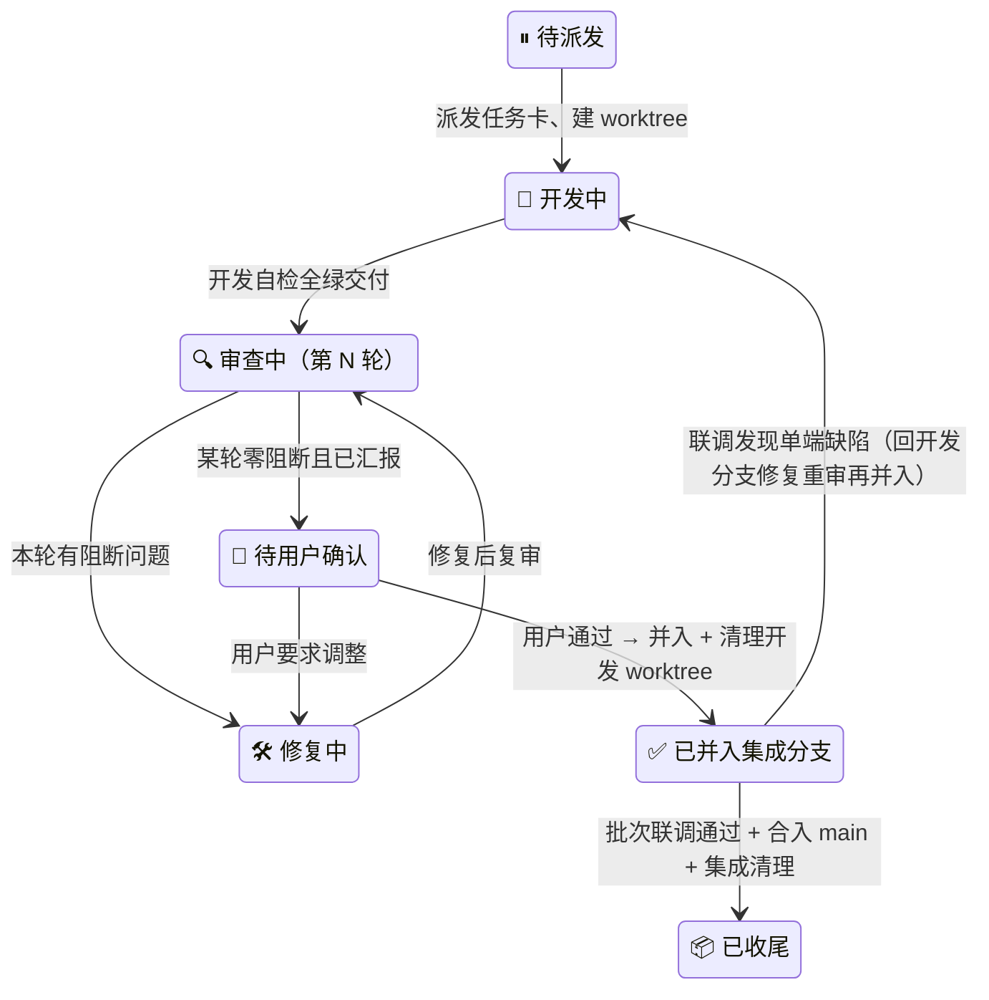

# 校园二手交易平台 · 进度看板

_版本 v0.1（骨架版）· 建立 2026-10-20 · 最后更新 2026-10-20 · 维护人：主 agent（唯一写入者）· 依据：[项目规范](00-项目规范.md) v0.4 · [需求分析](../需求分析.md) v1.0_

---

## 📋 文档定位与维护规则

本看板是全部开发任务的**调度与状态唯一事实源**：批次进度、任务行、槽位占用、审查轮次、联调结果、收尾核验均以此为准。任何 agent 不得凭对话记忆调度。

1. **主 agent 唯一写入**；开发 / 审查 / 修复 / 联调 agent 与用户只读。
2. **更新时机与任务生命周期同步**：派发时登记任务行 → 每轮审查后追加留痕 → 用户确认后更新状态 → 并入集成分支 / 合入 main 时登记 → 收尾核验逐项打勾。
3. **留痕只追加不删改**：审查与联调记录即使后续被推翻也保留原行，新结论另起一行（保证"审查清零 / 联调通过"凭据链完整）。
4. 任务行 b1 起随该批任务计划定稿逐批补入；本骨架版先固定批次框架、槽位表与状态机。契约修订任务（`feat/api/*`）同样登记任务行，代号 `b<批次>api`，无隔离参数。

## 📌 当前快照

| 项 | 状态 |
| --- | --- |
| 当前批次 | **b0 骨架与契约**（🔨 进行中） |
| 已落里程碑 | 需求分析 v1.0 ✅ · 项目规范 v0.4 ✅ · 契约基线 0.1.0 ✅（2026-10-20）· 双端总纲 v1.0 ✅（2026-10-20） |
| 下一步 | 派发 b0 双端骨架任务（b0be / b0fe），**等待用户指示** |
| 存储容器 | 由用户启停，不在此登记（运行状态用 `docker compose ps` 查看） |

## 📅 批次总表

各批后端 / 前端范围与首次用到的包以[项目规范](00-项目规范.md)「开发批次」为准，此处不重复，只跟踪进度与契约冻结版本。

| 批次 | 域 | 集成分支 | 契约冻结版本 | 状态 | 联调 | 合入 main |
| --- | --- | --- | --- | --- | --- | --- |
| b0 | 骨架与契约 | `integration/b0-skeleton` | 0.1.0（已冻结） | 🔨 进行中 | — | — |
| b1 | 用户域 | `integration/b1-user` | — | ⏳ 未开始 | — | — |
| b2 | 商品域 | `integration/b2-product` | — | ⏳ 未开始 | — | — |
| b3 | 交易域 | `integration/b3-order` | — | ⏳ 未开始 | — | — |
| b4 | 聊天域 | `integration/b4-chat` | — | ⏳ 未开始 | — | — |
| b5 | 管理域 | `integration/b5-admin` | — | ⏳ 未开始 | — | — |
| b6 | 集成收尾 | `integration/b6-release` | — | ⏳ 未开始 | — | — |

- 批次状态枚举：⏳ 未开始 → 🔨 进行中 → 🧪 联调中 → ✅ 已合入 main → 📦 已归档（批次 worktree 全清）。
- b3 / b4 互不依赖，是否并行由用户在 b2 完成后决定；启用并行时在槽位表登记第二集成槽位。
- 契约冻结版本 = 该批双端开工时 [CHANGELOG](../api/CHANGELOG.md) 最新版本号；批次内契约微调走修订流程并同步更新此列。

## 🧩 任务行

**任务代号即隔离键**：MySQL 表前缀 `<代号>-`、MongoDB 库 `<MONGO_DB>_<代号>`、Chroma 集合后缀 `<代号>`；集成 worktree 代号为 `int<批次>`。端口与 Redis 库基址见槽位表。

### b0 · 骨架与契约

| 代号 | 端 | 任务 | 分支 | worktree | 槽位 | 状态 | 备注 |
| --- | --- | --- | --- | --- | --- | --- | --- |
| b0be | 后端 | 工程骨架拉起：公共定义与统一响应、Swagger 路由、`/api/health`、迁移基线、pytest / ruff 基线 | `feat/be/b0-skeleton` | `.worktree/b0be` | A | ⏸ 待派发 | 约束见 [backend/00-骨架与契约](backend/00-骨架与契约.md) |
| b0fe | 前端 | 工程骨架拉起：路由与四态守卫、布局与设计令牌、api 客户端与 mock 机制、openapi 类型生成脚本 | `feat/fe/b0-skeleton` | `.worktree/b0fe` | A | ⏸ 待派发 | 约束见 [frontend/00-骨架与契约](frontend/00-骨架与契约.md) |

> 分支名为拟定（b0 范围固定自项目规范批次表），最终以主 agent 任务卡为准；任务卡同时下发隔离参数（端口、`DB_TABLE_PREFIX` 等）。

### b1 – b6

各批任务行随该批任务计划定稿补入（复制上表结构；同端多任务代号加序号，如 `b2be` / `b2be2`）。

## 🔄 任务状态机（任务行「状态」列合法值）



状态标注格式：`🔍 审查中（第 2 轮 · 1 阻断）`——括号内为最新一轮摘要，明细见留痕。

## 🔌 槽位与端口登记

| 槽位 | 后端端口 | 前端端口 | Redis 库基址 | 占用 | 备注 |
| --- | --- | --- | --- | --- | --- |
| 主仓（main） | `5000` | `5173` | `0`（db0–3） | 常驻 | 主仓 `.env` 永不加前缀 |
| 开发 A | `5010` | `5180` | `4` | 空闲 | 同批次配对双端任务默认共用本槽位（端口互不冲突） |
| 开发 B | `5020` | `5190` | `8` | 空闲 | 同端并行多任务时启用 |
| 集成 | `5030` | `5200` | `12` | 空闲 | 集成 worktree `.worktree/int<批次>` |
| 集成 · 备 | `5040` | `5210` | 届时分配 | 未启用 | 仅 b3/b4 并行时经用户决定启用，存储参数届时登记 |

占用登记格式：`b1be @ 2026-10-22`；任务收尾后改回"空闲"。MySQL / Mongo / Chroma 隔离随任务代号派生（见「任务行」），不在此表登记。

## 🧾 审查留痕（只追加）

每轮审查后由主 agent 摘要登记，修复说明附于同行。

```text
### <代号> · <任务名>
| 轮次 | 时间 | 阻断 / 建议 | 修复摘要 | 结果 |
| --- | --- | --- | --- | --- |
| 1 | | 3 / 2 | | 修复待复审 |
```

（暂无记录）

## 🧪 联调留痕（只追加）

每批次联调后由主 agent 摘要登记：冒烟清单结果、批次验收用例结果、问题分诊、结论与用户确认时间。

```text
### bN · integration/bN-域
- 冒烟：X/Y 通过 · 验收用例：X/Y 通过
- 问题分诊：单端缺陷 → <代号> 回退开发；集成性问题 → 集成分支修复复核
- 结论：<通过 / 不通过> · 用户确认：<时间 / 待确认>
```

（暂无记录）

## ✅ 收尾核验清单（主 agent 逐项打勾）

任务级（单任务闭环）：

- [ ] 某轮审查零阻断且留痕完整
- [ ] 用户确认记录（时间）
- [ ] 隔离数据已清理：`<代号>-` 前缀表 DROP · 独立 Mongo 库删除 · Chroma 集合删除
- [ ] 已并入集成分支
- [ ] 开发 worktree 已 remove、开发分支已删

批次级（合入 main 前后）：

- [ ] 联调通过且留痕完整
- [ ] 用户确认记录（时间）
- [ ] `int<批次>-` 前缀表等集成隔离数据已清理
- [ ] 集成 worktree 与集成分支已删
- [ ] 批次总表状态更新为 ✅ / 📦

## 🗺 相关文档

| 文档 | 作用 |
| --- | --- |
| [项目规范](00-项目规范.md) | 流程、批次范围、隔离与合并门禁（本看板的规则来源） |
| [backend/00-骨架与契约](backend/00-骨架与契约.md) | 后端端内总纲 |
| [frontend/00-骨架与契约](frontend/00-骨架与契约.md) | 前端端内总纲 |
| [openapi.yaml](../api/openapi.yaml) · [websocket-事件.md](../api/websocket-事件.md) · [CHANGELOG](../api/CHANGELOG.md) | 契约三件与变更记录 |
