# 校园二手交易平台需求分析

_课程设计项目 · 2026-10-18 · 版本 v1.0 · 状态：已确认_

---

## 📋 项目概述

### 文档说明

本文档是校园二手交易平台的**需求基线**，用于指导后续概要设计、详细设计、编码实现与答辩验收。文档以 Markdown 为唯一源文件；本期交付物仅本文档，docx 版本按课程要求后续导出。

需求来源为课程设计任务书与三轮澄清访谈。任务书中 `docs/ 实验过程/` 目录明确排除，不作为需求来源，也不在本文档中引用。

### 项目定位

一个**以学校为边界的校园二手交易平台**。学生注册并通过校园认证后，只能看到、搜索到、交易到本校同学发布的商品；平台提供发布、浏览、推荐、搜索、下单、模拟支付、线下面交确认、评价、实时聊天与后台管理的一站式闭环。

项目的交付标准不是"上线运营"，而是**可运行、可演示、可讲清楚**：一条命令拉起全部依赖，一套种子数据支撑完整演示链路，一份能撑起答辩的技术文档。

### 成功标准

| 维度 | 判定标准 |
| --- | --- |
| 可运行 | `docker compose up -d` 拉起四个存储服务后，前后端本地启动即可访问，无手工建库步骤 |
| 可演示 | 一条演示脚本覆盖注册→认证→发布→浏览→推荐→搜索→聊天→下单→支付→确认→评价全流程，无卡点 |
| 可解释 | 四类存储的职责边界、推荐与搜索的算法链路、同校隔离的实现层次，均能在答辩中讲清并指出代码位置 |
| 可维护 | 数据模型有迁移脚本，种子数据可重复生成，配置全部外置为环境变量 |

### 范围边界

**包含**：用户与认证、商品、交易、聊天、管理五大模块；四类存储的读写链路；向量推荐与向量搜索；模拟支付。

**不包含**：真实支付渠道对接、物流与收货地址、教务系统对接、短信与邮件服务、移动端 App、真实生产部署与运维、跨校交易。

**反目标**（技术上跑通但视为失败）：未认证用户能看到任何商品；跨校商品出现在列表、搜索或推荐中；聊天消息只存在于内存或缓存中导致重启丢失；推荐结果用纯随机冒充画像推荐。

### 范围与优先级基线

本期交付范围是 **P0 + P1 全部实现，P2 不实现**。这条基线决定了后续计划的排期口径，也决定了"什么算没做完"。

| 优先级 | 条数 | 本期处理 |
| --- | ---: | --- |
| P0 | 39 | 必须交付，缺失即验收不通过 |
| P1 | 9 | 必须交付，与 P0 同等待遇 |
| P2 | 1 | 明确不实现，功能点从界面移除，不在文档与答辩中承诺 |

P1 中包含几处容易被当成"开关"、实则是独立模块的工作量，排期时需单列：支付超时关闭需要定时任务与商品回滚、已支付订单取消需要订单状态机多一条边并联动商品状态、操作日志需要独立表与后台查询页、敏感词待复核需要词库与复核队列、分类管理需要后台 CRUD 页面。

> 📌 **前置状态**：本仓库此前只有文档，没有任何应用代码，属于从零开始。README 中的"重写版"仅指文档层面的重写，不存在需要对齐的旧版表名、接口路径或 UI 风格。

---

## 👥 角色与权限

### 角色定义

| 角色 | 判定条件 | 说明 |
| --- | --- | --- |
| 游客 | 未登录 | 仅可注册、登录、找回密码、查询学校与校区列表 |
| 未认证用户 | 已登录且 `auth_status != approved` | 可维护个人信息、提交认证材料，**不能浏览任何商品** |
| 认证学生 | 已登录且 `auth_status = approved` | 平台全部 C 端功能，作用域限定本校 |
| 管理员 | `role = admin` | 跨校可见，负责审核、处置与统计，**不能发布商品或下单** |

### 权限矩阵

| 功能 | 游客 | 未认证用户 | 认证学生 | 管理员 |
| --- | :---: | :---: | :---: | :---: |
| 注册 / 登录 / 找回密码 | ✅ | ✅ | ✅ | ✅ |
| 查询学校与校区列表 | ✅ | ✅ | ✅ | ✅ |
| 维护个人信息、上传头像 | ❌ | ✅ | ✅ | ✅ |
| 提交校园认证 | ❌ | ✅ | ❌ | ❌ |
| 浏览 / 搜索 / 查看商品详情 | ❌ | ❌ | ✅ 本校 | ✅ 全校 |
| 发布 / 编辑 / 上下架商品 | ❌ | ❌ | ✅ | ❌ |
| 收藏商品 | ❌ | ❌ | ✅ | ❌ |
| 创建订单 / 支付 / 确认完成 | ❌ | ❌ | ✅ 本校 | ❌ |
| 评价订单 | ❌ | ❌ | ✅ | ❌ |
| 实时聊天 | ❌ | ❌ | ✅ 本校 | ❌ |
| 用户管理 / 商品处置 / 统计 | ❌ | ❌ | ❌ | ✅ |

> 📌 **关键约束**：所有商品相关能力（浏览、搜索、详情、收藏、推荐、下单、聊天入口）在**未通过校园认证时一律返回 403**，这是平台最硬的准入线。

---

## 🧩 功能需求

功能编号规则：`FR-<模块>-<序号>`。优先级：P0 与 P1 本期均必须实现，P2 本期不实现（详见"范围与优先级基线"）。

### 用户模块

| 编号 | 需求 | 说明 | 优先级 |
| --- | --- | --- | --- |
| FR-USR-01 | 用户注册 | 用户名、密码、邮箱、学号为必填；用户名与学号全局唯一；密码强度不低于 8 位含字母与数字 | P0 |
| FR-USR-02 | 用户登录 | 支持用户名或学号登录；成功后签发 JWT；连续 5 次失败限流 10 分钟 | P0 |
| FR-USR-03 | 退出登录 | 前端清除令牌，服务端将 `jti` 写入黑名单直至过期 | P0 |
| FR-USR-04 | 个人信息管理 | 可修改昵称、头像、邮箱、手机号；学号与用户名注册后不可改 | P0 |
| FR-USR-05 | 修改密码 | 校验原密码后设置新密码 | P0 |
| FR-USR-06 | 密码重置 | 提交用户名 + 注册学号（或注册邮箱）校验一致后直接设置新密码，不发送邮件或短信 | P0 |
| FR-USR-07 | 校园认证提交 | 选择学校（多校区学校必须选择校区）、填写真实姓名、上传学生证照片、提交审核 | P0 |
| FR-USR-08 | 认证状态查询 | 展示未认证 / 待审核 / 已通过 / 已驳回，驳回时展示管理员填写的原因 | P0 |
| FR-USR-09 | 认证材料重提 | 被驳回后可修改材料重新提交，历史申请保留 | P1 |
| FR-USR-10 | 展示名生成 | 认证通过后展示名固定为 `昵称-学校名称`，多校区学校为 `昵称-学校名称(校区名称)` | P0 |
| FR-USR-11 | 用户主页 | 同校认证学生可查看他人主页：展示名、信誉分、在售商品数、收到的评价 | P1 |

### 商品模块

| 编号        | 需求     | 说明                                                   | 优先级 |
| --------- | ------ | ---------------------------------------------------- | --- |
| FR-GDS-01 | 商品发布   | 标题、描述、价格、分类、成色、1–9 张图片为必填；发布后立即上架                    | P0  |
| FR-GDS-02 | 商品编辑   | 仅发布者可编辑；编辑后异步重建向量与失效缓存                               | P0  |
| FR-GDS-03 | 商品列表   | 本校在售商品分页列表，支持分类、价格区间、成色、关键词排序筛选                      | P0  |
| FR-GDS-04 | 商品详情   | 展示图片轮播、价格、描述、卖家展示名与信誉分、发布者收藏数；非本校返回 404              | P0  |
| FR-GDS-05 | 商品搜索   | 输入名称向量化后经 Chroma 余弦召回，再按分类与价格二次过滤                    | P0  |
| FR-GDS-06 | 首页推荐   | 每次返回 40 个商品（5 列 × 8 行），80% 画像推荐 + 20% 随机，冷启动全随机       | P0  |
| FR-GDS-07 | 商品状态管理 | 上架 / 下架 / 交易中 / 已售四种状态，状态流转见业务规则                     | P0  |
| FR-GDS-08 | 商品收藏   | 收藏与取消收藏，收藏触发画像更新；个人中心可查看收藏列表                         | P0  |
| FR-GDS-09 | 分类管理   | 管理员维护全局单级分类，含名称、排序、启用状态                              | P1  |
| FR-GDS-10 | 我的商品   | 卖家查看自己发布的商品，按状态筛选，可编辑、上下架、删除                         | P0  |
| FR-GDS-11 | 图片上传   | 单图不超过 5 MB，仅允许 jpg/png/webp；文件落本地目录，数据库仅存图片 id 与相对路径 | P0  |

### 交易模块

| 编号 | 需求 | 说明 | 优先级 |
| --- | --- | --- | --- |
| FR-ORD-01 | 订单创建 | 买家对在售商品下单，立即锁定商品为交易中；不能购买自己发布的商品 | P0 |
| FR-ORD-02 | 订单列表 | 区分"我买到的"与"我卖出的"，按状态筛选分页 | P0 |
| FR-ORD-03 | 订单详情 | 展示商品快照、金额、状态、交易地点与备注、状态变更时间线 | P0 |
| FR-ORD-04 | 模拟支付 | 展示固定二维码与"使用微信/支付宝扫码"文案，点击"已完成支付"后前端轮询，后端一律返回支付成功 | P0 |
| FR-ORD-05 | 交易确认 | 买家点击"确认交易完成"，订单转已完成，商品转已售 | P0 |
| FR-ORD-06 | 订单取消 | 买家在待支付阶段可取消；已支付阶段需双方协商由买家发起，商品回到上架 | P1 |
| FR-ORD-07 | 支付超时关闭 | 待支付订单 30 分钟未支付自动关闭并释放商品 | P1 |
| FR-ORD-08 | 订单评价 | 订单完成后买家可对卖家打 1–5 星并填写文字，每单一次且不可修改 | P0 |
| FR-ORD-09 | 卖家信誉分 | 取该卖家全部评价评分的算术平均，保留两位小数，无评价展示"暂无" | P0 |
| FR-ORD-10 | 订单状态跟踪 | 每次状态变更写入状态流水，供详情页时间线与后台统计使用 | P0 |

### 聊天模块

| 编号 | 需求 | 说明 | 优先级 |
| --- | --- | --- | --- |
| FR-CHT-01 | 实时消息 | 基于 WebSocket（Socket.IO）双向推送，连接握手携带 JWT | P0 |
| FR-CHT-02 | 会话模型 | 用户维度单会话，同一对用户全局只有一条会话线，与商品无关 | P0 |
| FR-CHT-03 | 发起聊天 | 从商品详情页或用户主页发起，已存在会话则直接复用 | P0 |
| FR-CHT-04 | 聊天记录 | MySQL 全量持久化，历史消息分页拉取；Redis 缓存最近 50 条 | P0 |
| FR-CHT-05 | 消息已读 | 进入会话上报已读，未读数实时清零并同步给对端 | P1 |
| FR-CHT-06 | 在线状态 | 连接建立写 Redis 在线键（TTL 60 秒）并定时续期，断开或过期即离线 | P0 |
| FR-CHT-07 | 会话列表 | 按最后消息时间倒序，展示对方展示名、最后一条消息摘要与未读数 | P0 |
| FR-CHT-08 | 输入中提示 | 对端实时展示"正在输入" | P2 |

### 管理模块

| 编号 | 需求 | 说明 | 优先级 |
| --- | --- | --- | --- |
| FR-ADM-01 | 认证审核 | 待审核队列，查看学生证照片，通过或驳回并填写原因 | P0 |
| FR-ADM-02 | 用户管理 | 用户列表（跨校）、按学校与认证状态筛选、封禁与解封、撤销认证；仅展示展示名、认证状态与统计信息，**不展示手机号等联系方式** | P0 |
| FR-ADM-03 | 商品处置 | 全校商品列表，强制下架、恢复上架、删除，填写处置原因并留痕 | P0 |
| FR-ADM-04 | 待复核队列 | 发布时命中敏感词库的商品自动标记待复核，进入管理员处置队列 | P1 |
| FR-ADM-05 | 数据统计 | 用户数、认证通过数、待审核数、商品数、在售数、已售数、订单数、成交金额、分类分布、近 7 日趋势 | P0 |
| FR-ADM-06 | 学校管理 | 新增、编辑、停用学校；"是否多校区"开关，开启后可维护多个校区 | P0 |
| FR-ADM-07 | 学校批量导入 | 上传 csv/xlsx 导入学校与校区，支持模板下载与逐行错误报告 | P0 |
| FR-ADM-08 | 分类管理 | 全局单级分类的新增、编辑、排序、停用 | P1 |
| FR-ADM-09 | 操作日志 | 管理员对用户、商品、认证的每次处置写入日志，含操作人、对象、动作、原因、时间 | P1 |

### 功能结构

_功能结构总览。思维导图不支持无障碍标注，故以本段文字替代图示描述：平台分为用户、商品、交易、聊天、管理五个一级模块，各模块下挂具体功能点。_

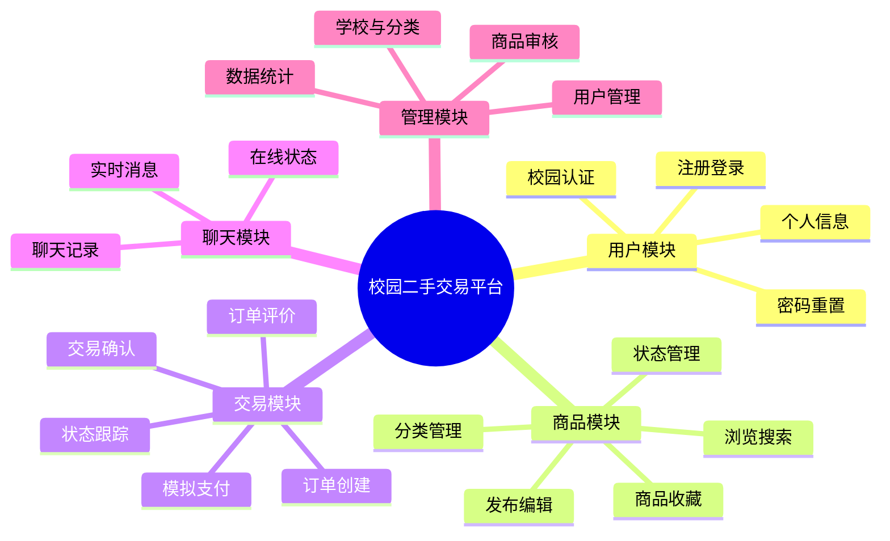

---

## 📌 关键业务规则

### 同校隔离

学校是平台的**数据分区键**。所有商品域数据（商品、订单、评价、会话）在写入时冗余 `school_id`，读取时以单列谓词过滤，避免多层 join 带来的性能与漏过滤风险。

隔离规则：

- 认证学生的一切商品查询附加 `school_id = 当前用户 school_id`。
- 多校区不构成隔离边界：同校跨校区交易合法，校区只影响展示与可选的同校区筛选。
- 非本校资源统一返回 **404 而非 403**，避免通过状态码探测他校资源是否存在。
- 管理员查询跨校数据，但只读与处置，不具备交易能力。
- 缓存键必须包含 `school_id`，否则会串校。

### 校园认证

认证是"选学校 + 上传学生证 + 管理员人工审核"，不接入任何教务系统。

- 学校选择发生在认证申请阶段，注册阶段只填学号。
- 认证申请中的学号必须与注册学号一致，不一致直接拒绝提交，防止代认证。
- 多校区学校必须选择校区；单校区学校校区字段置空。
- 通过后 `users.school_id` / `campus_id` 落库，`display_name` 重算。
- 撤销认证后用户回到未认证态，历史订单与消息保留但不可再产生新交易。

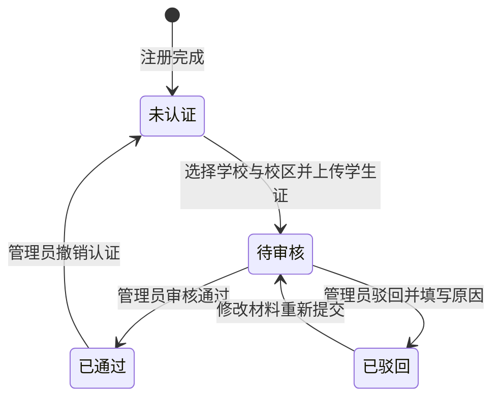

### 商品状态

发布即上架，不做发布前审核；管理员执行的是**事后处置**。

发布时对标题与描述做敏感词匹配：命中词库的商品照常上架并可见，同时 `moderation_status` 置为 `待复核` 并进入管理员处置队列；管理员处理后置为 `已处置`（强制下架或删除）或 `正常`（驳回误报）。未命中的商品直接置为 `正常`。

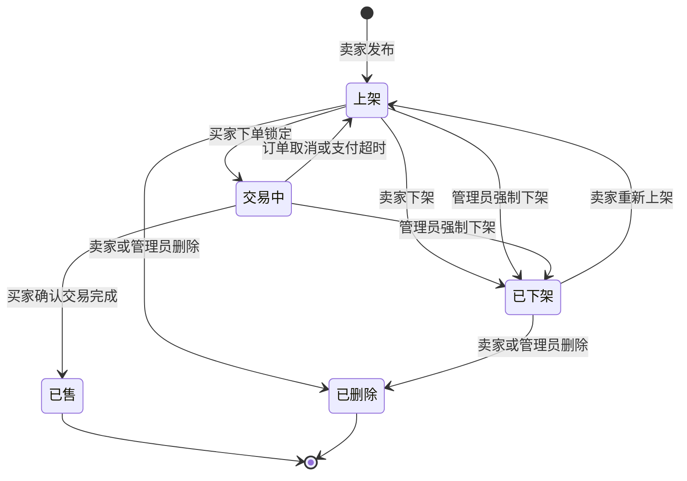

只有 `上架` 状态参与列表、搜索与推荐；`交易中` 仅对买卖双方与管理员可见。

卖家主动下架后商品回到 `已下架`；管理员强制下架的商品**只有管理员能恢复上架**，卖家无法自行重新上架，避免违规商品反复出现。

### 订单与支付

交易为纯线下面交，**不采集收货地址**。订单只记录约定交易地点（自由文本，可空）与买家备注。

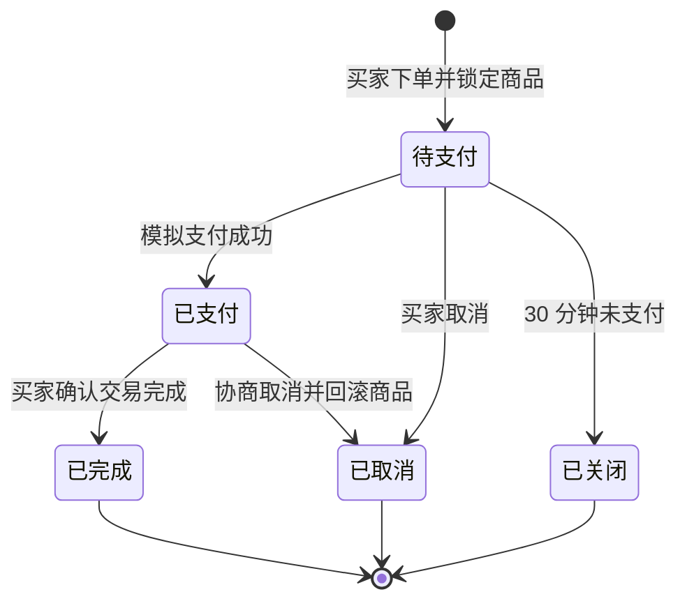

**模拟支付规则**（这是本项目的显式简化，答辩时需说明）：

1. 订单页点击"立即支付"，后端生成一条支付记录并返回固定二维码资源。
2. 界面展示"使用微信 / 支付宝扫码"，二维码内容固定为一句话，不具备任何支付能力。
3. 二维码下方"已完成支付"按钮触发前端向后端轮询查询支付状态。
4. 后端查询接口**一律返回支付成功**，并推进订单状态为已支付。
5. 不接入微信支付、支付宝或任何第三方支付 SDK。

**取消与超时规则**：

- 待支付阶段买家可直接取消，商品回到上架。
- 已支付阶段允许买家发起取消，取消后商品回滚为上架、支付记录置为已退款，订单终止；该动作视为双方线下已达成一致，平台不做仲裁。
- 待支付订单超过 30 分钟未支付，由定时任务关闭并释放商品。

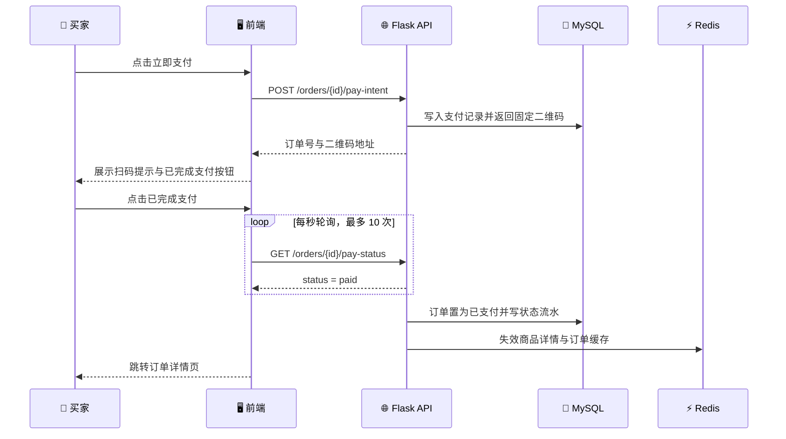

### 评价与信誉

- 仅买家评卖家，一单一评，完成后 30 天内可评。
- 评分 1–5 星必填，文字 0–500 字可选。
- 卖家信誉分为全部评价的算术平均，缓存于 Redis 评价库，新增评价时增量重算。

### 聊天

- 会话为用户对维度：`user_a_id < user_b_id` 规范化唯一约束，避免双份会话。
- 会话双方必然同校（创建会话时校验），跨校会话不可能存在。
- 消息全量写 MySQL；Redis 只保留最近 50 条与未读数，属于可丢弃的加速层。
- 在线状态以 Redis 键 TTL 实现，不做长连接注册中心。
- 消息支持文本与图片两种类型，图片复用统一上传能力，`content_type` 区分；不支持消息撤回。

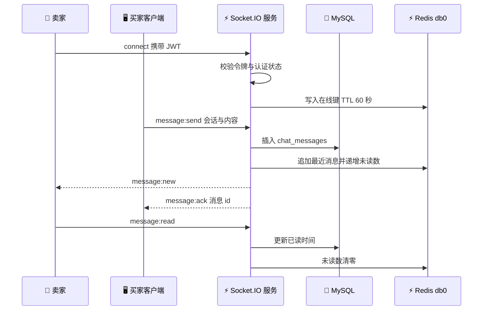

### 学校与校区

- 学校由管理员后台维护，字段含名称、是否多校区、启用状态。
- 勾选"是"后必须录入至少一个校区；关闭多校区时若有用户已绑定校区，需先迁移或提示。
- 支持 csv/xlsx 批量导入，模板列：学校名称、是否多校区、校区名称（多校区用分号分隔）。
- 导入采用"逐行校验 + 部分成功"策略，返回成功行数与失败行号及原因。

### 图片

- 数据库 `images` 表只存 `id`、相对路径、MIME、大小、哈希、用途、上传者。
- 实体文件落 `backend/uploads/`，按 `用途/年月/` 分目录，文件名使用内容哈希。
- 访问经由后端鉴权路由转发，**不暴露可枚举的静态目录**；学生证照片仅本人与管理员可读。

---

## 🏗️ 系统架构

### 技术栈

| 层 | 选型 | 说明 |
| --- | --- | --- |
| 前端 | React 18 + Vite | 单页应用，`pnpm` 管理，Vite 代理 `/api` 与 `/socket.io` |
| 后端 | Python Flask | 应用工厂 + 蓝图分层，Flask-SocketIO 承载 WebSocket |
| 结构化存储 | MySQL 8 | 用户、学校、商品、订单、评价、聊天等主数据 |
| 交互记录 | MongoDB 7 | 用户画像向量、行为流水、商品向量权威副本 |
| 向量检索 | Chroma | 商品向量索引，使用余弦距离 |
| 缓存 | Redis 7 | 聊天 / 评价 / 商品三库分离，另有系统库 |
| 向量模型 | Qwen3-Embedding | OpenAI 兼容协议，云端优先、本地兜底，见下节 |
| 部署 | Docker Compose | 仅承载四个存储服务，前后端本地进程运行 |

### Embedding 端点

向量模型是推荐与搜索的前提，也是本项目唯一的外部模型依赖。设计上**同时支持云端与本地两种来源，云端优先、本地兜底**，避免答辩现场断网导致演示链断裂。

| 模式 | 端点形态 | 启用条件 |
| --- | --- | --- |
| 云端 | DashScope 或其他 OpenAI 兼容服务 | `EMBEDDING_BASE_URL` 配置了可用的云端地址且探测通过 |
| 本地 | 进程内加载 `Qwen3-Embedding-0.6B`，对外包一层 OpenAI 兼容 HTTP 接口 | 云端未配置或探测失败时自动切换 |

落地要求：

- 提供一个独立的本地向量服务启动脚本，暴露 `/v1/embeddings` 与 `/v1/models`，协议与云端一致，业务代码无需区分来源。
- 启动时探测当前端点，把生效模式写入日志与 `/api/health` 响应，便于演示时直接展示"当前走的是本地还是云端"。
- 模型与维度必须与 Chroma 集合一致。默认 `Qwen3-Embedding-0.6B`、1024 维；若切换模型或改维度，必须清空并重建 Chroma 集合与 MongoDB 中的商品向量。
- 本地模式首次启动需下载模型权重，该步骤写入 README 的"首次运行"章节，不能留到演示现场。
- 本机当前未安装 `ollama` / `vllm`，也未配置任何推理端点，因此本地模式所需的 Python 依赖与模型权重需作为环境准备阶段的一部分单独完成。

> ⚠️ **风险提示**：若本地模型加载失败且云端不可用，推荐与搜索会进入降级路径。降级能保证系统不崩，但 AC-07 与 AC-09 将无法通过，因此本地模式必须在上线演示前实测通过。

### 架构总览

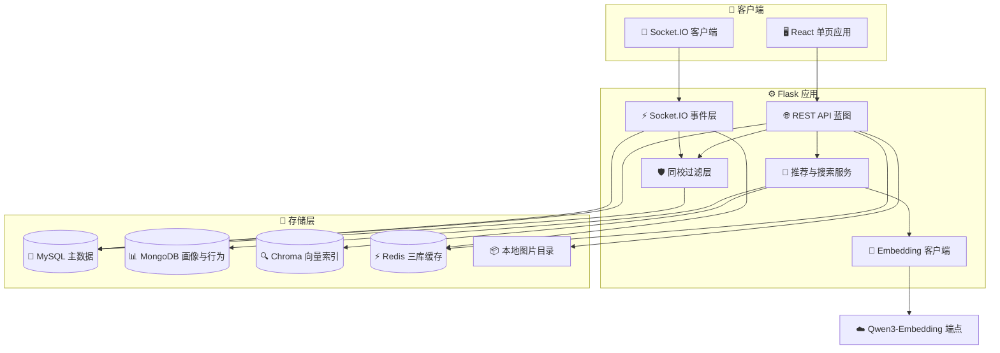

### 同校过滤层

过滤层是**横切关注点**，不是某个接口里的 if 判断。它由三段组成，缺一不可：

1. **准入装饰器**：`@login_required` 校验 JWT，`@verified_required` 校验认证状态，未过返回 403。
2. **作用域上下文**：请求进入时解析 `school_id` 注入 `g.school_id`，管理员标记 `g.scope_all = True`。
3. **查询改写**：所有商品域仓库方法只接受 `scoped_query(model)` 返回的已过滤查询对象，禁止直接 `Model.query`；Chroma 查询统一注入 `school_id` 条件；Redis 键统一由 `scoped_key()` 生成。

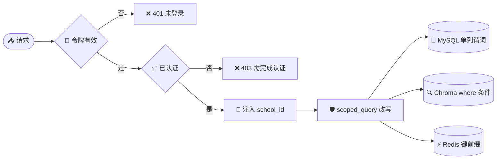

> 💡 **设计取舍**：把 `school_id` 冗余到商品、订单、评价、会话四张表，是用少量存储换掉每次查询的关联判断。这是本项目隔离正确性的主要保障，也是答辩时应重点说明的一处设计决策。

### 接口契约

REST 接口统一前缀 `/api`，统一响应体 `{ code, message, data }`，分页参数 `page` / `page_size`，默认 20 条、上限 100 条。

| 分组 | 方法 | 路径 | 说明 |
| --- | --- | --- | --- |
| 认证 | POST | `/api/auth/register` | 注册 |
| 认证 | POST | `/api/auth/login` | 登录，返回 JWT |
| 认证 | POST | `/api/auth/logout` | 注销并拉黑令牌 |
| 认证 | POST | `/api/auth/password/reset` | 校验学号或邮箱后重置 |
| 用户 | GET / PUT | `/api/users/me` | 读取 / 更新个人资料 |
| 用户 | PUT | `/api/users/me/password` | 修改密码 |
| 用户 | POST | `/api/users/me/avatar` | 上传头像 |
| 用户 | GET | `/api/users/{id}` | 同校用户主页 |
| 认证 | POST | `/api/certification/applications` | 提交认证材料 |
| 认证 | GET | `/api/certification/applications/mine` | 我的认证记录 |
| 学校 | GET | `/api/schools` | 学校与校区列表（公开） |
| 商品 | GET | `/api/products` | 本校商品列表 |
| 商品 | POST | `/api/products` | 发布商品 |
| 商品 | GET | `/api/products/{id}` | 商品详情 |
| 商品 | PUT | `/api/products/{id}` | 编辑商品 |
| 商品 | PATCH | `/api/products/{id}/status` | 上下架 |
| 商品 | DELETE | `/api/products/{id}` | 删除商品 |
| 商品 | GET | `/api/products/search` | 向量搜索 |
| 商品 | POST / DELETE | `/api/products/{id}/favorite` | 收藏 / 取消收藏 |
| 商品 | GET | `/api/categories` | 分类列表 |
| 推荐 | GET | `/api/recommendations/home` | 首页 40 个商品 |
| 订单 | POST | `/api/orders` | 创建订单 |
| 订单 | GET | `/api/orders` | 我买到的 / 我卖出的 |
| 订单 | GET | `/api/orders/{id}` | 订单详情与状态时间线 |
| 订单 | POST | `/api/orders/{id}/pay-intent` | 发起模拟支付 |
| 订单 | GET | `/api/orders/{id}/pay-status` | 查询支付状态（恒成功） |
| 订单 | POST | `/api/orders/{id}/complete` | 确认交易完成 |
| 订单 | POST | `/api/orders/{id}/cancel` | 取消订单 |
| 订单 | POST | `/api/orders/{id}/review` | 提交评价 |
| 聊天 | GET | `/api/conversations` | 会话列表 |
| 聊天 | POST | `/api/conversations` | 创建或复用会话 |
| 聊天 | GET | `/api/conversations/{id}/messages` | 历史消息分页 |
| 聊天 | POST | `/api/conversations/{id}/read` | 上报已读 |
| 管理 | GET | `/api/admin/certifications` | 认证审核队列 |
| 管理 | POST | `/api/admin/certifications/{id}/review` | 通过或驳回 |
| 管理 | GET / PATCH | `/api/admin/users` | 用户管理与封禁 |
| 管理 | GET | `/api/admin/products` | 全校商品 |
| 管理 | POST | `/api/admin/products/{id}/takedown` | 强制下架 / 恢复 |
| 管理 | GET / POST / PUT | `/api/admin/schools` | 学校维护 |
| 管理 | POST | `/api/admin/schools/import` | csv/xlsx 导入 |
| 管理 | GET / POST / PUT | `/api/admin/categories` | 分类维护 |
| 管理 | GET | `/api/admin/stats/overview` | 核心指标 |
| 管理 | GET | `/api/admin/stats/trend` | 近 7 日趋势 |

WebSocket 事件：

| 方向 | 事件 | 载荷 |
| --- | --- | --- |
| C → S | `connect` | `auth: { token }` |
| C → S | `conversation:join` | `conversation_id` |
| C → S | `message:send` | `conversation_id`, `content`, `content_type` |
| S → C | `message:new` | `message_id`, `sender_id`, `content`, `created_at` |
| S → C | `message:ack` | `client_msg_id`, `message_id` |
| C → S | `message:read` | `conversation_id`, `last_message_id` |
| S → C | `presence:update` | `user_id`, `online` |
| C → S | `typing` | `conversation_id` |

---

## 💾 数据设计

### 存储职责划分

| 存储 | 职责 | 权威性 |
| --- | --- | --- |
| MySQL | 绝大多数结构化主数据：用户、学校、校区、认证、分类、商品、图片、收藏、订单、状态流水、评价、会话、消息、管理日志 | 唯一权威 |
| MongoDB | 用户画像向量、行为流水（点击/收藏/购买）、商品向量副本 | 画像与向量权威 |
| Chroma | 商品向量检索索引 | 派生，可从 MongoDB 重建 |
| Redis | 聊天、评价、商品三块热数据缓存 + 系统库 | 派生，可随时清空 |

**向量一致性约定**：商品发布或编辑后先写 MongoDB `product_vectors`，再 upsert 到 Chroma。若 Chroma 写入失败，记录到 Redis 重试队列，由每 60 秒的补偿任务重放。Chroma 索引损坏时以 MongoDB 为准全量重建。

### MySQL 数据模型

数据模型按域拆为三张图，避免单图实体过多难以阅读。

**用户与校园域**

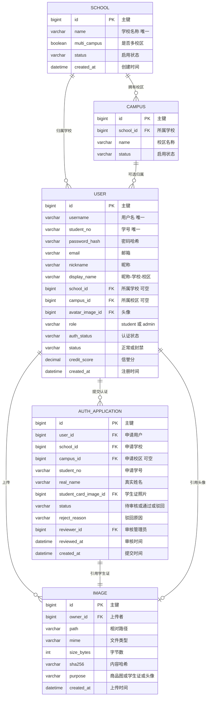

**商品域**

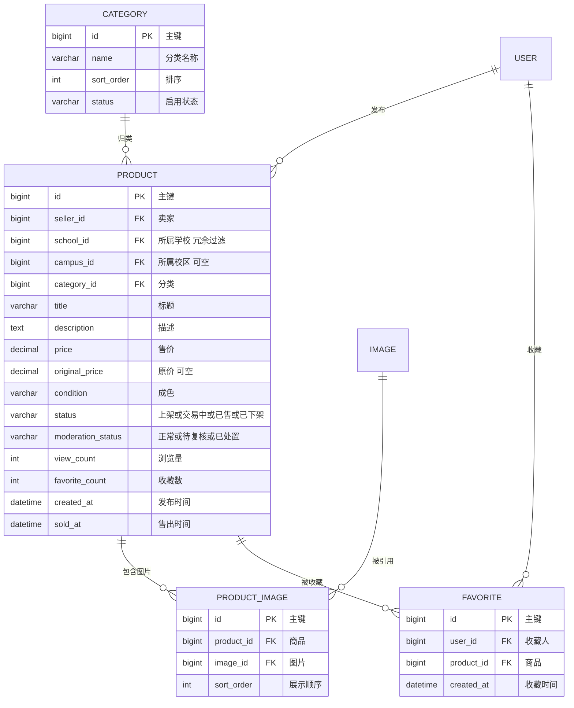

**交易与沟通域**

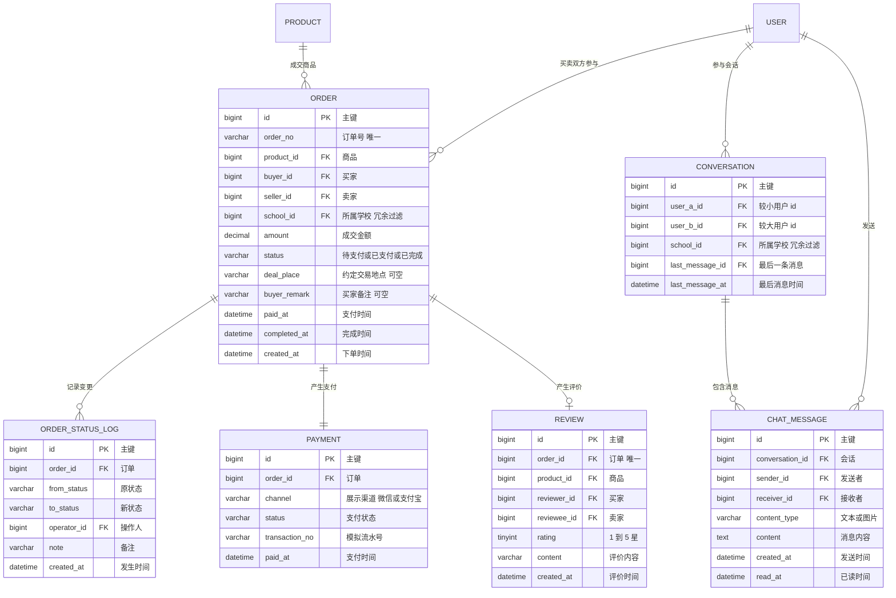

### MySQL 索引要点

| 表 | 索引 | 用途 |
| --- | --- | --- |
| `users` | `uk_username`、`uk_student_no`、`idx_school_auth` | 登录唯一性与审核队列 |
| `products` | `idx_school_status_created`、`idx_seller_status`、`idx_category` | 列表、我的商品、分类筛选 |
| `orders` | `uk_order_no`、`idx_buyer_status`、`idx_seller_status`、`idx_school_created` | 订单列表与统计 |
| `chat_messages` | `idx_conversation_created` | 历史消息分页 |
| `conversations` | `uk_user_pair`、`idx_user_a`、`idx_user_b` | 会话唯一性与列表 |
| `reviews` | `uk_order`、`idx_reviewee` | 一单一评与信誉分统计 |
| `favorites` | `uk_user_product`、`idx_user` | 防重复收藏 |

### MongoDB 集合

| 集合 | 字段 | 说明 |
| --- | --- | --- |
| `user_profiles` | `user_id`（唯一）、`vector`、`dim`、`model`、`behavior_count`、`updated_at` | 用户兴趣画像向量，未产生行为时不建文档 |
| `user_behaviors` | `user_id`、`product_id`、`action`、`weight`、`school_id`、`source`、`created_at` | 行为流水，只增不改 |
| `product_vectors` | `product_id`（唯一）、`vector`、`dim`、`model`、`text_hash`、`school_id`、`status`、`updated_at` | 商品向量权威副本 |

索引：`user_behaviors` 建 `(user_id, created_at)` 与 `(product_id)`；`user_profiles`、`product_vectors` 建 `user_id` / `product_id` 唯一索引。

### Chroma 集合

| 项 | 取值 |
| --- | --- |
| 集合名 | `product_vectors` |
| 距离度量 | `cosine` |
| id | 商品 id 的字符串形式 |
| embedding | Qwen3-Embedding 输出的 1024 维向量 |
| document | `标题 + 分类 + 成色 + 描述` 拼接文本 |
| metadata | `school_id`、`campus_id`、`category_id`、`price`、`status`、`seller_id` |

检索时 `where` 固定注入 `school_id` 与 `status = on_sale`，`n_results` 取召回上限的 1.5 倍以便过滤后仍有足够候选。

> 📌 **维度说明**：Qwen3-Embedding-0.6B 原生输出 1024 维，并支持通过 MRL 截断到更低的维度[^1]。本项目默认 1024 维，维度通过环境变量配置，切换模型时需同步重建全部向量。

### Redis 键设计

四个库在同一实例内以 database index 隔离：

| 库 | 模块 | 典型键 | 结构 / TTL |
| --- | --- | --- | --- |
| db0 | 聊天 | `chat:conv:{id}:recent` | LIST，保留最近 50 条，无 TTL |
| db0 | 聊天 | `chat:conv:{id}:meta` | HASH，最后消息与双方未读数 |
| db0 | 聊天 | `chat:online:{user_id}` | STRING，TTL 60 秒，心跳续期 |
| db0 | 聊天 | `chat:user:{id}:convs` | ZSET，score 为最后消息时间戳 |
| db1 | 评价 | `review:product:{id}:page:{n}` | STRING JSON，TTL 300 秒 |
| db1 | 评价 | `review:user:{id}:stats` | HASH，评价数、均值、星级分布 |
| db2 | 商品 | `product:detail:{school}:{id}` | STRING JSON，TTL 600 秒 |
| db2 | 商品 | `product:home:{school}:{user}` | STRING JSON，TTL 300 秒 |
| db2 | 商品 | `product:list:{school}:{hash}` | STRING JSON，TTL 120 秒 |
| db2 | 商品 | `product:category:all` | STRING JSON，TTL 3600 秒 |
| db3 | 系统 | `auth:blacklist:{jti}` | STRING，TTL 等于令牌剩余有效期 |
| db3 | 系统 | `lock:product:{id}` | STRING，下单锁，TTL 10 秒 |
| db3 | 系统 | `rate:login:{ip}` | STRING 计数，TTL 10 分钟 |
| db3 | 系统 | `queue:vector:retry` | LIST，向量写入失败重试队列 |

商品与评价的缓存键一律包含 `school_id`，避免跨校串数据。商品编辑、状态变更、下单、确认完成后主动失效对应键。

---

## 🔄 核心流程

### 浏览与过滤

用户进入首页时，前端并发请求商品列表与推荐接口。两个接口共用同一套过滤层：先解析身份与学校，再走 `scoped_query`，最后命中缓存或回源 MySQL。

### 下单到评价

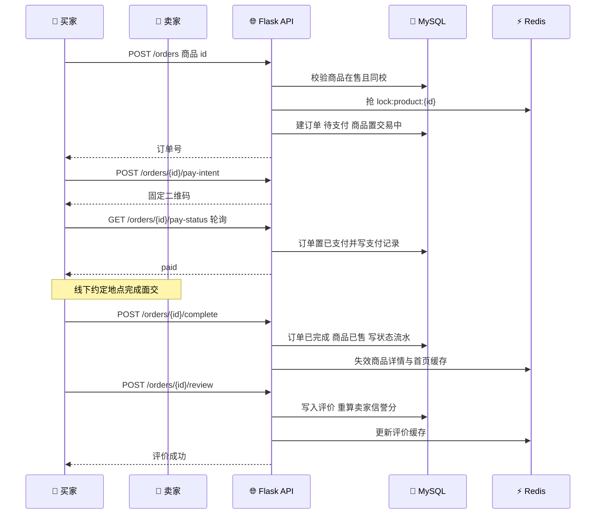

### 收藏与画像

收藏动作同时触发三条写入：MySQL 收藏关系、MongoDB 行为流水、MongoDB 用户画像向量更新。三者中画像更新允许失败重试，收藏关系必须成功。

---

## 🧠 推荐与搜索

### 商品向量化

商品发布或编辑后，按固定模板拼接文本并请求 Embedding 服务：

```text
标题：{title}
分类：{category_name}
成色：{condition}
描述：{description}
```

返回向量写入 MongoDB `product_vectors` 与 Chroma，同时记录 `text_hash`。编辑时若 `text_hash` 未变则跳过重建。

Qwen3-Embedding 为指令感知模型，检索侧查询需附带任务指令前缀，具体前缀作为配置项，可随端点调整[^2]。

### 用户画像更新

行为分三类，权重按"用户向量占大头、单次行为改动幅度小"的原则设定：

| 行为 | 用户向量权重 `w` | 商品向量权重 `1 - w` | 单次影响 |
| --- | ---: | ---: | --- |
| 购买 | 0.55 | 0.45 | 最大 |
| 收藏 | 0.70 | 0.30 | 中等 |
| 点击 | 0.82 | 0.18 | 最小 |

更新公式：

```text
new_user_vector = product_vector × (1 - w) + old_user_vector × w
```

配套规则：

- 更新后做 L2 归一化，保证与 Chroma 的余弦距离口径一致。
- 用户尚无画像时，首次行为直接令 `new_user_vector = product_vector`（即 `w = 0` 的特例），避免零向量污染。
- 同一用户对同一商品的同一行为在 24 小时内只更新一次画像，但行为流水照常记录。
- 每次更新递增 `behavior_count`，用于判断是否脱离冷启动。

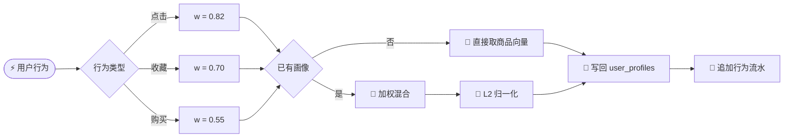

### 首页推荐

目标配比：一次 40 个商品（5 列 × 8 行），**32 个画像推荐 + 8 个随机**；冷启动用户 40 个全部随机。

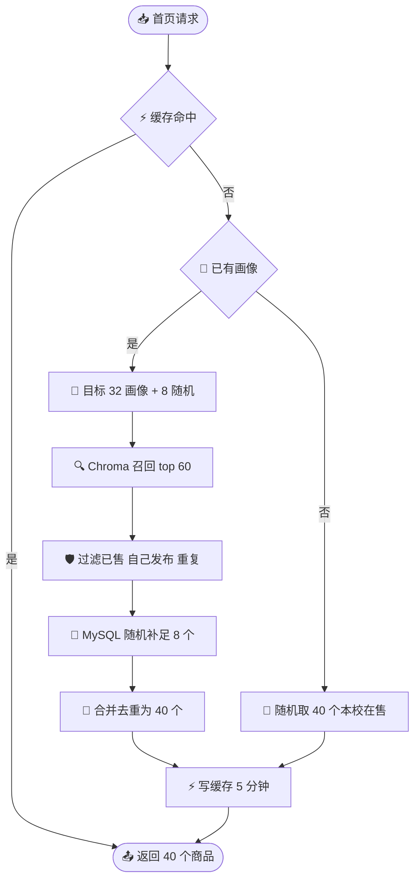

补充规则：

- 召回不足 32 个时，缺口全部用随机商品补齐，保证首页始终有内容。
- 排除自己发布的商品与已售商品。
- 同一批推荐内按商品 id 去重。
- 结果写入 Redis 商品库 `product:home:{school}:{user}`，TTL 300 秒，支持前端"换一批"强制刷新。
- **不做跨请求曝光去重**：同一用户多次刷新首页可能看到重复商品，去重范围仅限单次返回的 40 个。这是为控制复杂度而显式接受的取舍。

### 搜索

搜索走"语义召回 + 条件精筛"两段式，而不是数据库模糊匹配。

```mermaid
flowchart LR
    accTitle: 商品搜索链路
    accDescr: 用户输入关键词后先向量化并在 Chroma 中按余弦距离召回同校在售商品，再用分类价格成色条件在 MySQL 中精筛并排序返回。

    kw(["📥 输入关键词"]) --> vec["🔗 拼接指令前缀并向量化"]
    vec --> ch["🔍 Chroma 余弦召回 top 60"]
    ch --> where["🛡️ where 同校且在售"]
    where --> ids["📋 得到商品 id 列表"]
    ids --> sql["💾 MySQL 条件精筛"]
    sql --> rank["📊 按相似度排序"]
    rank --> page["📤 分页返回"]
```

- 关键词为空时退化为普通列表接口。
- 召回上限 60，经分类、价格区间、成色过滤后按原始相似度排序分页。
- Chroma 只承担"同校 + 在售"这一层硬过滤，业务条件留给 MySQL，便于后续扩展筛选维度。
- 搜索结果不写缓存，避免条件组合爆炸。

### 降级策略

| 故障 | 降级行为 |
| --- | --- |
| Embedding 服务不可用 | 首页退化为全随机，搜索退化为 MySQL `LIKE` 标题匹配，商品发布仍成功但标记向量待生成 |
| Chroma 不可用 | 同上，并在日志中记录告警 |
| Redis 不可用 | 直接回源 MySQL，聊天在线状态全部显示未知，不影响核心交易 |
| MongoDB 不可用 | 推荐退化为全随机，收藏与下单仍可用，画像更新进入重试队列 |

降级必须**显式可见**：接口返回中带 `degraded: true` 与原因，便于演示时讲解。

---

## ⚙️ 非功能需求

### 指标

| 编号 | 类别 | 指标 | 验证方式 |
| --- | --- | --- | --- |
| NFR-01 | 性能 | 首页推荐接口 P95 响应 < 1.5 秒（含 Embedding 调用） | 压测脚本 20 并发 |
| NFR-02 | 性能 | 商品详情缓存命中时 P95 < 100 毫秒 | 日志耗时统计 |
| NFR-03 | 性能 | 聊天消息端到端投递 < 200 毫秒（局域网） | 双浏览器实测 |
| NFR-04 | 性能 | 商品列表与搜索分页查询 P95 < 500 毫秒 | 慢查询日志 |
| NFR-05 | 安全 | 密码使用 bcrypt 加盐哈希存储，禁止明文与可逆加密 | 代码审查 |
| NFR-06 | 安全 | 全部受保护接口校验 JWT，管理接口额外校验角色 | 越权用例测试 |
| NFR-07 | 安全 | 上传文件校验扩展名、MIME 与大小，文件名重写为哈希 | 恶意文件上传测试 |
| NFR-08 | 安全 | 学生证照片仅本人与管理员可访问 | 越权访问测试 |
| NFR-09 | 安全 | 数据库访问统一走 ORM 参数化查询，禁止字符串拼接 SQL | 代码审查 |
| NFR-10 | 一致性 | 下单锁商品，杜绝同一商品被两人同时支付 | 并发下单测试 |
| NFR-11 | 可用性 | 单次演示全流程无阻塞性错误，降级路径可显式触发 | 演示脚本演练 |
| NFR-12 | 可维护性 | 表结构通过迁移脚本管理，种子数据脚本可重复执行 | 全新环境重建验证 |
| NFR-13 | 可维护性 | 全部外部依赖地址与密钥通过环境变量注入，仓库不含明文密钥 | 配置审查 |
| NFR-14 | 可观测性 | 关键链路输出结构化日志，含请求 id、用户 id、耗时 | 日志抽样 |

### 部署与运行

Docker Compose **只承载四个存储服务**，前后端以本地进程运行，便于调试与演示。

| 服务 | 镜像 | 端口 | 存储目录 | 说明 |
| --- | --- | --- | --- | --- |
| `mysql` | `mysql:8.0` | 3306 | `.mysql` | 初始化 SQL 挂载到 `docker-entrypoint-initdb.d` |
| `mongodb` | `mongo:7` | 27017 | `.mongodb` | 开启认证，初始化脚本建库建集合 |
| `redis` | `redis:7-alpine` | 6379 | `.redis` | 开启 AOF 持久化，`databases 16` |
| `chromadb` | `chromadb/chroma` | 8000 | `.chromadb` | 数据目录挂载，集合由应用首次启动时创建 |

> 📌 **目录命名**：沿用仓库根目录已有的 `.mysql`、`.mongodb`、`.redis`、`.chromadb` 四个隐藏目录。这四个名称即数据库名，前导点仅表示不纳入版本控制；目录名与数据库名在语义上一致，无需改名。

环境变量清单：

| 变量 | 说明 | 默认值 |
| --- | --- | --- |
| `MYSQL_HOST` / `MYSQL_PORT` | MySQL 地址 | `127.0.0.1` / `3306` |
| `MYSQL_DB` / `MYSQL_USER` / `MYSQL_PASSWORD` | 库名与账号 | `campus_market` / 由 `.env` 提供 |
| `MONGO_URI` / `MONGO_DB` | MongoDB 连接串与库名 | 由 `.env` 提供 |
| `REDIS_HOST` / `REDIS_PORT` | Redis 地址 | `127.0.0.1` / `6379` |
| `CHROMA_HOST` / `CHROMA_PORT` | Chroma 地址 | `127.0.0.1` / `8000` |
| `EMBEDDING_BASE_URL` | OpenAI 兼容端点 | 由 `.env` 提供 |
| `EMBEDDING_API_KEY` | 端点密钥，本地部署可空 | 空 |
| `EMBEDDING_MODEL` | 模型名 | `Qwen3-Embedding-0.6B` |
| `EMBEDDING_DIM` | 向量维度 | `1024` |
| `JWT_SECRET` / `JWT_EXPIRE_MINUTES` | 令牌密钥与有效期 | 由 `.env` 提供 / `1440` |
| `UPLOAD_DIR` / `MAX_UPLOAD_MB` | 上传目录与单文件上限 | `backend/uploads` / `5` |

启动顺序：`docker compose up -d` → 等待健康检查 → 执行迁移与种子脚本 → 启动 Flask → 启动 Vite。

### 种子数据

演示效果依赖种子数据，必须包含：

- 3 所学校，其中 2 所为多校区（各含 2–3 个校区），1 所为单校区。
- 每校至少 60 件在售商品，覆盖全部分类，保证首页 40 个推荐位不重复且有剩余。
- 2 个管理员账号、每校 5 名学生账号，其中每校至少 1 人处于待审核、1 人处于已驳回。
- 预置 30 条历史订单与评价，使统计图表与信誉分非空。
- 预置 2 组会话与 20 条消息，使聊天记录页可直接演示。

素材来源：**全部由脚本生成，不依赖任何外部图片素材**。

- 商品标题与描述由模板 + 分类词表组合生成，保证中文可读、同一分类下有足够语义区分度。
- 商品图为按分类配色生成的纯色或渐变色占位图，附带商品标题文字，文件尺寸统一，避免 400–1600 个真实素材文件的版权与体积问题。
- 学生证照片同样生成占位图，但需带明显的"示例材料"字样，避免与真实证件混淆。
- 种子脚本必须可重复执行：以商品标题哈希作为幂等键，重复运行不产生重复数据。
- 脚本在写入 MySQL 后，需同步完成 MongoDB 向量与 Chroma 索引的批量构建；180 件商品的向量化耗时取决于 Embedding 模式，本地模式首次执行明显慢于云端，README 中需注明预期耗时。

> 📌 **演示影响**：占位图会让界面显得"假"，这是显式接受的取舍。答辩时应主动说明种子数据为脚本生成，并把演示重点放在链路与算法上，而非商品内容本身。

---

## ✅ 验收与演示

### 验收清单

| 编号 | 验收项 | 通过标准 |
| --- | --- | --- |
| AC-01 | 一键启动 | 全新克隆仓库后按 README 操作可拉起全部服务并访问首页 |
| AC-02 | 准入隔离 | 未认证账号访问商品列表、详情、搜索、推荐均返回 403 |
| AC-03 | 同校隔离 | 用 A 校账号无法通过任何入口看到、搜到、推荐到 B 校商品；直接构造 B 校商品 id 返回 404 |
| AC-04 | 多校区显示 | 多校区学校用户展示名为 `昵称-学校(校区)`，单校区学校为 `昵称-学校` |
| AC-05 | 认证闭环 | 提交材料 → 管理员通过 → 用户立即可浏览；驳回后展示原因且可重提 |
| AC-06 | 学校导入 | 上传 xlsx 成功导入学校与校区，错误行给出明确原因 |
| AC-07 | 推荐配比 | 有画像用户首页 40 个商品中随机部分约为 8 个，冷启动用户 40 个全部随机 |
| AC-08 | 画像更新 | 同一用户连续点击不同商品后，其 MongoDB 画像向量发生变化且模长为 1 |
| AC-09 | 向量搜索 | 搜索"机械键盘"能召回标题不含该词但描述相关的商品，且结果全部同校 |
| AC-10 | 下单锁定 | 两账号并发下单同一商品，仅一单成功，另一单收到商品已被锁定提示 |
| AC-11 | 模拟支付 | 扫码内容为固定文本，点击"已完成支付"后轮询返回成功且订单转已支付 |
| AC-12 | 交易闭环 | 确认完成后商品转已售、订单转已完成、评价写入、卖家信誉分更新 |
| AC-13 | 聊天实时 | 双浏览器互发消息实时到达，刷新后历史消息仍在，Redis 清空后历史不丢 |
| AC-14 | 在线状态 | 关闭一方浏览器约 60 秒后对端显示离线 |
| AC-15 | 缓存分库 | 聊天、评价、商品三类键分别落在 db0、db1、db2 |
| AC-16 | 统计可用 | 管理后台概览与近 7 日趋势与数据库实际数据一致 |
| AC-17 | 降级可见 | 停掉 Embedding 服务后首页仍可用且接口标记 `degraded` |
| AC-18 | 端点双模 | `/api/health` 能正确报告当前使用云端还是本地向量端点，两种模式下推荐与搜索均可用 |
| AC-19 | P1 覆盖 | 支付超时关闭、已支付取消、操作日志、待复核队列、分类管理五项均可用 |

### 演示脚本

答辩演示按以下顺序进行，总时长控制在 8 分钟内：

1. 展示 `docker compose ps`，说明四库分离与各自职责。
2. 游客访问商品页被拦截，注册新账号，访问商品页返回 403。
3. 提交校园认证（多校区学校选校区、上传学生证），管理员登录通过审核。
4. 用户重新登录，展示名为 `昵称-学校(校区)`，首页出现 40 个商品。
5. 讲解推荐配比：切到 Redis 查看缓存键，指出画像与随机的构成。
6. 点击几件商品后刷新首页，观察推荐结果变化，展示 MongoDB 中画像向量被更新。
7. 搜索一个语义相关但标题不含关键词的词，展示 Chroma 召回结果。
8. 发布一件新商品，切换另一账号搜索到它并发起聊天，双屏演示实时消息。
9. 下单 → 弹出固定二维码 → 点击"已完成支付" → 轮询成功。
10. 确认交易完成，商品转已售，提交评价，卖家信誉分变化。
11. 管理员后台：认证审核队列、商品强制下架、统计图表。
12. 停掉 Embedding 服务，说明降级策略与 `degraded` 标记。

---

## 🔗 参考资料

[^1]: Qwen Team. "Qwen3-Embedding" — 模型系列说明与维度、MRL 支持情况. https://github.com/QwenLM/Qwen3-Embedding

[^2]: Qwen. "Qwen3-Embedding-0.6B" — 模型卡，含指令感知与嵌入维度说明. https://huggingface.co/Qwen/Qwen3-Embedding-0.6B

[^3]: Chroma. "Configure Collections" — `hnsw:space` 距离度量与元数据过滤语法. https://docs.trychroma.com/docs/collections/configure
